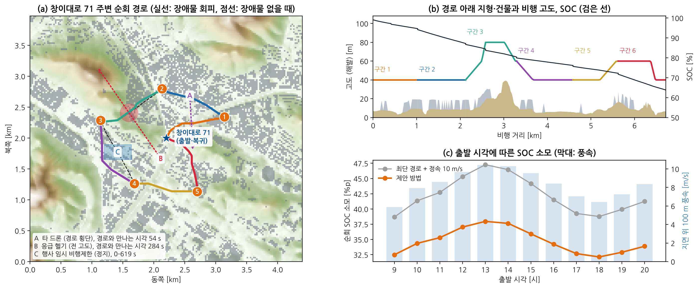
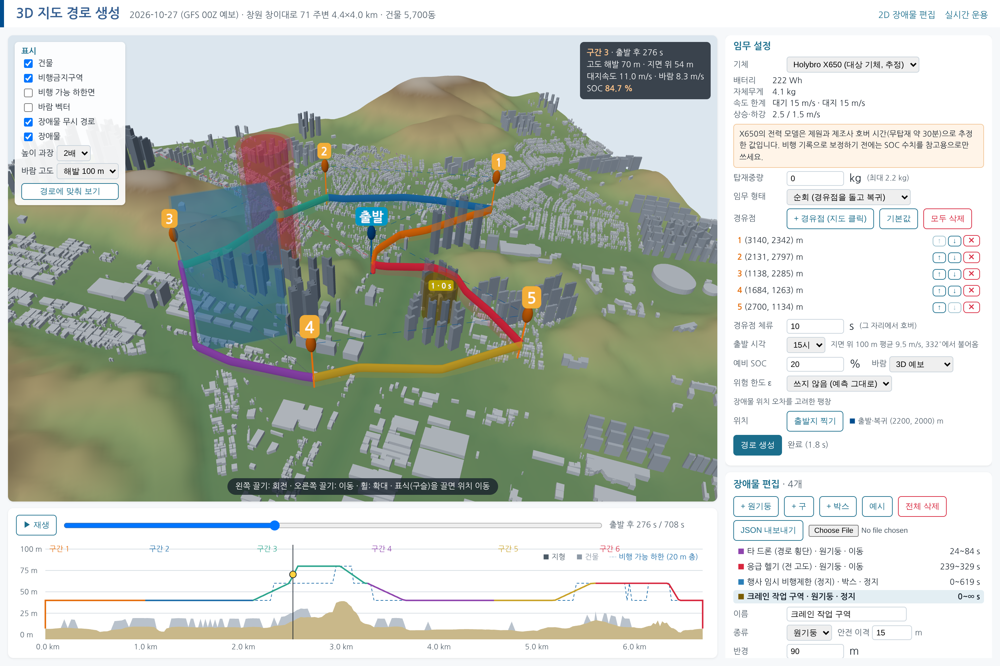

# 창원 창이대로 71 주변 순회 비행 시뮬레이션과 3D 장애물 편집

> 근거 데이터: `results/changwon.json` · 그림 F27 · 화면 `results/figures/platform_3d_changwon.png` · 미션 `results/missions/changwon_x650_15h_tour.waypoints`
> 재현: `PYTHONPATH=src python scripts/build_site.py changwon` → `PYTHONPATH=src python scripts/run_changwon.py`
> 플랫폼: `PYTHONPATH=src python -m dpo.webapp --site changwon` → `http://127.0.0.1:8765/3d`

이 문서는 세 가지를 다룹니다. (1) 3D 화면의 장애물 편집, (2) 출발지에서 경유점을 돌고 돌아오는 순회 임무, (3) 창원 창이대로 71 주변에서 대상 기체(Holybro X650)로 한 시뮬레이션입니다.

| 항목 | 한 줄 요약 |
|---|---|
| 3D 장애물 편집 | 3D 지도를 눌러 장애물을 놓고, 경로점 구슬을 끌어 옮기고, 크기·고도·시각·불확실성을 고칩니다. |
| 순회 임무 | 출발지 → 경유점들 → 출발지를 착륙 없이 이어 비행하고, 미션 파일은 하나로 나옵니다. |
| 창원 시뮬레이션 | 6.7 km 순회에 SOC 37.2 %p를 쓰고, 예시 장애물 3종을 모두 피했습니다(최소 이격 28 m). |

X650의 전력 모델은 비행 자료로 보정하지 않은 추정입니다(`docs/target_x650.md` 2장). SOC 절댓값은 참고용입니다.

---

## 1. 3D 화면의 장애물 편집

2D 화면(`/`)에만 있던 편집 기능을 3D 화면(`/3d`)에 넣었습니다.

- **추가:** `+ 원기둥`·`+ 구`·`+ 박스`를 누른 뒤 지도에서 놓을 곳을 누릅니다.
- **이동 경로:** `+ 경로점`을 누르고 지도를 차례로 누르면 경로점이 이어집니다. 경로점이 1개면 정지, 2개 이상이면 구간별 등속 이동입니다.
- **끌어 옮기기:** 선택한 장애물의 경로점 구슬을 끌면 위치가 바뀝니다. 출발지와 경유점 표식도 같은 방법으로 옮깁니다.
- **선택:** 지도에서 장애물 몸체를 누르거나 목록에서 고릅니다.
- **속성:** 이름, 종류, 반경(또는 박스 반폭), 고도 범위, 안전 이격, 존재 시간, 경로점별 좌표·시각, 위치 불확실성(σ0, σv, σt)을 고칩니다.
- **불확실성 표시:** 위험 한도 ε을 고르면 안전 이격에 불확실성 팽창을 더한 바깥 껍질이 시간에 따라 커지는 모습으로 보입니다.
- **검증·저장:** `검증`은 서버의 허용 범위 검사를 그대로 씁니다. JSON 내보내기·불러오기는 2D 화면과 같은 형식입니다.
- **변경 안내:** 계획한 뒤 장애물이나 임무를 고치면 "경로 생성을 다시 눌러 주세요"가 뜨고, 미션 내보내기는 다시 계획할 때까지 숨깁니다.

브라우저 자동 시험으로 확인한 동작입니다. 지도 클릭으로 장애물 추가, 경로점 2개 추가, 반경·이름·불확실성 수정, 경로점 구슬 끌기(목표 위치와 일치), 표에서 시각 수정, 박스·구 추가와 삭제, 몸체 클릭 선택, 검증, 경유점 추가·삭제. 페이지 오류는 없었습니다.

**3D 화면에 없는 것:** 비행 중 변경 발표에 따른 재계획은 2D 화면과 실시간 화면(`/live`)에만 있습니다. 3D 화면에서는 장애물을 고친 뒤 처음부터 다시 계획합니다.

## 2. 순회 임무

- **정의:** 출발지에서 이륙해 경유점을 순서대로 지나고 출발지로 돌아와 착륙합니다. 중간에는 착륙하지 않습니다.
- **계획:** 경유점 사이의 각 구간을 시공간 계획기로 차례로 계획합니다. 다음 구간은 앞 구간이 끝난 위치·고도·시각·남은 에너지에서 시작합니다.
- **경유점 체류:** 경유점마다 정한 시간(기본 10 s)만큼 그 자리에서 호버합니다. 호버 에너지도 SOC에 들어갑니다.
- **미션 내보내기:** 이륙~착륙이 한 번이므로 ArduPilot 미션 파일도 하나입니다. 체류와 장애물 회피 대기는 `NAV_LOITER_TIME`으로 들어갑니다.
- **제약:** 경유점은 최대 12개입니다. 순회 임무는 비행 중 재계획을 지원하지 않습니다. 경유점 순서는 사용자가 정한 대로이며, 순서를 최적화하지는 않습니다.

## 3. 창원 지도

| 항목 | 내용 |
|---|---|
| 기준 지점 | 창원시 의창구 창이대로 71 (창원시농업기술센터, 명서동) |
| 좌표 | 북위 35.23923°, 동경 128.64658° (Overture Maps 장소 자료의 '창원시농업기술센터') |
| 범위 | 기준 지점을 가운데 둔 4.4 × 4.0 km |
| 지형 | Copernicus GLO-30 DSM, 지면 고도 -1–199 m |
| 건물 | Overture Maps 5,712동, 최고 171 m |
| 계획 격자 | 수평 25 m, 수직 20 m, 해발 20–360 m, 지면 위 30–150 m |
| 바람 | NOAA GFS 2026-10-27 00Z 예보, 지면 위 100 m 풍속 5.9–10.4 m/s (09–20시), 북북서풍 |

- **좌표 확인:** 주소로 좌표를 주는 서비스는 이 환경에서 접속이 막혀 있었습니다. 웹 검색으로 창이대로 71이 창원시농업기술센터임을 확인하고, 지도 자료에서 그 시설의 좌표를 찾았습니다. 같은 자료에서 창이대로 45(약 230 m 거리)와 창이대로85번길(약 160 m 거리)이 양옆에 있어 위치는 맞는 것으로 보입니다. 건물 단위 오차(수십 m)는 있을 수 있습니다 [확인요망].
- **비행금지구역:** 이 지역에는 금지구역을 등록하지 않았습니다. 실제 공역 제한(관제권, 비행금지·제한구역, 인구밀집지역 규정)은 확인하지 않았으며, 실제 비행 전에 반드시 확인하고 승인을 받아야 합니다.
- **바람 날짜:** 판교 시뮬레이션과 같은 날을 썼습니다. 창원에서 특별히 고른 날이 아닙니다.

기본 순회 경유점 5곳은 기준 지점에서 0.8–1.1 km 떨어진 곳에 자동으로 놓았습니다(3D 화면에서 옮기거나 다시 찍을 수 있습니다).

| 경유점 | 지역 좌표 (x, y) [m] | 위도, 경도 |
|---|---|---|
| 1 | (3140, 2342) | 35.24231, 128.65691 |
| 2 | (2131, 2797) | 35.24641, 128.64581 |
| 3 | (1138, 2285) | 35.24180, 128.63490 |
| 4 | (1684, 1263) | 35.23258, 128.64091 |
| 5 | (2700, 1134) | 35.23142, 128.65207 |

## 4. 시뮬레이션 결과

조건: Holybro X650, 탑재 0 kg, 15시 출발, 경유점마다 10 s 체류, 예비 SOC 20 %.

**예시 장애물** (기본 순회 경로와 실제로 만나도록 시각을 맞춤)

| 장애물 | 크기 | 움직임 | 경로와의 관계 |
|---|---|---|---|
| 타 드론 (경로 횡단) | 원기둥 반경 30 m, 전 고도 | 15 m/s 이동, 24–84 s | 구간 1을 54 s에 가로지름 |
| 응급 헬기 (전 고도) | 원기둥 반경 120 m, 전 고도 | 20 m/s 이동, 239–329 s | 구간 3을 284 s에 가로지름 |
| 행사 임시 비행제한 (정지) | 박스 440×240 m, 전 고도 | 정지, 0–619 s | 구간 4 위 |

**세 경우의 결과**

| 경우 | SOC 소모 | 도착 SOC | 비행 시간 | 거리 | 회피 대기 | 장애물 최소 이격 | 충돌 표본 |
|---|---|---|---|---|---|---|---|
| 장애물 없음 | 35.6 %p | 64.4 % | 672 s | 6.57 km | 0 s | – | 0 |
| 예시 장애물 3종 | 37.2 %p | 62.8 % | 707 s | 6.72 km | 24 s | 28 m | 0 |
| 장애물 + 위치 불확실성 (ε = 0.05) | 38.5 %p | 61.5 % | 739 s | 6.78 km | 47 s | 28 m | 0 |

- **장애물을 무시한 경로는 구간 1·3·4에서 충돌합니다.** 계획한 경로는 세 경우 모두 충돌이 없었습니다.
- **회피 비용은 SOC 1.5 %p, 시간 36 s입니다.** 타 드론과 헬기는 지나갈 때까지 기다렸고(합계 24 s), 행사 제한 구역은 돌아갔습니다.
- **위치 불확실성을 넣으면 더 보수적으로 납니다.** σ0 10 m, σv 0.5 m/s, ε 0.05에서 SOC가 1.3 %p, 시간이 31 s 더 듭니다.
- **세 경우 모두 예비 20 %를 크게 남깁니다**(도착 SOC 61.5–64.4 %).

**구간별 (예시 장애물 3종)**

| 구간 | 에너지 | SOC | 시간 | 거리 | 고도(해발) | 장애물 최소 이격 |
|---|---|---|---|---|---|---|
| 구간 1 | 42 kJ | 5.3 %p | 98 s | 1.02 km | 40–40 m | 48 m |
| 구간 2 | 58 kJ | 7.5 %p | 134 s | 1.10 km | 40–40 m | 796 m |
| 구간 3 | 53 kJ | 6.8 %p | 124 s | 1.17 km | 40–80 m | 84 m |
| 구간 4 | 33 kJ | 4.2 %p | 97 s | 1.29 km | 40–60 m | 28 m |
| 구간 5 | 31 kJ | 3.9 %p | 80 s | 1.04 km | 40–60 m | 392 m |
| 구간 6 | 73 kJ | 9.4 %p | 174 s | 1.10 km | 40–60 m | 978 m |

비행 고도는 해발 40–80 m로, 지면 위 약 30–60 m입니다. 구간 3에서 언덕과 건물을 넘느라 80 m까지 올라갑니다.

**방법 비교** (장애물 없음, 15시)

| 방법 | SOC 소모 | 비행 시간 | 거리 |
|---|---|---|---|
| 최단 경로 + 정속 10 m/s | 44.2 %p | 848 s | 6.38 km |
| 최단 경로 + 속도 최적화 | 39.3 %p | 731 s | 6.38 km |
| 제안 방법 | 35.9 %p | 678 s | 6.53 km |

- 제안 방법은 정속 최단 경로보다 SOC를 8.3 %p 적게 쓰고 170 s 빨리 돕니다.
- 출발 시각 09–20시에 제안 방법은 32.1–38.0 %p, 정속 최단 경로는 38.7–47.3 %p를 씁니다. 바람이 센 13시에 가장 많이 듭니다.

**미션 파일** (`results/missions/changwon_x650_15h_tour.waypoints`, 예시 장애물 3종)
- 항목 76개: 경로점 39개, 속도 변경 27회, 호버 대기 7회
- 출발지 지면 기준 상대 고도 33–73 m, 대지속도 7–15 m/s
- 미션의 도착 SOC가 계획 결과와 일치하고(0.3 %p 이내), `pymavlink` 미션 로더가 76개 항목을 모두 읽습니다.

## 5. 한계
- **모의 결과입니다.** 실기체 비행도, ArduPilot 모의 비행(SITL)도 하지 않았습니다.
- **X650 전력 모델은 추정입니다.** 가정에 따라 SOC가 ±20 % 정도 달라질 수 있습니다(`docs/target_x650.md`).
- **기준 좌표는 지도 자료의 시설 위치입니다.** 도로명주소 좌표를 직접 받은 것이 아닙니다.
- **공역 제한을 확인하지 않았습니다.** 금지구역이 없다는 뜻이 아닙니다.
- **건물 높이의 상당수는 추정입니다.** 실측 높이가 없는 건물은 층수나 용도로 추정했습니다.
- **예시 장애물은 가상입니다.** 경로와 만나도록 일부러 시각을 맞췄습니다.
- **이 기체는 주변 비행체를 스스로 탐지하지 못합니다**(ADS-B 수신기 없음). 이동 장애물 정보는 지상에서 받아 넣는다고 가정했습니다.
- **계획 격자의 층 간격은 20 m입니다.** 층을 바꾸는 경사 구간에서는 비행 가능 하한보다 최대 10 m 낮아질 수 있습니다.
