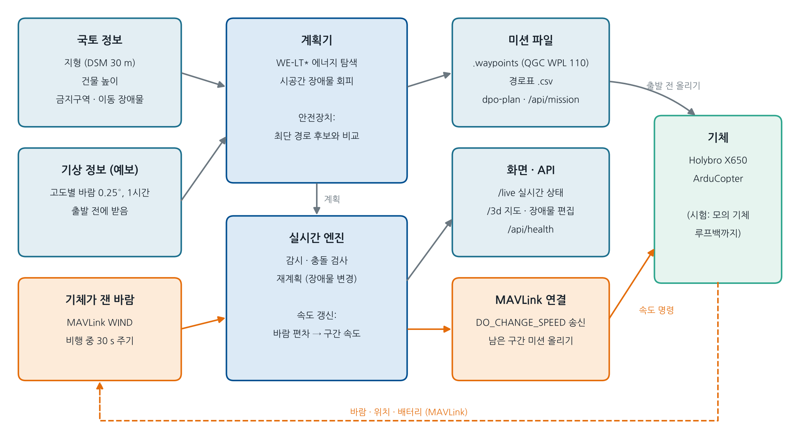
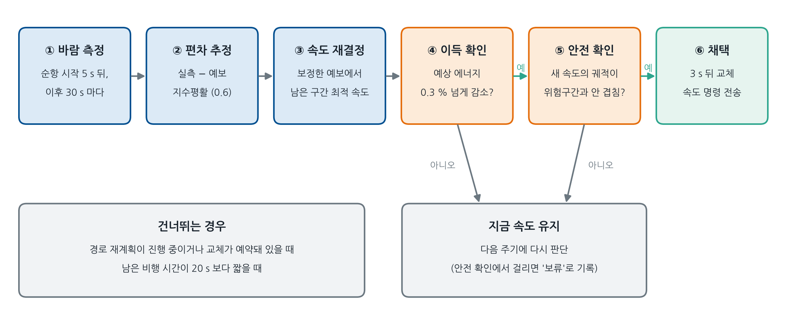
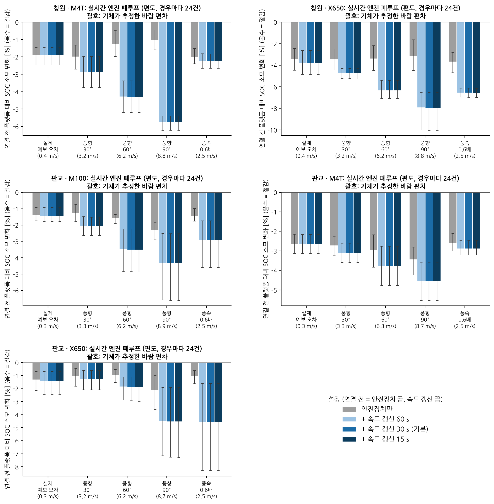

# 배포·운용 안내 (v1.0.0)

속도 갱신과 안전장치를 실시간 플랫폼과 미션 파일에 연결하고, 설치해서 쓸 수 있는 패키지로 묶었습니다. 이 문서는 설치, 실행, 설정, 연결 방식, 검증 범위를 다룹니다. 배경과 실험은 [`review_gaps.md`](review_gaps.md), 전체 보고서는 [`drone_soc_deployment_report.docx`](drone_soc_deployment_report.docx)에 있습니다.

## 1. 무엇이 연결됐나

| 기능 | 연결한 곳 | 기본값 |
|---|---|---|
| 안전장치 (최단 경로 후보 비교) | 계획 API(`/api/plan`), 명령줄(`dpo-plan`), 실시간 엔진의 초기 계획·재계획. 미션 파일은 채택한 경로로 만들어집니다. | 켬 |
| 속도 갱신 (바람 편차 → 구간 속도) | 실시간 엔진(`/live`). 순항 시작 5초 뒤 처음 재고, 이후 30초마다 다시 판단합니다. | 30초 |
| 속도 명령 | 화면의 명령 표, `/api/live/mission`, MAVLink `DO_CHANGE_SPEED` 송신 | 연결했을 때만 송신 |
| 남은 구간 미션 | `/api/live/mission.waypoints`, `.csv`, `/api/live/upload` | 요청할 때만 |



## 2. 설치

```bash
pip install "drone-path-opt[mavlink]"          # wheel 을 받은 경우: pip install drone_path_opt-1.0.0-py3-none-any.whl
```

저장소에서 직접 설치하려면 다음과 같습니다.

```bash
pip install -e ".[dev]"
```

| 선택 설치 | 내용 |
|---|---|
| `mavlink` | 기체 연결 (pymavlink) |
| `data` | 지형·건물·예보를 새로 받을 때 (rasterio, pygrib 등) |
| `report` | 발표자료·그림 생성 스크립트 |
| `dev` | 시험 (pytest, pymavlink, build) |

기본 설치는 numpy, scipy, numba, matplotlib만 요구합니다.

### 자료 폴더 (`DPO_HOME`)

프로그램은 `DPO_HOME` 아래에서 자료를 찾습니다. 지정하지 않으면 소스 저장소(개발 설치) 또는 현재 폴더를 씁니다.

| 경로 | 내용 | 필수 |
|---|---|---|
| `data/processed/site_grid*.npz` | 지형·건물 점유 격자 | 예 |
| `data/raw/gfs_*_00z.npz` | 예보 바람 | 예 |
| `data/raw/gfs_*_06z.npz` | 모의 운용의 '실제 바람' (06Z) | 아니오 |
| `data/raw/adsb/` | 실측 ADS-B 항적 (침입기 투입) | 아니오 |
| `results/adsb_error_model.json` | 실측 오차 분위수 모양 | 아니오 |
| `scenarios/` | 예시 장애물 | 아니오 |
| `data/raw/overture_buildings*.json` | 3D 화면의 건물 다각형. 없으면 격자 높이로 상자를 그립니다. | 아니오 |

필수 자료가 없으면 시작할 때 없는 파일 이름과 지금의 자료 폴더를 알려 줍니다. 새 지역은 `scripts/build_site.py`로 만듭니다.

## 3. 실행

```bash
dpo-plan --check                                   # 자료와 계획기 점검
```

```bash
dpo-plan --drone x650 --payload 1.0 --dep-hour 15 --out missions/
```

```bash
dpo-server --host 0.0.0.0 --port 8765 --site pangyo
```

| 화면 | 주소 |
|---|---|
| 계획·장애물 편집 | `http://<host>:8765/` |
| 3D 지도 | `/3d` |
| 실시간 운용 | `/live` |
| 상태 점검 | `/api/health` |

### 환경변수

| 변수 | 뜻 | 기본값 |
|---|---|---|
| `DPO_HOME` | 자료 폴더 | 저장소 또는 현재 폴더 |
| `DPO_SITE` | 대상 지역 (`pangyo`, `changwon`) | `pangyo` |
| `DPO_HOST`, `DPO_PORT` | 서버 주소·포트 | `127.0.0.1`, `8765` |
| `DPO_MAVLINK` | 기체 연결 주소 (예: `udpin:0.0.0.0:14550`) | 없음 |

### Docker

```bash
docker build -t drone-path-opt .
```

```bash
docker run --rm -p 8765:8765 -e DPO_SITE=changwon drone-path-opt
```

이 환경에는 Docker 데몬이 없어 **이미지 빌드는 시험하지 못했습니다.** Dockerfile이 하는 일(wheel 설치, 자료 복사, 저장소 밖 실행, 상태 점검)은 가상환경에서 같은 순서로 확인했습니다.

## 4. 명령줄 `dpo-plan`

| 인자 | 뜻 |
|---|---|
| `--site`, `--drone`, `--payload`, `--kind`, `--dep-hour` | 지역, 기체, 탑재, 배송/회수, 출발 시각 |
| `--hub X,Y`, `--dst X,Y`, `--lonlat` | 출발지·목적지 (지역 좌표 m 또는 경도,위도) |
| `--tour "X,Y;X,Y"`, `--dwell` | 순회 경유점과 체류 시간 |
| `--one-way`, `--reserve`, `--eps`, `--obstacles FILE` | 편도, 예비 SOC, 위험 한도, 장애물 파일 |
| `--no-safeguard` | 안전장치 끔 |
| `--out DIR`, `--json`, `--check` | 미션 파일 폴더, JSON 출력, 점검 |

종료 코드는 0(임무 가능), 1(임무 불가), 2(입력·자료 오류)입니다.

## 5. 실시간 운용 설정 (`POST /api/live/start`)

| 키 | 뜻 | 기본값 |
|---|---|---|
| `drone` | `m100` 또는 `x650` | `m100` |
| `safeguard` | 안전장치 | `true` |
| `speed_update` | 속도 갱신 주기 [s]. 0이면 끔 | `30` |
| `speed_margin` | 채택에 필요한 예상 에너지 감소 비율 | `0.003` |
| `wind_truth` | 모의 운용의 실제 바람: `null`(예보와 같음), `"06z"`, `{"rot": 60, "scale": 1}` | `null` |
| `wind_noise` | 기체 바람 측정 잡음 σ [m/s] | `0` |
| `wind_from_link` | MAVLink `WIND` 값을 측정으로 사용 | `false` |

### 속도 갱신의 판단 순서



- **왜 안전 확인이 필요한가:** 속도를 바꾸면 장애물과 만나는 시각이 달라집니다. 새 속도로 비행한 궤적이 위험 시간구간과 겹치면 채택하지 않고 '보류'로 기록합니다.
- **경로 재계획이 먼저입니다.** 장애물 때문에 재계획이 요청되면 예약된 속도 갱신은 버립니다.

## 6. 기체 연결 (MAVLink)

```bash
dpo-server --mavlink udpin:0.0.0.0:14550
```

| 방식 | 내용 | 권고 |
|---|---|---|
| 명령 방식 | 기체의 미션은 그대로 두고, 속도 변경 지점에서 `MAV_CMD_DO_CHANGE_SPEED`(p1 = 1 대지속도)를 보냅니다. | 기본 |
| 파일 방식 | 남은 구간 미션(.waypoints)을 다시 올립니다. 첫 경로점이 지금 위치이고 이륙 항목이 없습니다. | 운용자가 판단해서 |

- 명령 방식을 쓸 때는 미션 파일 안의 속도 항목이 나중에 덮어쓰지 않는지 확인해야 합니다 `[확인요망: ArduCopter에서 COMMAND_LONG 속도와 미션 내 DO_CHANGE_SPEED의 우선순위]`.
- ArduCopter가 바람을 추정하려면 `EK3_DRAG_BCOEF_X/Y`를 설정해야 합니다(기본 0).

## 7. 검증 범위

| 항목 | 방법 | 결과 |
|---|---|---|
| 단위·통합 시험 | `pytest -q` (41개) | 통과 |
| 새 가상환경 설치 | wheel 설치 → 저장소 밖에서 `dpo-plan`, `dpo-server` | 동작, `/api/health` 200 |
| 실시간 화면 | Playwright: 설정 → 비행 → 속도 갱신 채택 → 명령 표 → 미션 내려받기 | 콘솔 오류 없음 |
| MAVLink | 같은 컴퓨터의 UDP 루프백에서 모의 기체와 속도 명령·바람·미션 올리기 왕복 | 통과 |
| 폐루프 효과 (E15) | 실시간 엔진으로 3개 조합 × 5개 바람 경우 × 24건 × 5개 설정 | 아래 표 |
| Docker 이미지 빌드 | – | **미검증** |
| ArduPilot SITL · 실기체 | – | **미검증** |

**E15: 연결 전 플랫폼 대비 SOC 소모 변화** (편도 1.5–2.8 km, 경우마다 24건, 기본 설정 = 안전장치 + 속도 갱신 30초)

| 바람 경우 (추정 편차) | 창원 · X650 | 판교 · M100 | 판교 · X650 |
|---|---|---|---|
| 실제 예보 오차 (0.3–0.4 m/s) | −3.8 % | −1.4 % | −1.4 % |
| 풍향 30° (3.2 m/s) | −4.7 % | −2.1 % | −1.2 % |
| 풍향 60° (6.2 m/s) | −6.3 % | −3.5 % | −1.9 % |
| 풍향 90° (8.8 m/s) | −7.9 % | −4.3 % | −4.5 % |
| 풍속 0.6배 (2.5 m/s) | −6.5 % | −2.9 % | −4.6 % |



- 속도 갱신은 360건 모두에서 안전장치만 쓴 것보다 나쁘지 않았습니다(최악 +0.00 %). 판단 한 번에 2–3 ms가 듭니다.
- 갱신 주기 15·30·60초의 차이는 거의 없었습니다. 순항 5초 뒤의 첫 측정이 대부분을 고치기 때문입니다. 틀린 예보를 풍향 회전·풍속 배율로 만들어 오차가 영역 전체에 같다는 점이 이 결과에 영향을 줍니다.
- 안전장치는 예보가 맞을 때 나빠진 경우가 없었습니다. 예보가 틀리면 예보 기준의 선택이 실제 바람에서는 손해일 수 있어, 조합·경우에 따라 0–21 %의 건에서 최대 +2.7 % 나빴습니다.
- 가로지르는 이동 장애물을 넣은 144건은 모두 완주했고 침범이 없었습니다(최소 이격 32–38 m). 안전 확인에 걸려 보류된 속도 갱신은 25회입니다.

## 8. 운용할 때 알아 둘 것

- **서버에는 인증이 없습니다.** `0.0.0.0`으로 열 때는 신뢰하는 망 안에서만 쓰십시오.
- **실시간 엔진은 기체를 모의합니다.** 위치와 에너지는 엔진이 계산한 값이고, 기체의 실제 위치를 받아 따라가는 기능은 없습니다. MAVLink 연결은 속도 명령 송신과 바람 수신까지입니다.
- **X650 전력 모델은 추정입니다.** 속도에서 나오는 이득의 크기가 이 모델에 좌우됩니다.
- **순회 임무는 실시간 화면에서 지원하지 않습니다.** 계획·미션 파일까지만 됩니다.

## 9. 문제 해결

| 증상 | 원인과 조치 |
|---|---|
| `필수 자료가 없습니다` | `DPO_HOME`이 자료 폴더를 가리키는지 확인 |
| 첫 요청이 느림 | 처음 한 번 수치 코드를 컴파일합니다(수 초). `NUMBA_CACHE_DIR`을 쓰기 가능한 곳으로 두면 다음부터 빨라집니다. |
| `MAVLink 연결 실패` | 주소·포트, 기체의 HEARTBEAT 송신 여부 확인. 실패해도 서버는 연결 없이 계속 뜹니다. |
| 속도 갱신이 채택되지 않음 | 예보가 맞거나(편차 작음), 이미 최고 속도가 최적인 경우입니다. 화면의 '채택 / 측정' 값을 보십시오. |
