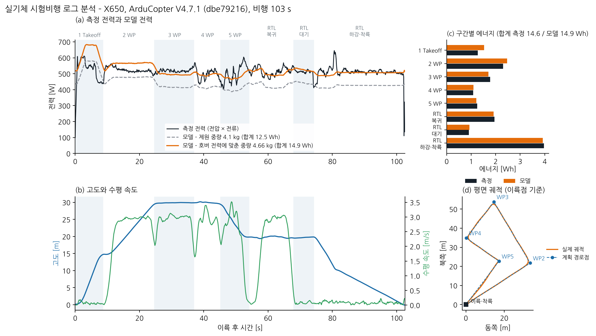

# 1. 결론 먼저

| 질문 | 답 |
|---|---|
| 계획기의 X650 전력 모델이 맞는가 | **제원 중량(4.1 kg)으로는 16 % 적게 예측합니다** (측정 14.6 Wh, 모델 12.5 Wh). 호버 전력이 515 W로 모델(434 W)보다 높습니다. |
| 무엇이 다른가 | 모델의 중량을 4.66 kg으로 두면 측정 호버 전력과 같아지고, 비행 전체 에너지가 2 % 안(모델 14.9 Wh)으로 맞습니다. 카메라·짐벌·RTK를 단 실제 이륙 중량이 제원보다 무거운 것으로 보이나, **실제 중량을 재지 않아 확정할 수 없습니다.** |
| 계획기의 시간 예측은 맞는가 | **맞습니다.** 경로점 구간 실제 45.4초, 계획기 예측 46.9초 (가감속 보정 포함, 오차 3 %). |
| 우리 프로그램이 비행 중 쓰는 값이 들어오는가 | **들어옵니다.** 위치·배터리·바람·현재 경로점이 모두 약 2 Hz로 수신된다고 정리해 주셨습니다. 다만 **바람 추정이 꺼져 있어** 바람 값이 0입니다 (`EK3_DRAG_BCOEF_X/Y = 0`). |
| 아직 확인하지 못한 것 | **5 m/s 이상의 전력.** 이 비행은 3.5 m/s까지만 날아서, 계획기가 속도를 고르는 데 쓰는 고속 전력(동체 항력)을 검증할 수 없습니다. |
| 고성 왕복 400 m를 2분 안에 | 고도 30 m에서는 7 m/s로 약 **2분 11초**로 예상합니다 (PPT 추정 1분 51초). **고도 20 m에서 7–8 m/s**면 1분 53–58초입니다. 차이는 반환점의 감속·가속과 실측 수직 구간 시간에서 옵니다 (5절). |

# 2. 받은 자료와 비행 개요

| 자료 | 내용 |
|---|---|
| `2026-11-13 16-25-57.bin` | 기체 로그 (ArduCopter 4.7.1, Pixhawk 6X). 배터리 10 Hz, GPS 5 Hz, 제어·EKF 기록 |
| `2026-11-13 16-28.waypoints` | 올린 미션: 이륙 15 m → 경로점 4개 (30, 30, 30, 20 m) → RTL |
| `261113_시험비행 정리.pptx` | 비행 결과 정리, 고성 시험 검토 |
| `비행데이터_수신범위_정리.docx` | 비행 중 수신 / 착륙 후 로그로만 볼 수 있는 값 |

| 항목 | 값 (로그에서 계산) |
|---|---|
| 비행 시간 (이륙 ~ 착륙) | 103초 |
| 사용 에너지 | **14.6 Wh** (630 mAh) – 222 Wh 배터리의 6.6 % |
| 평균 전류 · 평균 전력 | 22.1 A · 512 W |
| 전압 | 24.2 V → 23.3 V |
| 최고 고도 · 최고 수평 속도 | 30.2 m · 3.5 m/s |
| 배터리 내부저항 (로그 추정) | 0.028 Ω (계획기 가정 0.03 Ω과 같음) |

정리해 주신 값(14.7 Wh, 635 mAh, 1분 40초)과 같습니다.

{width=100%}

# 3. 전력 모델과의 비교

로그의 전압 × 전류(측정 전력)와, 같은 순간의 속도·상승률을 계획기의 X650 전력 모델에 넣은 값(모델 전력)을 비교했습니다. 바람은 기록되지 않아 무풍으로 두었고, 외기온은 15 °C로 가정했습니다.

| 구간 | 시간 | 측정 전력 | 모델 (4.1 kg) | 모델 (4.66 kg) | 측정 ÷ 모델 (4.66 kg) |
|---|---|---|---|---|---|
| 이륙 (0 → 15 m) | 8.8 s | 515 W | 530 W | 625 W | 0.83 |
| 경로점 2 (15 → 30 m 상승하며 이동) | 15.9 s | 523 W | 474 W | 561 W | 0.93 |
| 경로점 3 (30 m, 3 m/s) | 12.4 s | 518 W | 418 W | 498 W | 1.04 |
| 경로점 4 (30 m, 3 m/s) | 8.1 s | 496 W | 416 W | 496 W | 1.00 |
| 경로점 5 (30 → 20 m 하강하며 이동) | 9.1 s | 500 W | 406 W | 484 W | 1.03 |
| RTL 복귀 (20 m, 3 m/s) | 13.7 s | 515 W | 427 W | 508 W | 1.01 |
| RTL 홈 위 대기 | 6.4 s | 509 W | 442 W | 524 W | 0.97 |
| RTL 하강·착륙 | 28.2 s | 510 W | 424 W | 504 W | 1.01 |
| **합계 에너지** | 103 s | **14.6 Wh** | **12.5 Wh** | **14.9 Wh** | **0.98** |

- **제원 중량(4.1 kg)의 모델은 이륙을 뺀 모든 구간에서 10–24 % 적게 봅니다.** 호버 전력이 모델 434 W, 측정 515 W입니다.
- **중량을 4.66 kg으로 두면 수평 이동·대기·하강 구간이 ±4 % 안에서 맞습니다.** 4.66 kg은 측정 호버 전력에서 거꾸로 구한 값입니다. 실제로 기체가 그만큼 무거운지(카메라·짐벌·RTK 안테나 포함), 아니면 모터·프로펠러 효율이 가정보다 낮은지는 이 비행만으로 가를 수 없습니다. **이륙 중량을 저울로 재 주시면 둘을 구분할 수 있습니다.** 둘 중 어느 쪽이냐에 따라 탑재중량을 바꿨을 때의 예측이 달라집니다.
- **상승 구간은 모델이 17–20 % 크게 봅니다.** 모델은 상승 전력을 '중량 × 상승률'만큼 더하는데, 실제 회전익은 천천히 오를 때 그보다 덜 씁니다. 상승은 한 번뿐이라 아직 모델을 고치지 않았습니다.
- **3.5 m/s까지의 비행이라 고속 전력은 검증되지 않았습니다.** 계획기의 절감 대부분은 5–15 m/s의 속도 선택에서 나오는데, 이 영역의 전력은 동체 항력면적(가정 0.08 m²)에 달려 있습니다.
- 보정 도구(`dpo-calibrate`)를 이 로그에 돌리면 "정상 구간이 6개뿐"이라며 보정을 거부합니다. 정속 구간이 짧고 속도가 하나뿐이기 때문입니다. 6절의 비행이 있으면 보정할 수 있습니다.
- 측정 호버 전력(515 W)으로 계산하면, 예비 20 %를 남기고 호버할 수 있는 시간은 약 20분입니다(전압 강하·저온 손실 제외).

# 4. 계획기의 시간 모형과 경로 추종

| 항목 | 값 |
|---|---|
| 경로점 구간 4개의 실제 시간 | 45.4 s |
| 계획기 예측 (거리 ÷ 3 m/s, 상승 2.5 · 하강 1.5 m/s) | 40.6 s |
| 가감속 보정 (출발·정지·꺾임, SITL에서 맞춘 식) | +6.3 s |
| **계획기 예측 합계** | **46.9 s (실제보다 1.5 s 길게, 3 %)** |

- 계획기가 미션 요약에 내는 가감속 보정값이 실기체에서도 맞았습니다. 이 보정식은 SITL에서 8 m/s로 맞춘 것이고, 실기체에서는 3 m/s 한 번만 확인한 것입니다.
- 경로 이탈은 정리해 주신 대로 최대 0.8 m입니다. 계획기가 내보내는 미션을 기체가 그대로 따를 수 있다는 근거입니다.

# 5. 수신 범위와 우리 프로그램

비행 중 실행기(`dpo-fly`)가 쓰는 값과, 정리해 주신 수신 범위를 맞춰 보았습니다.

| 실행기가 쓰는 값 | MAVLink 메시지 | 수신 (정리 문서) | 비고 |
|---|---|---|---|
| 위치·속도 | `GLOBAL_POSITION_INT` | ○ 약 2 Hz | 충분 (실행기는 30초마다 판단) |
| 바람 추정 | `WIND` | ○ 약 2 Hz | **값이 0** – `EK3_DRAG_BCOEF_X/Y`가 0이라 추정이 꺼져 있음 |
| 배터리 | `BATTERY_STATUS` | ○ 약 2 Hz | 전압·전류·누적 사용량 |
| 현재 경로점 | `MISSION_CURRENT` | ○ 약 2 Hz | |
| 속도 명령 | `COMMAND_LONG` (`DO_CHANGE_SPEED`) 송신 | (송신) | 조종기 경유 링크에서 송신 시험 필요 |

- **바람 추정을 켜야 비행 중 속도 갱신을 쓸 수 있습니다.** 켜기 전에는 계획 속도만 보내는 방식(`dpo-fly --no-wind`)으로 씁니다.
- **배터리 용량 설정(`BATT_CAPACITY`)이 3,300 mAh**라 기체가 내는 잔량 %가 실제와 다릅니다. 정리해 주신 대로 10,000 mAh로 고쳐야 합니다. 실행기는 잔량 % 대신 누적 사용 에너지로 SOC를 계산하므로 영향은 작지만, 출발 판정과 경고에는 맞는 값이 필요합니다.

# 6. 고성 왕복 400 m 시험 재추정

PPT의 추정(7 m/s에서 1분 51초)을 이번 실측으로 다시 계산했습니다. 수직·대기 구간은 이번 비행의 실측 시간과 실측 평균 전력(512 W), 수평 구간은 4.66 kg 모델의 전력, 반환점의 감속·가속은 4절의 보정식을 썼습니다.

| 수평 속도 | 고도 30 m: 총 시간 | 고도 30 m: 에너지 | 고도 20 m: 총 시간 | 고도 20 m: 에너지 |
|---|---|---|---|---|
| 3 m/s | 3분 19초 | 27.5 Wh (12.4 %) | 3분 6초 | 25.7 Wh (11.6 %) |
| 5 m/s | 2분 30초 | 19.9 Wh (9.0 %) | 2분 17초 | 18.2 Wh (8.2 %) |
| 6 m/s | 2분 18초 | 18.1 Wh (8.2 %) | 2분 6초 | 16.3 Wh (7.4 %) |
| **7 m/s** | **2분 11초** | 16.9 Wh (7.6 %) | **1분 58초** | 15.1 Wh (6.8 %) |
| 8 m/s | 2분 6초 | 16.1 Wh (7.2 %) | 1분 53초 | 14.3 Wh (6.4 %) |
| 10 m/s | 2분 0초 | 15.2 Wh (6.8 %) | 1분 48초 | 13.4 Wh (6.0 %) |

- **PPT 추정보다 약 20초 깁니다.** 반환점에서 멈췄다 다시 가속하는 시간(7 m/s에서 약 15초)과, 실측 수직·대기 구간(고도 30 m 기준 약 59초)을 넣었기 때문입니다.
- **2분 안에 하려면 고도 20 m에서 7–8 m/s**가 무난합니다. 고도 30 m를 지켜야 하면 10 m/s 이상이 필요합니다.
- **빠를수록 에너지도 적게 듭니다.** 떠 있는 시간이 줄기 때문입니다. 모델에서 미터당 에너지가 가장 적은 속도는 약 14 m/s이지만, 5 m/s 이상의 전력은 아직 검증되지 않았습니다.
- 바람이 있으면 가는 편과 오는 편의 시간이 달라집니다. 맞바람 5 m/s에서 7 m/s 명령이면 대지속도가 그만큼 줄어듭니다.

# 7. 다음 시험에 부탁드릴 것

고성 시험에 아래를 더하면, 계획기의 전력 모델을 실측으로 보정하고 고속 영역까지 검증할 수 있습니다.

| 순위 | 할 일 | 이유 |
|---|---|---|
| 1 | **이륙 중량을 저울로 재기** (배터리·카메라 포함, 탑재물 별도) | 4.66 kg 추정을 확인하고, 중량 문제인지 효율 문제인지 가름 |
| 2 | **같은 왕복을 속도만 바꿔 3회** (예: 5, 7, 10 m/s). 가는 편과 오는 편을 같은 속도로 | 정속 구간이 25–40초씩 생겨 전력 곡선을 보정할 수 있음. 왕복이라 바람 영향이 상쇄됨 |
| 3 | 시작 전 **30초 호버** (지면 위 10 m 이상) | 전력 곡선의 기준점 |
| 4 | **`BATT_CAPACITY` = 10000** | 잔량 %를 실제와 맞춤 |
| 5 | **`EK3_DRAG_BCOEF_X/Y` 설정** (시작값: 질량 [kg] ÷ 정면·측면 면적 [m²]) + 지상 풍속계 기록 | 기체 바람 추정을 켜고, 그 정확도를 풍속계로 확인 |
| 6 | 같은 비행의 **`.tlog`(지상국 기록)** | 비행 중 실제로 받은 값과 주기를 확인 (실행기 연결 준비) |
| 7 | 비행마다 기록표 (`drone_soc_flight_log_template.xlsx`) | 중량·배터리·특이 사항 |

# 8. 한계

- 비행 1회, 103초, 수평 3.5 m/s 이하입니다. 고속 전력과 반복 변동은 알 수 없습니다.
- 바람이 기록되지 않아 무풍으로 계산했습니다. 바람이 있었다면 구간별 비교가 달라질 수 있습니다.
- 외기온을 15 °C로 가정했습니다 (공기 밀도 1.22 kg/m³).
- 4.66 kg은 측정 호버 전력에서 거꾸로 구한 값이며 측정값이 아닙니다.
- 계획기의 기본 X650 모델은 아직 바꾸지 않았습니다. 이륙 중량과 6절의 비행 자료를 받은 뒤 `dpo-calibrate`로 보정합니다. 그 전까지 이 기체 구성으로 계획할 때는 **탑재중량에 0.56 kg을 더해 넣으면** 호버 전력이 측정과 맞습니다(효율 문제라면 탑재를 늘렸을 때의 예측은 다소 틀릴 수 있습니다).

재현: `PYTHONPATH=src python scripts/analyze_flight_log.py "<로그.bin>" 20261113 --mass hover` → `results/flight_20261113.json`, `results/figures/F37_flight_20261113.png`. 결과 파일에는 위도·경도를 쓰지 않고 이륙점 기준 좌표만 남깁니다.
