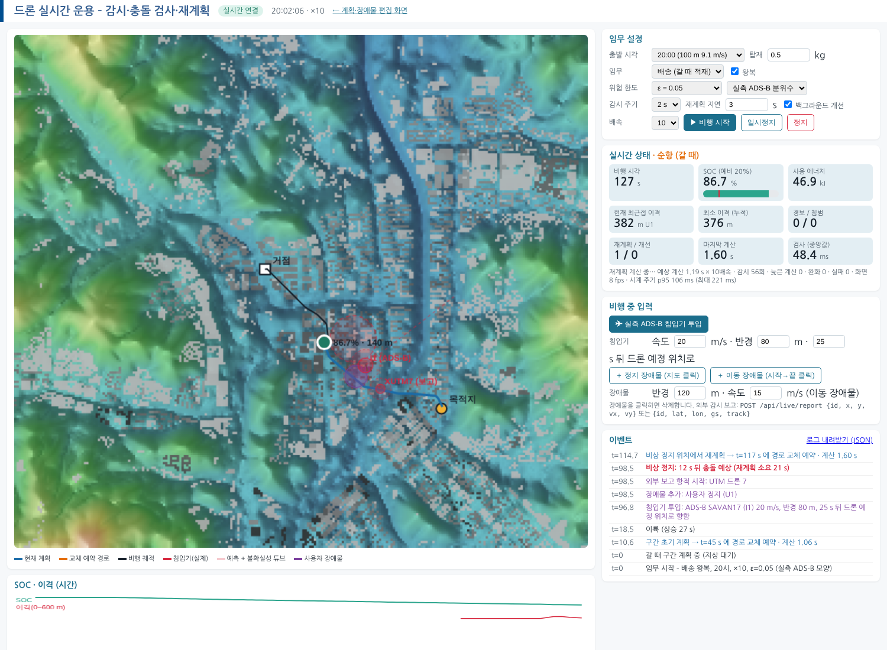

# 실시간 운용 플랫폼 (감시 · 충돌 검사 · 재계획)

> 실행: `PYTHONPATH=src python -m dpo.webapp` → 브라우저 **http://localhost:8765/live** (계획·편집 화면은 `/`)
> 코드: `src/dpo/live.py` (엔진), `src/dpo/webapp/server.py` (API·SSE), `src/dpo/webapp/static/live.html·live.js` (화면)
> 시험: `tests/test_live.py` (동기 모드 5종), `scripts/bench_live.py` (실시간 벤치 → `results/live_bench.json`)

## 1. 무엇을 하는가
드론이 **시계에 맞춰 실제로 비행하는 동안**(1~30배속) 다음을 계속 수행합니다.
- **감시:** 장애물·침입기 정보를 갱신합니다.
- **충돌 검사:** 남은 경로를 수 ms 안에 검사합니다.
- **재계획:** 충돌이 예상되면 경로를 다시 계획합니다.

계획 계산은 백그라운드에서 돌기 때문에 **계산하는 동안에도 비행은 멈추지 않습니다.** 계산 지연은 실제 비행 위치에 그대로 반영됩니다.



## 2. 구조

```
            ┌──────────── 시계 스레드 (20 Hz) ────────────┐
 입력 ─────▶│ 시각 전진(배속) · 단계 전환 · 예약 경로 교체   │──▶ 원격측정·이벤트·실제 이격 감시
 (REST)     └───────────────┬─────────────────────────────┘
  · 장애물 추가/수정/삭제     │ 감시 주기마다(또는 입력 즉시)
  · 실측 ADS-B 침입기 투입    ▼
  · 외부 감시 보고   ┌── 감시 스레드 ──────────────────────────┐
                     │ 예측 갱신(등속 + 실측/가우시안 튜브)        │
                     │ → 위험구간 표 → 남은 경로 검사(~7 ms)        │
                     └───────┬───────────────┬──────────────────┘
               충돌까지 여유 있음 │              │ 여유 없음(계산이 끝나기 전 충돌)
                             ▼              ▼
                ┌ 재계획 스레드 ┐      비상 정지(그 자리 호버) → 정지 위치에서 재계획
                │ 교체 시각 T_sw = 지금 + 지연 + 1.5 × 예상계산 × 배속
                │ 완화 단계: ε → ε=0.2 → 팽창 없음
                │ T_sw 전에 끝나면 교체 예약, 늦으면 폐기·재시도
                └──────────────┘
                ┌ 개선 스레드 ┐  여유 시간에 정밀 가중치로 다시 풀어 더 싸면 교체 (anytime)
                └─────────────┘
 화면 ◀── SSE 10 Hz (상태·새 이벤트·바뀐 경로만)
```

- **즉시 계획 + 백그라운드 개선 (anytime):**
  - 긴급 계획은 빠른 가중치(2.0)로 풀어 0.3~1.6 s 안에 끝냅니다.
  - 남는 시간에 정밀 가중치(1.2)로 다시 풀고, 남은 에너지가 0.5 % 넘게 줄면 교체합니다.
  - 동기 시험에서 정밀 탐색만 쓴 결과(281 kJ)와 거의 같은 282.7 kJ를 얻었습니다.
- **GIL 해제:** 탐색 함수를 numba `nogil`로 컴파일해, 계산 중에도 시계·감시 스레드가 멈추지 않게 했습니다.
  - 해제 전에는 계산하는 동안 시계가 멈춰, 10배속에서 감지가 10 s 늦었습니다.
- **비상 정지(호버):** 충돌까지 남은 시간이 재계획 소요 시간보다 짧으면 그 자리에 멈춥니다.
  - 호버 중에는 위치가 고정이라, 계산이 늦게 끝나도 결과를 그대로 쓸 수 있습니다.
- **출발 대기:** 구간 계획이 준비될 때까지 지상에서 기다렸다가 이륙합니다. 공중 호버로 배터리를 쓰지 않습니다.
- **비상 착륙과 중단:**
  - 배터리가 예비 SOC에 도달하거나, 비상 대기 중 회피 경로를 4회 연속 찾지 못하면 그 자리에 착륙합니다.
  - 남은 배터리로 다음 구간을 갈 수 없으면 지상에서 임무를 중단합니다. 배터리 제한을 풀고 다시 풀어 원인(배터리인지 장애물인지)을 구분합니다.

## 3. 비행 중 입력
| 입력 | 방법 | 반영 |
|---|---|---|
| 정지·이동 장애물 | 화면: 지도 클릭 / `POST /api/live/obstacle {obstacle}` | 지금 발표된 것으로 보고 즉시 검사 |
| 장애물 삭제 | 화면: 장애물 클릭 / `POST /api/live/obstacle/delete {id}` | 즉시 |
| 실측 ADS-B 침입기 | 화면 버튼 / `POST /api/live/intruder {speed, radius, lead, heading, seed}` | 실측 1 Hz 항적을 L 초 뒤 드론 예정 위치로 향하는 충돌 코스로 재생합니다. 시간·선회는 그대로, 속도만 축소합니다. |
| 외부 감시 보고 | `POST /api/live/report {id, x, y, vx, vy}` 또는 `{id, lat, lon, gs, track}` | ADS-B 수신기나 UTM 연동용입니다. 마지막 보고로 추측항법하고, 30 s 동안 보고가 없으면 해제합니다. 80 m/s 넘는 보고는 거부합니다. |
| 제어 | `POST /api/live/control {action: pause/resume/stop, speed}` | 즉시 |
| 상태·로그 | `GET /api/live/stream` (SSE), `GET /api/live/state`, `GET /api/live/log` (JSON 내려받기) | – |

화면에는 다음이 표시됩니다.
- **지도:** 현재 계획(파랑), 교체 예약 경로(주황 점선), 비행 궤적, 실제 침입기·장애물, 예측과 불확실성 튜브
- **계기:** SOC(예비선), 에너지, 현재·최소 이격, 경보·침범, 재계획·개선 횟수, 계산·검사 시간, 시계 주기
- **이벤트 타임라인**과 SOC·이격 그래프

## 4. 검증
**단위 시험** (`tests/test_live.py`, 동기·결정적 모드): 다섯 가지를 확인합니다.
- 편도 완주
- 침입기 투입 시 재계획하고 침범이 없음
- 바로 앞에 장애물이 생기면 비상 정지 후 완주
- 배터리 예비에 도달하면 비상 착륙·중단
- 외부 보고가 장애물로 반영되고, 비정상 속도 보고는 거부됨

**실시간 벤치** (`scripts/bench_live.py`, 스레드 실제 구동)
- **조건:** 20시 왕복, 10배속, 5회
- **입력:** 매회 실측 침입기(충돌 코스), 경로 위 정지 장애물, 외부 보고 항적을 동시에 넣었습니다.

| 지표 | 결과 |
|---|---|
| 완주 / 침범 | **5/5 완주, 침범 0** (최소 이격 37.5 m) |
| 비상 정지 / 재계획 / 늦은 계산 / 계획 실패 | 8 / 9 / 0 / 0 |
| 감시 검사 시간 (중앙값) | **6.9 ms** |
| 재계획 계산 시간 (중앙값 / 최대) | 0.81 s / 1.62 s |
| 시계 주기 (목표 50 ms) p95 / p99 / 최대 | 63 / 129 / 198 ms |
| SOC 소모 | 70.6 ~ 73.6 %p |

**브라우저 종단 시험** (Playwright, `/live`): 다음 흐름을 모두 거쳐 완주했고 페이지 오류는 없었습니다.
- 비행 시작(10배속) → SSE 수신 초당 약 9.8 프레임
- 침입기 투입, 지도 클릭으로 경로 위 장애물 추가, REST 외부 보고
- 비상 정지 2회, 재계획, 백그라운드 개선
- 침범 0으로 완주

> 개발 중 발견해 고친 문제 (모두 시험으로 재현한 뒤 수정)
> 1. 계산이 GIL을 잡아 시계가 멈추던 문제 → numba `nogil`, 개선 계산을 별도 스레드로 분리
> 2. 근접 경보와 침범이 같은 억제 타이머를 써서 침범이 누락되던 문제
> 3. 공중에서 계획을 기다리느라 배터리를 소모하던 문제 → 지상 출발 대기
> 4. 계산이 교체 시각보다 늦게 끝나 경로 교체가 무산되던 문제 → 비상 정지와 호버 중 결과 재사용
> 5. 침입기가 드론 바로 옆에 생성되던 문제
> 6. 배터리 부족 상황에서 무한히 재시도하던 문제 → 원인 구분 후 중단, 비상 착륙

## 5. 한계
- **배속별 성능:** 시계 주기 p99가 129 ms입니다. 파이썬으로 짠 궤적 시뮬레이션과 위험구간 표 생성은 아직 GIL을 잡기 때문입니다. 10배속이면 시뮬레이션 시간 약 1.3 s에 해당하며, 1~5배속에서는 영향이 작습니다.
- **탐색 중단 불가:** 경로가 없을 때 탐색을 끝까지 하면 최대 약 10 s가 걸리고 도중에 멈출 수 없습니다. 그동안은 비상 정지(호버)로 안전을 확보합니다.
- **외부 연동:** OpenSky 실시간 API와 기상청 실황 연동은 이 개발 환경의 네트워크 정책 때문에 시험하지 못했습니다. 대신 `/api/live/report` 형식으로 연동할 수 있게 해 두었습니다.
- **단일 사용자:** 동시에 한 임무만 운용합니다. 다중 드론과 다중 사용자 지원은 향후 과제입니다.
