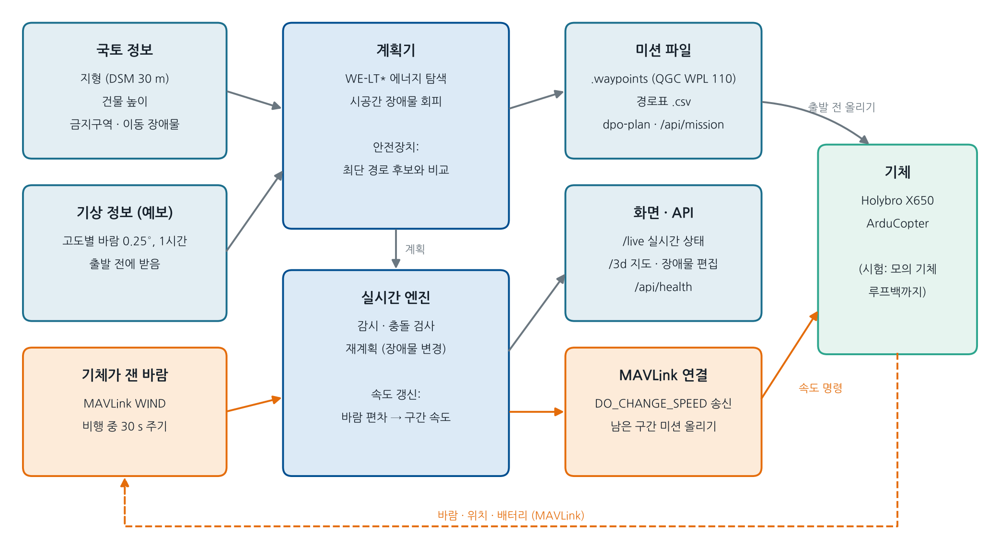
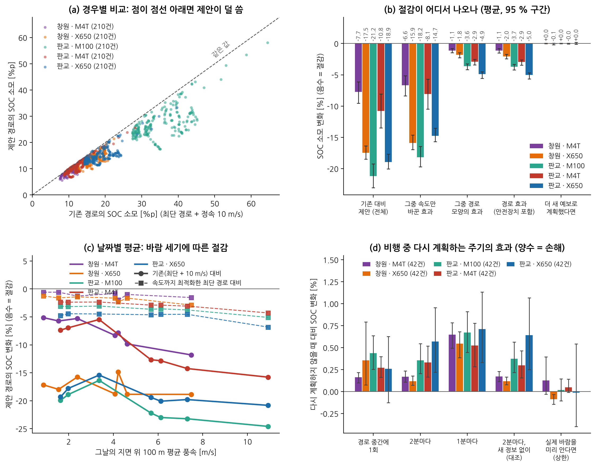
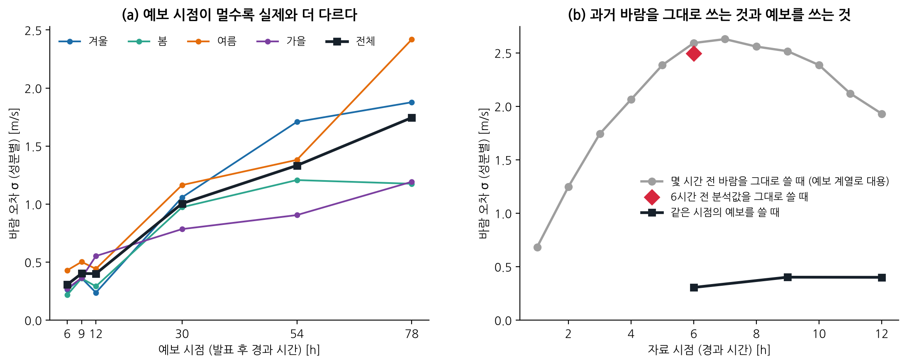
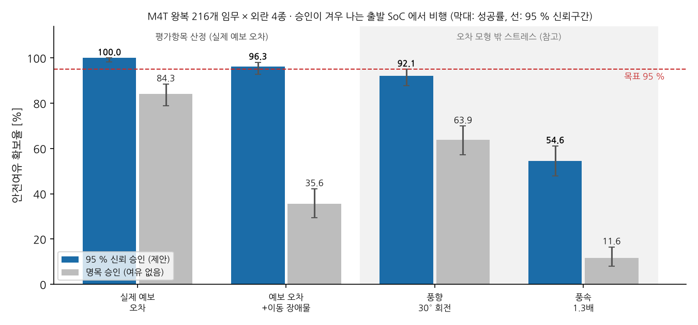
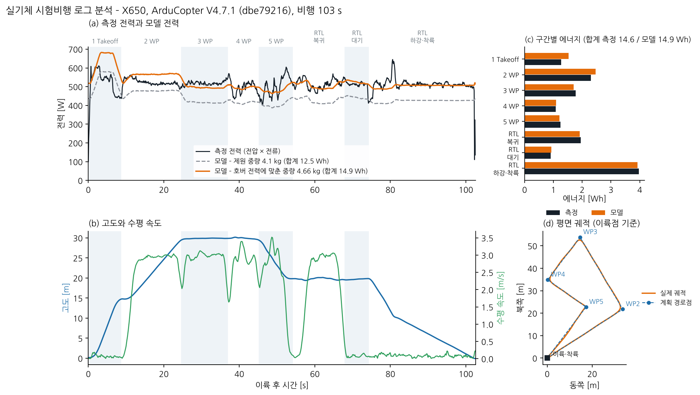

<!--
  투고처: 한국정밀공학회지 (JKSPE). 투고 규정(분량·초록 길이·키워드 수·그림 캡션 언어·참고문헌 형식)은 확인하지 못했다 → [확인요망: JKSPE 투고 규정].
  수치는 모두 저장소 결과 파일에서 가져왔다 (results/E13_stats.json, E14_stats.json, E15_stats.json, E16_stats.json, E17_stats.json,
  m4t_model.json, flight_20261113.json, summary.json). 근거가 없는 자리는 [자료필요]·[인용필요]·[확인요망]·[주장약화] 로 남겼다.
  참고문헌은 docs/paper/references.bib 의 항목(웹 검색으로 서지 확인)만 썼다.
-->

**저자** [자료필요: 저자 순서·소속 – 한국전자기술연구원, 플랫폼비앤티(주) 공동 연구자, 교신저자 표시]

---

## Abstract

Battery state of charge (SoC), not path length, decides whether a delivery drone can finish a round trip with a safe reserve. We plan the route, altitude and segment ground speed of each leg jointly so as to minimize the predicted SoC consumption in a time-varying three-dimensional wind field taken from an operational numerical forecast (NOAA GFS), real terrain and building data. Because the forecast is never exact, the departure is approved only when the 95 % upper bound of SoC consumption, computed from a forecast-error model fitted to a year of GFS data, still leaves the reserve; in flight, the segment speeds are updated every 30 s from the measured wind bias. In 420 simulated one-way delivery flights of a DJI Matrice 4T model on two Korean urban sites over seven days, the plan reduced SoC consumption by 7.7–10.8 % relative to the shortest path flown at a constant 10 m/s, and most of the reduction came from the speed choice (6.6–8.1 %) rather than from the path shape (1.1–2.9 %). Missions approved at the tightest admissible battery level returned with the reserve kept in 424 of 432 flights (98.1 %, 95 % confidence interval 96.4–99.1 %) under actual forecast errors and a crossing moving obstacle, against 60.0 % when approved on the nominal forecast. A flight of a Holybro X650 reproduced the planned segment time within 3 % [자료필요: 실증 짝 비교 비행 결과 1–2문장 – 7절].

**Keywords:** Delivery drone, Energy-aware path planning, Wind field, State of charge, Numerical weather forecast, Battery reserve [확인요망: 키워드 수·형식]

---

## 기호 설명 [확인요망: JKSPE 가 기호 설명(Nomenclature)을 요구하는지]

| 기호 | 뜻 | 단위 |
|---|---|---|
| $V_g$, $V_a$ | 구간 대지속도, 대기속도 | m/s |
| $\mathbf w$ | 바람 벡터 (예보) | m/s |
| $m$ | 구간 질량 (기체 + 탑재) | kg |
| $P$ | 소비전력 | W |
| $E_b$ | 배터리 에너지 | Wh |
| $\Delta\mathrm{SoC}$ | SoC 소모 | %p |
| $R$ | 정책 예비 SoC (Reserve) | % |
| $\sigma(\tau)$ | 예보 발표 후 $\tau$ 시간에서의 바람 오차 표준편차 (성분별) | m/s |

---

## 1. 서론

소형 회전익 드론으로 물품을 배송할 때 임무가 성립하는지는 이동 거리가 아니라 배터리 잔량(SoC, State of Charge)으로 결정된다 [1–3]. 같은 거리라도 지면 위 수십~백여 미터에서 부는 바람의 방향과 세기, 비행 고도, 구간 속도에 따라 소비 에너지가 크게 달라지기 때문이다. 공개된 DJI Matrice 100 배송 비행 기록 [4]을 분석한 결과, 이동 거리만으로 비행 에너지를 설명한 회귀의 결정계수는 −1.47이었고, 속도·바람·상승률을 반영한 회전익 전력 모델은 시험 비행에서 평균 절대 백분율 오차(MAPE) 9.6 %를 보였다 (3.1절).

바람을 고려한 드론 경로 연구는 바람 의존 에너지를 그래프 위 배송 경로에 반영하거나 [5], 기상 불확실성에 강건한 임무를 계획하거나 [6], 격자·any-angle 탐색에 바람장을 결합하는 방향으로 발전해 왔다 [7–9]. 그러나 이들 연구에서 구간 대지속도는 고정되거나 별도로 정해지며, 계획에 쓰는 바람이 예보일 때 그 오차가 배터리 여유에 주는 영향은 출발 판정 단계에서 정량적으로 다뤄지지 않았다 [확인요망: [7–9] 본문에서 속도 결정·예보 오차 처리 여부 확인 – 현재는 초록 기준]. 실무에서는 최단 경로를 정해진 속도로 비행하고, 고정 비율의 예비 전력을 남기는 방식이 흔하다 [인용필요: 상용 드론 배송·점검 운용에서 정속·고정 예비 전력 관행에 관한 문헌 또는 운용 지침].

본 연구는 이 두 가지를 함께 다룬다. 첫째, 수치예보 바람장 위에서 경로·고도와 구간 대지속도를 동시에 정하는 3차원 시공간 탐색으로 예상 SoC 소모를 최소화한다. 둘째, 예보가 틀릴 수 있다는 점을 예보 발표 후 경과 시간과 계절에 따른 오차 모형으로 정량화하고, 그 오차 아래에서도 예비 SoC를 지킬 수 있을 때만 출발을 승인한다. 비행 중에는 기체가 잰 바람으로 예보의 편차를 추정해 남은 구간 속도를 30초마다 다시 정한다.

본 논문의 기여는 다음과 같다.

1. 구간 대지속도를 결정 변수로 포함한 바람장 반영 3차원 시공간 경로계획을 실제 지형·건물·수치예보 자료 위에서 구현하고, 기존 운용 방식(최단 경로 + 정속) 대비 절감을 **속도 선택의 몫과 경로 모양의 몫으로 분해**하였다. 실증 기체(DJI Matrice 4T) 모델에서는 절감의 대부분이 속도 선택에서 나왔다.
2. 1년치 예보 자료로 만든 예보 오차 모형으로 출발 판정의 신뢰 상한을 보정하고, 승인된 임무의 **정상 복귀율(배터리 안전여유 확보율)**을 실제 예보 오차와 이동 장애물 아래에서 폐루프로 평가하였다.
3. 실기체(Holybro X650) 비행 기록으로 계획기의 시간·에너지 예측을 점검하고 [자료필요: 실증 기체 짝 비교 비행의 기여 문장 – 7절 결과 확정 후], 그 차이의 원인을 밝혔다.

---

## 2. 문제 정의

### 2.1 공간과 바람

비행 공간은 수평 25 m, 수직 20 m 간격의 3차원 격자로 나눈다. 비행 가능한 칸은 지면 위 30–150 m이고 건물 위 20 m 이상이며 비행 금지 구역 밖인 칸이다. 지형은 Copernicus GLO-30 표면 모델 [인용필요: Copernicus DEM 자료 인용 형식], 건물 윤곽과 높이는 Overture Maps [인용필요: Overture Maps 자료 인용 형식]에서 얻었다. 바람은 NOAA GFS 0.25° 예보 [인용필요: NOAA GFS 자료 인용 형식]의 지면 위 10–100 m 고도면과 975·950 hPa 면을 고도와 시간에 대해 보간한 3차원 시간 가변장 $\mathbf w(\mathbf x, t)$이다.

### 2.2 목적 함수

임무는 출발지에서 목적지로 가는 편과 돌아오는 편으로 이루어지고, 편마다 질량 $m_\ell$이 다르다 (배송이면 가는 편에 탑재). 계획 $\pi$는 격자 경로점, 구간 대지속도 $V_{g,i}$, 경로점에서의 대기 시간 $\tau_i$로 정의한다. 예상 SoC 소모는

$$
\Delta\mathrm{SoC}(\pi)=\frac{1+\epsilon_R}{E_b}\Big[\sum_{\ell}\sum_{i\in\ell}P\big(V_{a,i},\,\dot z_i,\,m_\ell,\,\rho\big)\,t_i+\sum_i P_h\,\tau_i+E_{\mathrm{TO}}+E_{\mathrm{LD}}\Big]\times 100 \qquad (1)
$$

이다. 여기서 $t_i$는 구간 비행 시간, $E_{\mathrm{TO}}$·$E_{\mathrm{LD}}$는 이륙·착륙 에너지, $\epsilon_R$은 배터리 내부저항 손실 계수이다. 대기속도는 지면 궤적을 유지하도록 기수를 틀어 측풍을 상쇄한다는 가정에서 $\mathbf V_a = V_g\hat{\mathbf e}_i-\mathbf w$로 구한다.

**제약.** 대기속도 상한, 상승·하강률 상한, 그리고 도착 SoC가 정책 예비 $R$(본 연구에서 20 %) 이상일 것.

본 연구에서 비용은 SoC 소모 하나이며, 고도 변화의 비용은 상승·하강 전력으로 (1)에 포함된다. 시간에 대한 가중항은 두지 않았고, 안전 마진은 가중합이 아니라 제약(예비 SoC 하한, 이동 장애물 안전 구간)으로 다룬다.

---

## 3. 에너지·SoC 모델

### 3.1 전력 모델

소비전력은 운동량 이론에 기반한 회전익 전력 모델 [12,13]에 상승 항을 더해 다음과 같이 계산한다.

$$
P = \frac{1}{\eta}\Big[k\,T v_i + P_0\Big(1+\frac{3V_a^2}{U_{\mathrm{tip}}^2}\Big)\frac{\rho}{\rho_0} + \tfrac12\rho\,C_DA\,V_a^3 + m g \dot z\Big] + P_{\mathrm{av}} \qquad (2)
$$

$T=\sqrt{(mg)^2+(\tfrac12\rho C_DA V_a^2)^2}$는 필요 추력, $v_i$는 전진 비행의 유도속도, $k=1.15$는 유도동력 보정계수, $P_{\mathrm{av}}$는 항전 장비 전력이다. 하강($\dot z<0$)에서는 위치에너지의 25 %만 회수한다고 보았다. SoC는 배터리 내부저항 손실을 평균 전력 기준 계수 $\epsilon_R$로 반영해 환산한다.

DJI Matrice 100의 공개 비행 기록 198회 [4]로 계수를 보정하였다 (학습 142회·12일, 시험 56회·6일). 시험 비행에서 MAPE는 9.6 %, 결정계수는 0.77이었다. 같은 자료에서 이동 거리만으로 에너지를 설명한 모형은 MAPE 26.3 %, 결정계수 −1.47이었다.

### 3.2 실증 기체 DJI Matrice 4T 모델

실증 기체의 비행 기록은 아직 확보하지 못하여, 공식 사양의 두 조건 – 무탑재·무풍 호버 42분, 약 9 m/s 정속 비행 49분 – 에 맞도록 종합 효율 $\eta$와 동체 항력 면적 $C_DA$를 정하였다 (표 1). 형상 동력 $P_0$와 항전 전력 $P_{\mathrm{av}}$는 가정값이다.

**표 1. DJI Matrice 4T 전력 모델의 계수**

| 계수 | 값 | 출처 |
|---|---|---|
| 이륙 질량 | 1.219 kg (+ 탑재 최대 0.2 kg) | 공식 사양 [인용필요: DJI Matrice 4T 사양 페이지] |
| 배터리 에너지 | 99 Wh (리튬이온 4S) | 공식 사양 |
| 회전면 면적 | 0.236 m² (10.8 in 프로펠러 4개) | 공식 사양 |
| 종합 효율 $\eta$ | 0.670 | 두 사양 조건에 맞춤 |
| 동체 항력 면적 $C_DA$ | 0.0391 m² | 두 사양 조건에 맞춤 |
| $P_0$, $P_{\mathrm{av}}$ | 20 W, 15 W | 가정 |

이 모델에서 탑재 0.2 kg일 때 미터당 에너지가 가장 작은 대기속도는 12 m/s이고, 무탑재 최대 거리는 28.8 km로 DJI 표기값 35 km보다 짧다. 즉 모델은 고속 구간 전력을 크게 보는 쪽이다. 탑재 상태와 고속 구간은 실측으로 확인되지 않았다 (7절).

---

## 4. 경로계획과 출발 판정

### 4.1 바람장 반영 3차원 시공간 탐색 (WE-LT\*)

경로 탐색은 2차원 지도에서 A\*, Lazy Theta\* [10], Q-learning, RRT\* 등 5종을 비교해 계산 시간과 경로 길이가 가장 유리했던 Lazy Theta\*를 기본으로 하였다 [자료필요: 5종 비교의 출처 – 2026. 6. 30. 회의자료 수치를 본문에 넣을지, 부록으로 돌릴지]. 이를 26방향 3차원 격자와 시간 축으로 확장하고, 비용을 (1)의 SoC 소모로 바꾸었다 (WE-LT\*, Wind- and Energy-aware Lazy Theta\*). 각 구간에서는 대지속도 후보(3 m/s부터 기체 상한까지 0.5 m/s 간격) 가운데 미터당 에너지 $P/V_g$가 가장 작은 값을 고른다. 바람장에서는 에너지 비용이 거리처럼 삼각부등식을 만족하지 않으므로, any-angle 지름길은 에너지가 실제로 더 작을 때만 받아들인다.

이동 장애물이 있으면 격자마다 시간 축 안전 구간을 계산해 SIPP [11]처럼 대기 행동을 허용하며, 우회와 호버 대기 가운데 에너지가 작은 쪽을 고른다. 가는 편과 오는 편은 바람이 다르므로 따로 최적화한다.

**안전장치.** 같은 출발·도착에 대해 최단 경로(속도는 최적화)도 함께 계산하고, 예보 기준으로 에너지 탐색 결과가 더 크면 최단 경로를 쓴다. 이렇게 하면 탐색이 최단 경로보다 나쁜 결과를 내는 경우를 막을 수 있다.

### 4.2 예보 오차 모형

계획에 쓰는 바람은 언제나 과거에 발표된 예보이다. 2025년 11월–2026년 10월의 매월 5·15·25일(36일) GFS 예보를 서로 비교해, 예보 발표 후 경과 시간 $\tau$(6, 9, 12, 30, 54, 78 시간)와 계절별로 지면 위 100 m 바람의 성분별 오차 표준편차 $\sigma(\tau)$를 구하였다. 전체 평균에서 $\sigma$는 6시간 0.31 m/s, 30시간 1.00 m/s, 78시간 1.74 m/s였다. 이 오차는 예보끼리의 비교이며 관측과의 비교가 아니다 (8절).

### 4.3 신뢰 상한에 의한 출발 판정

계획 경로에 대해 바람 편차 $(\delta u,\delta v)\sim\mathcal N(0,\sigma^2 I)$를 200회(6.3절의 신뢰도 검증에서는 100회) 표본 추출하여 SoC 소모 분포를 구하고, 구간별 95 % 분위수의 합을 $U_{95}$라 한다. 가는 편과 오는 편은 같은 편차에 반대로 반응하므로 이 합은 실제 임무 분위수보다 크다(보수적). 출발 판정은

$$
\text{승인(go)}:\ \ \mathrm{SoC}_0 - U_{95} \ \ge\ R \qquad (3)
$$

이며, 예보 그대로의 명목 소모로는 예비를 지키지만 (3)을 만족하지 못하면 '주의', 명목으로도 못 지키면 '불가'로 판정한다.

### 4.4 비행 중 속도 갱신

비행 중에는 기체가 추정한 바람과 예보의 차이를 지수평활(가중치 0.6)로 추정하고, 30초마다 남은 구간의 대지속도를 다시 계산한다. 새 속도로 남은 구간의 예상 에너지가 0.3 % 넘게 줄 때만 명령을 바꾼다. 남은 비행이 20초보다 짧으면 갱신하지 않는다.

---

## 5. 시뮬레이션 실험 설계

| 항목 | 설정 |
|---|---|
| 지역 | 성남 판교(6.2 × 5.5 km), 창원 창이대로 주변(4.4 × 4.0 km) |
| 날짜·시각 | 2026년 10월 7일 (지면 위 100 m 평균 풍속 0.5–11.6 m/s) × 출발 15·17·19시 |
| 임무 | 무작위 출발·도착 쌍 10개, 탑재 상태의 편도 배송 비행 (직선거리 1.5–2.8 km) |
| 기체 | DJI Matrice 4T 모델 (탑재 0.2 kg). 비교: Holybro X650 [자료필요: X650 모델 계수 표 또는 참조], DJI M100 (각 탑재 1.0 kg) |
| 계획 바람 | 00Z 발표 예보 |
| 평가 바람 | 6시간 뒤 06Z 발표 예보 (계획 때 모르는 값으로 취급) |
| 비교 방식 | (A) 최단 경로 + 정속 10 m/s, (B) 최단 경로 + 구간 속도 최적화, (C) 제안 방식 |
| 통계 | 같은 날의 경우는 바람이 같아 독립이 아니므로, 날짜 단위로 다시 뽑는 부트스트랩(4,000회) 95 % 신뢰구간 |

(A)는 운용자가 경로와 속도를 정하는 일반적인 웨이포인트 비행을 나타낸다. (B)와 (C)의 차이가 경로 모양의 몫이고, (A)와 (B)의 차이가 속도 선택의 몫이다.

---

## 6. 결과

### 6.1 기존 경로 대비 SoC 소모

**표 2. 기존 경로(A) 대비 편도 비행의 SoC 소모 (평가 바람 기준, 경우마다 210회)**

| 지역 · 기체 | (A) 소모 | (C) 소모 | 변화 (95 % 신뢰구간) | (C)가 작은 경우 |
|---|---|---|---|---|
| 판교 · M4T | 12.0 %p | 10.7 %p | −10.8 % (−13.5, −8.0) | 201/210 |
| 창원 · M4T | 10.8 %p | 10.0 %p | −7.7 % (−9.5, −6.1) | 210/210 |
| 창원 · X650 | 16.6 %p | 13.7 %p | −17.5 % (−18.5, −16.3) | 210/210 |
| 판교 · X650 | 18.6 %p | 15.0 %p | −18.9 % (−20.0, −17.6) | 206/210 |
| 판교 · M100 | 35.1 %p | 27.5 %p | −21.2 % (−23.0, −19.2) | 210/210 |

[확인요망: 표 2의 소모량은 평균값, 변화율은 경우별 변화율의 평균 – 저장소 정의(exp_superiority.py)와 일치하는지 저자 확인]

실증 기체 M4T 모델에서 제안 방식은 420회 가운데 411회에서 (A)보다 SoC를 적게 썼고, 평균 감소율은 7.7–10.8 %였다. 바람이 가장 약한 날(평균 0.9 m/s)의 감소는 5.1 %, 가장 강한 날(10.9 m/s)은 15.8 %로 바람이 셀수록 절감이 컸다 (그림 2).

### 6.2 절감의 출처

**표 3. 절감의 분해**

| 지역 · 기체 | 속도 선택의 몫 (A→B) | 경로 모양의 몫 (B→C, 95 % 신뢰구간) |
|---|---|---|
| 판교 · M4T | −8.1 % | −2.9 % (−3.4, −2.5) |
| 창원 · M4T | −6.6 % | −1.1 % (−1.5, −0.8) |
| 창원 · X650 | −15.9 % | −1.8 % (−2.3, −1.5) |
| 판교 · X650 | −14.7 % | −4.9 % (−5.5, −4.5) |
| 판교 · M100 | −18.2 % | −3.6 % (−4.2, −3.2) |

모든 조합에서 절감의 대부분은 구간 속도 선택에서 나왔다. M4T는 미터당 에너지가 가장 작은 속도(약 12 m/s, 3.2절)가 기존 정속 10 m/s와 가까워 속도 선택의 몫(6.6–8.1 %)이 비교 기체(14.7–18.2 %)보다 작았고, 그만큼 전체 절감도 작았다. 경로 모양의 몫은 1.1–4.9 %였으며, 안전장치(4.1절)를 적용하면 경로 모양 단계가 최단 경로보다 나쁜 경우는 최악 +0.3 %로 제한되었다 [확인요망: '최악 +0.3 %'는 창원 M4T 의 안전장치 적용 시 최악값 – 표 3에 열로 넣을지].

따라서 "기존 경로"를 최단 경로 + 속도 최적화(B)로 정의하면 제안 방식의 이득은 경로 모양의 몫(1.1–4.9 %)으로 줄어든다. 이 결과는 바람장 경로계획의 이득을 보고할 때 비교 기준의 속도 설정을 함께 밝혀야 함을 보여 준다. 또한 속도 선택의 효과는 동체 항력 면적 가정에 민감하여, X650에서 $C_DA$를 0.08 m²로 두면 정속 10 m/s 대비 −22.2 %, 0.16 m²로 두면 −6.6 %였다.

에너지 기반 A\*(26방향)와의 단일 사례 비교에서는 (판교, 2026-10-27, X650, 탑재 1 kg, 왕복 2.4 km) 왕복 SoC 소모가 에너지 A\* 50.1 %p, 제안 방식 47.4 %p였다 [주장약화: 단일 사례 – 다일·다경로 비교로 확장하거나 사례로만 제시].

### 6.3 출발 판정의 신뢰도

판정이 쓰는 95 % 상한 안에 실제(평가 바람) SoC 소모가 든 비율은 432회 중 409회(94.7 %)였다 (창원 X650 203/216, 판교 M100 206/216; 36일 × 출발 15·18시 × 경로 3개, 편도). 평가 바람(06Z 예보)이 있는 15·18시 출발만 셌다. 예보 오차 모형은 기체와 무관하므로 M4T에도 같은 모형을 썼다. 95 % 신뢰 수준에 필요한 SoC 여유는 명목 소모의 3.7 %(6시간 전 예보), 14 %(30시간 전), 27 %(78시간 전)였다 (그림 3).

### 6.4 배터리 안전여유 확보율

승인된 임무가 실제로 예비를 지키는지 보기 위해, M4T 모델의 왕복 216개 임무(판교·창원 × 36일 × 경로 3개, 편도 1.5–2.5 km, 탑재 0.2 kg)를 **승인이 겨우 나는 출발 SoC**(36.6–55.5 %, 식 (3)의 등호)에서 실시간 엔진으로 이륙부터 착륙까지 폐루프 비행시켰다. 성공은 정상 복귀·착륙, 이동 장애물 침범 없음, 종료 SoC ≥ 20 %를 모두 만족하는 경우로 정의하였다. 출발 SoC가 이보다 높으면 성공이 더 쉬우므로, 이 조건은 가장 엄한 경우이다.

**표 4. 외란별 안전여유 확보율 (출발 SoC = 승인 경계)**

| 외란 | 95 % 신뢰 승인 (제안) | 명목 승인 (여유 없음) |
|---|---|---|
| 실제 예보 오차 (06Z) | 216/216 (100.0 %) | 182/216 (84.3 %) |
| 실제 예보 오차 + 경로를 가로지르는 이동 장애물 | 208/216 (96.3 %) | 77/216 (35.6 %) |
| **합계** | **424/432 (98.1 %; 95 % 신뢰구간 96.4–99.1 %)** | 259/432 (60.0 %) |
| (참고) 풍향 30° 회전 | 199/216 (92.1 %) | 138/216 (63.9 %) |
| (참고) 풍속 1.3배 | 118/216 (54.6 %) | 25/216 (11.6 %) |

신뢰구간은 Wilson 구간이다. 실제 예보 오차와 이동 장애물 조건에서 제안 판정의 확보율은 98.1 %였고, 같은 임무를 명목 소모만으로 승인하면 60.0 %로 떨어졌다. 두 판정의 차이는 평균 0.96 %p(0.45–2.44 %p)의 SoC 여유에서 나왔다. 제안 판정의 실패 8회는 모두 정상 복귀했으나 종료 SoC가 20 %에 약간 못 미친 경우(최저 19.5 %)였고, 이동 장애물 침범은 모든 경우에서 0회였다 (그림 4).

예보 오차 모형 밖의 외란(풍향 30° 회전, 풍속 1.3배)에서는 확보율이 92.1 %, 54.6 %로 떨어졌다. 이 경우 실패에는 목적지에서 복귀를 보류(지상 대기)하거나 비상 착륙한 경우가 포함되었다. 이는 예보 오차 모형이 실제 오차를 과소평가하면 판정의 보장도 그만큼 약해짐을 뜻한다.

### 6.5 비행 중 속도 갱신

폐루프 시뮬레이션(경우마다 24회)에서 안전장치와 30초 속도 갱신은 연결 전 플랫폼(둘 다 끔) 대비 M4T의 SoC 소모를 1.9–5.8 % 줄였다. 600회 모두에서 속도 갱신은 안전장치만 쓴 경우보다 나쁘지 않았고(최악 +0.00 %), 판단 1회의 계산 시간은 2–3 ms였다. 예보가 틀린 경우의 손해 가운데 30초 갱신이 되찾은 비율은 풍향 30–180° 회전과 풍속 0.6배 경우에서 42–73 %였으나, 풍속 1.4배 경우에는 −9 %(창원 X650)와 27 %(판교 M100)로 일관되지 않았다 (X650·M100 기준) [확인요망: 회복률 정의(E14)를 본문에 한 문장으로 넣고, 풍속 1.4배의 원인 분석 추가 여부]. 가로지르는 이동 장애물을 넣은 240회는 모두 완주했고 침범은 없었다 (최소 이격 32–38 m).

---

## 7. 실기체 시험

### 7.1 X650 비행 기록과 모델 비교 (2026. 11. 13.)

Holybro X650 (Pixhawk 6X, ArduCopter 4.7.1, 6S 222 Wh)으로 경로점 4개를 지나는 103초 비행을 수행하였다 (최고 고도 30 m, 최고 수평 속도 3.5 m/s). 기체 로그의 전압·전류에서 계산한 사용 에너지는 14.6 Wh, 평균 전력은 512 W였다. 로그로 추정한 배터리 내부저항은 0.028 Ω으로 계획기의 가정(0.03 Ω)과 비슷했다.

- **시간.** 경로점 구간의 실제 비행 시간 45.4초에 대해 계획기의 예측은 46.9초였다 (오차 3 %).
- **에너지.** 제원 중량(4.1 kg)으로 계산한 모델 에너지는 12.5 Wh로 측정값보다 작았다 (측정값이 16.5 % 큼). 측정 호버 전력(515 W)에 맞는 등가 질량은 4.66 kg이었고, 이 질량으로는 비행 전체 에너지가 14.9 Wh로 측정과 2 % 이내였다. 다만 이 등가 질량은 같은 비행의 호버 구간에서 구한 값이므로 독립 검증이 아니며 [주장약화: 표본 내 보정], 실제 이륙 중량(카메라·짐벌·RTK 포함)을 재지 않아 확정할 수 없다.
- **확인하지 못한 것.** 최고 속도가 3.5 m/s여서 속도 선택에 쓰는 고속 구간 전력(동체 항력)은 이 비행으로 검증할 수 없었다. 기체의 바람 추정 기능이 꺼져 있어(EK3_DRAG_BCOEF = 0) 비행 고도의 실측 바람도 얻지 못하였다.

### 7.2 실증 기체 짝 비교 비행 [자료필요: 전체 절 – 실증 비행 후 작성]

설계(안):

- 기체: DJI Matrice 4T (실증 기체) [확인요망: 플랫폼비앤티(주) 실증 기체·장소·일정], 같은 배터리·같은 탑재(0 kg, 0.2 kg).
- 비교: 같은 날 같은 출발·도착 왕복을 (A) 최단 경로 + 정속 10 m/s 와 (C) 제안 경로로 번갈아 비행 (순서를 바꿔 바람 변화의 치우침을 줄임). 최소 10쌍, 바람이 다른 날 2–3일.
- 측정: 비행 기록의 전압·전류 적분 에너지, 이륙 중량, 비행 고도 바람(기체 추정 또는 고도 풍속계), 종료 SoC.
- 지표: 예측 에너지 오차(MAPE), 짝 차이의 평균과 95 % 신뢰구간(짝 t 검정 또는 Wilcoxon 부호순위 검정), 예비 SoC 확보 여부, 실측 바람과 예보의 차이(예보 오차 모형의 실측 검증).
- 표본 크기 근거: 짝 차이의 비행 간 표준편차를 5 %로 가정하면 10쌍에서 95 % 신뢰구간 반폭은 약 ±3.6 %로, 표 2의 기대 절감(7.7–10.8 %)을 구분할 수 있다 [확인요망: 첫 비행의 실측 변동으로 다시 계산].

[자료필요: 표 5 – 짝 비교 결과 (쌍 수, 평균 에너지 A/C, 변화율과 95 % 신뢰구간, p 값)]
[자료필요: 그림 6 – 실측 대 예측 에너지 산점도, 실측 바람 대 예보]

---

## 8. 토의

**절감의 출처와 비교 기준.** 본 연구의 시뮬레이션에서 절감의 대부분은 구간 속도 선택에서 나왔다. 이는 바람장 경로계획의 효과가 경로 모양보다 "어떤 속도로 날 것인가"에 더 크게 달려 있음을 뜻하며, 기존 연구와 성능을 비교할 때 비교 대상의 속도 설정을 같게 맞추지 않으면 경로 탐색의 이득이 과대평가될 수 있다. 다만 속도 선택의 효과는 동체 항력 면적에 민감하므로(6.2절), 실증 기체의 고속 구간 전력을 실측으로 확인하기 전까지 M4T의 수치는 모델 가정에 의존한다.

**예보 오차와 보장의 범위.** 출발 판정의 보장은 예보 오차 모형이 실제 오차를 잘 나타낼 때만 성립한다. 본 연구의 오차 모형과 평가 바람은 모두 예보끼리의 비교에서 나왔고, 지면 위 30–150 m의 실측 바람은 쓰지 않았다. 비행 고도의 국지 바람은 건물과 지형의 영향으로 0.25° 예보보다 변동이 클 수 있으므로 [인용필요: 도시 저고도 바람의 국지 변동과 수치예보 해상도에 관한 문헌], 실측 바람으로 오차 모형을 보정하는 것이 다음 과제이다. 오차 모형 밖의 외란에서 확보율이 떨어진 결과(표 4)는 이 보정의 필요성을 보여 준다.

**한계.** (1) M4T 전력 모델은 공식 사양 두 점에 맞춘 것이며 탑재·고속 구간은 실측 미검증이다. (2) X650 비행은 1회·저속이었다. (3) 비행 금지 구역은 예시 원형 구역만 넣었다. (4) 배터리 노화(SoH)에 따른 용량 감소는 다루지 않았다.

---

## 9. 결론

수치예보 바람장 위에서 경로·고도와 구간 대지속도를 동시에 정하는 3차원 시공간 경로계획과, 예보 오차 모형으로 보정한 출발 판정을 제안하였다. 실증 기체 DJI Matrice 4T 모델의 판교·창원 420회 시뮬레이션에서 기존 운용(최단 경로 + 정속 10 m/s) 대비 SoC 소모가 7.7–10.8 % 줄었고, 그 대부분(6.6–8.1 %)은 속도 선택에서 나왔다. 예보 오차를 반영한 판정으로 승인한 임무는 실제 예보 오차와 이동 장애물 아래에서 98.1 %가 예비 SoC를 지키고 정상 복귀하였으며, 명목 예보로 승인하면 60.0 %에 그쳤다. 실기체 시험에서 계획기의 구간 시간 예측은 3 % 이내였고 [자료필요: 짝 비교 비행의 결론 문장], 향후 실측 바람으로 예보 오차 모형을 보정하고 배터리 노화를 반영할 계획이다.

---

## 후기

본 연구는 플랫폼비앤티(주)의 민간수탁연구 "배터리 잔존 용량을 고려한 드론 경로 최적화 알고리즘 개발"의 지원으로 수행되었다 [확인요망: 과제번호·사사 문구, 위탁 기관과의 성과 공개 협의].

---

## 참고문헌 [확인요망: JKSPE 참고문헌 형식으로 변환]

1. Stolaroff, J. K., et al., "Energy use and life cycle greenhouse gas emissions of drones for commercial package delivery," Nature Communications, Vol. 9, Paper No. 409, 2018. doi:10.1038/s41467-017-02411-5
2. Zhang, J., Campbell, J. F., Sweeney, D. C., and Hupman, A. C., "Energy consumption models for delivery drones: A comparison and assessment," Transportation Research Part D, Vol. 90, Paper No. 102668, 2021. doi:10.1016/j.trd.2020.102668
3. Dorling, K., Heinrichs, J., Messier, G. G., and Magierowski, S., "Vehicle routing problems for drone delivery," IEEE Transactions on Systems, Man, and Cybernetics: Systems, Vol. 47, No. 1, pp. 70–85, 2017. doi:10.1109/TSMC.2016.2582745
4. Rodrigues, T. A., et al., "In-flight positional and energy use data set of a DJI Matrice 100 quadcopter for small package delivery," Scientific Data, Vol. 8, Paper No. 155, 2021. doi:10.1038/s41597-021-00930-x
5. Betti Sorbelli, F., Corò, F., Das, S. K., and Pinotti, C. M., "Energy-constrained delivery of goods with drones under varying wind conditions," IEEE Transactions on Intelligent Transportation Systems, Vol. 22, No. 9, pp. 6048–6060, 2021. doi:10.1109/TITS.2020.3044420
6. Thibbotuwawa, A., Bocewicz, G., Radzki, G., Nielsen, P., and Banaszak, Z., "UAV mission planning resistant to weather uncertainty," Sensors, Vol. 20, No. 2, Paper No. 515, 2020. doi:10.3390/s20020515
7. Lian, F., Li, B., Yang, Q., Zhu, H., and Du, D., "WA-LPA\*: An energy-aware path-planning algorithm for UAVs in dynamic wind environments," Drones, Vol. 9, No. 12, Paper No. 850, 2025. doi:10.3390/drones9120850
8. Lian, F., Yang, Q., Li, B., Wang, P., Luo, H., and Du, D., "Optimal path planning of unmanned aerial vehicle with wind field," Proc. 28th IEEE International Conference on Intelligent Transportation Systems (ITSC), pp. 4195–4200, 2025.
9. Gu, R., Zhao, Y., and Ren, X., "Integrating wind field analysis in UAV path planning: Enhancing safety and energy efficiency for urban logistics," Chinese Journal of Aeronautics, Vol. 39, No. 1, Paper No. 103605, 2026. doi:10.1016/j.cja.2025.103605
10. Nash, A., Koenig, S., and Tovey, C., "Lazy Theta\*: Any-angle path planning and path length analysis in 3D," Proc. AAAI Conference on Artificial Intelligence, Vol. 24, No. 1, pp. 147–154, 2010. doi:10.1609/aaai.v24i1.7566
11. Phillips, M. and Likhachev, M., "SIPP: Safe interval path planning for dynamic environments," Proc. IEEE International Conference on Robotics and Automation, pp. 5628–5635, 2011.
12. Leishman, J. G., "Principles of Helicopter Aerodynamics," 2nd Ed., Cambridge University Press, 2006.
13. Zeng, Y., Xu, J., and Zhang, R., "Energy minimization for wireless communication with rotary-wing UAV," IEEE Transactions on Wireless Communications, Vol. 18, No. 4, pp. 2329–2345, 2019. doi:10.1109/TWC.2019.2902559

---

## 그림 [확인요망: 그림 캡션 언어(국문/영문)와 위치 – JKSPE 규정]

{width=15cm}

{width=15cm}

{width=15cm}

{width=15cm}

{width=15cm}

그림 6. [자료필요: 실증 짝 비교 결과 – 실측 대 예측 에너지, 실측 바람 대 예보]
