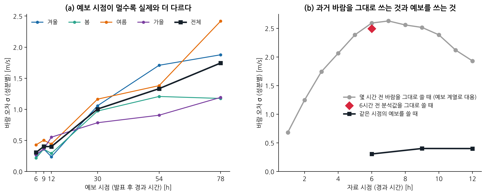
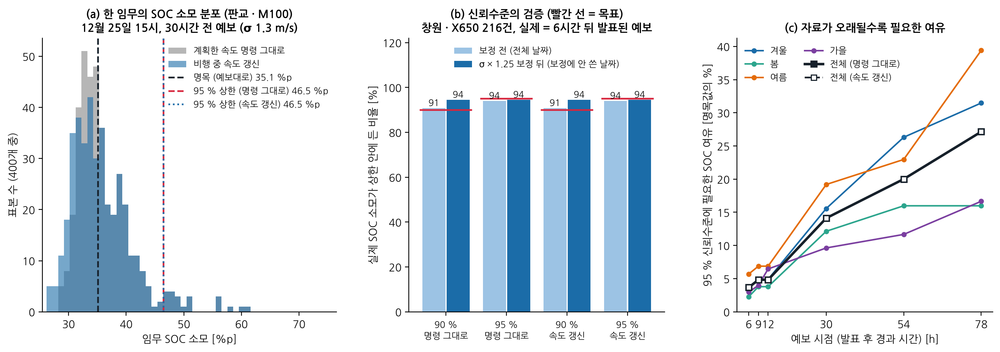
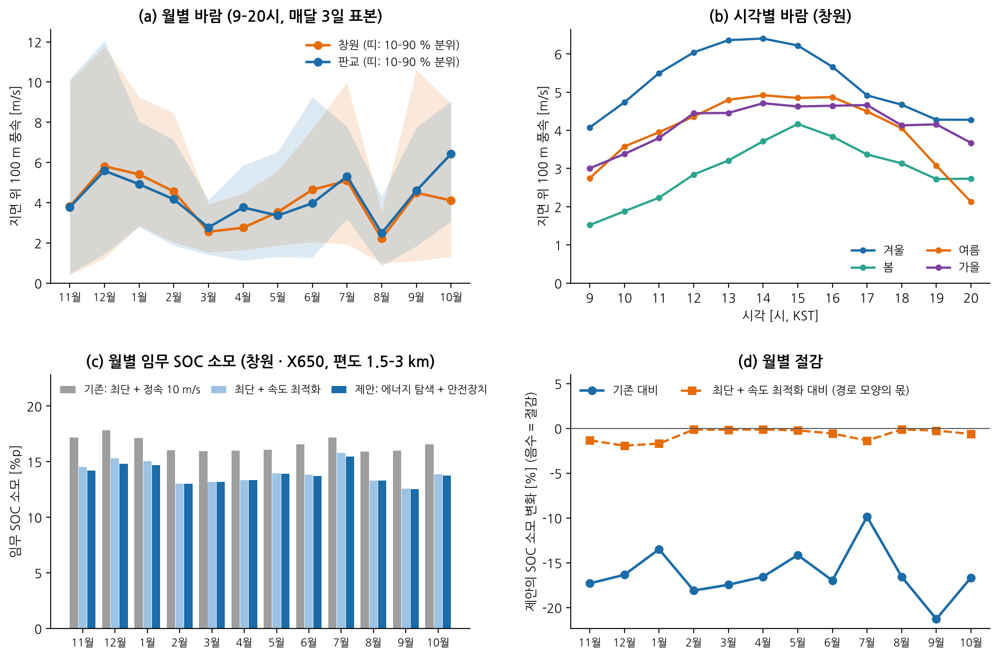

# 과거 시점 자료로 계획한 경로의 신뢰도 (E16)

계획에 쓰는 바람은 언제나 과거에 발표된 예보입니다. 이 문서는 그 예보의 시점(발표 후 얼마나 지났는지)과 계절에 따라 계획이 얼마나 믿을 만한지를 잰 결과와, 그것을 출발 판정에 쓰는 방법을 정리합니다.

모든 수치는 GFS 예보끼리의 비교이고 시뮬레이션입니다. 관측 바람은 쓰지 못했습니다.

**용어 – 예보 시점.** 계획에 쓴 예보가 발표된 시각입니다. "예보 시점 6시간 전"은 발표 후 6시간이 지난 예보로 계획했다는 뜻입니다. 예보 시점이 멀수록(발표 후 시간이 지날수록) 실제 바람과 더 다릅니다. 프로그램에서는 `--forecast-age <시간>` 으로 넣습니다.

## 1. 결론 먼저

| 질문 | 답 | 근거 |
|---|---|---|
| 과거 자료는 얼마나 틀리는가 | 6시간 전 예보는 성분별 0.31 m/s, 30시간 전 1.00 m/s, 78시간 전 1.74 m/s 틀립니다. | 표 2, 그림 F34 |
| 예보 대신 과거에 잰 바람을 그대로 쓰면 | 6시간 전 값을 그대로 쓰면 2.5 m/s 틀립니다. 같은 시점의 예보보다 8배 큽니다. | 표 3 |
| 신뢰수준으로 경로를 검토할 수 있는가 | 예. 계획 경로의 SOC 소모 분포와 임무 성립 확률을 구해 출발 판정(go / caution / no-go)을 냅니다. | 4절, `dpo.reliability` |
| 그 신뢰수준은 맞는가 | 95 % 상한 안에 실제 SOC 소모가 든 비율이 432건 중 409건(94.7 %)이었습니다. 목표와 거의 같습니다. | 표 5 |
| 예보 시점이 멀면 여유를 얼마나 더 둬야 하는가 | 95 % 신뢰수준에 필요한 SOC 여유는 6시간 전 예보에서 명목값의 3.7 %, 30시간 전 14 %, 78시간 전 27 %입니다. | 표 6 |
| 계절별로 알고리즘을 바꿔야 하는가 | **아니요.** 설정은 하나로 두고 여유만 계절에 맞춥니다. 경로 모양의 이득은 계절이 아니라 바람 세기에 달려 있고, 안전장치가 그 판단을 자동으로 합니다. | 5절, 표 7 |
| 신뢰도를 기준으로 경로 후보를 고르면 더 나은가 | **아니요.** 두 후보(에너지 탐색, 최단)가 바람 편차에 거의 같이 반응해, 분위수로 골라도 결과가 달라지지 않았습니다. | 4.3절 |

## 2. 자료와 방법

| 항목 | 내용 |
|---|---|
| 표본 | 2025-11 – 2026-10, 매달 5·15·25일 = 36일, 창원과 판교 |
| 날짜마다 받은 것 | 00Z 예보 f000–f012 (계획용), 06Z 예보 f000–f006 (평가용), 같은 시각을 맞히는 더 오래된 예보 3개(30·54·78시간 전 발표) |
| 받은 양 | 예보 시각 828개 → 파일 360개, 약 5 MB. 실패·누락 0 |
| 오차의 정의 | 지역 중심, 지면 위 30–100 m 다섯 고도의 (예보 − 평가용 예보) 바람 벡터. σ는 성분별 표준편차 |
| 임무 | 날짜 36 × 출발 9·12·15·18시 × 경로 3개 = 조합마다 432건. 창원 X650(탑재 1.0 kg), 판교 M100(0.5 kg) |
| 평가 바람 | 15·18시는 06Z 예보(계획 때는 모르는 값). 9·12시는 06Z 예보가 덮지 않아 계획에 쓴 예보에서 평가했습니다. |

- 36일은 한 해에서 뽑은 표본입니다. 여러 해를 평균한 기후값이 아니므로 월별 수치는 해마다 달라질 수 있습니다 `[자료필요: 여러 해의 재분석 또는 관측]`.
- 평가용 바람도 예보입니다. 실제 바람과 예보의 차이는 여기서 잰 것보다 클 수 있습니다 `[자료필요: 실증 지역 비행 고도의 관측 바람]`.

## 3. 과거 자료는 얼마나 틀리는가



**표 2. 예보 시점(발표 후 경과 시간)에 따른 바람 오차 σ [m/s, 성분별]**

| 예보 시점 (발표 후) | 전체 | 겨울 | 봄 | 여름 | 가을 |
|---|---|---|---|---|---|
| 6시간 | 0.31 | 0.26 | 0.22 | 0.43 | 0.27 |
| 9시간 | 0.40 | 0.36 | 0.36 | 0.50 | 0.36 |
| 12시간 | 0.40 | 0.24 | 0.29 | 0.44 | 0.55 |
| 30시간 | 1.00 | 1.06 | 0.97 | 1.16 | 0.78 |
| 54시간 | 1.33 | 1.71 | 1.21 | 1.38 | 0.90 |
| 78시간 | 1.74 | 1.88 | 1.17 | 2.42 | 1.19 |

- **하루가 넘어가면 오차가 3배가 됩니다.** 당일 예보(6–12시간)는 0.3–0.4 m/s, 전날 예보(30시간)는 1.0 m/s입니다.
- **여름이 가장 크고 가을이 가장 작았습니다.** 계절마다 9일뿐이라 계절 간 차이는 경향으로만 봐야 합니다.
- 벡터 오차(RMSE)는 σ의 √2배입니다(6시간 0.43, 30시간 1.42, 78시간 2.47 m/s).
- 6시간보다 새로운 예보의 오차는 재지 못했습니다. 모형은 6시간 값을 그대로 씁니다.

**표 3. 과거에 잰 바람을 그대로 쓸 때의 오차 σ [m/s]**

| 자료 시점 (경과 시간) | 1시간 | 3시간 | 6시간 | 12시간 |
|---|---|---|---|---|
| 그대로 쓸 때 (예보 계열로 대용) | 0.68 | 1.74 | 2.59 | 1.93 |
| 6시간 전 분석값을 그대로 쓸 때 | – | – | 2.49 | – |
| 같은 시점의 예보를 쓸 때 | – | – | 0.31 | 0.40 |

- **바람은 몇 시간 사이에 예보 오차보다 훨씬 크게 변합니다.** 낮 동안 바람이 세졌다 약해지는 하루 주기 때문입니다(그림 F35 b).
- 그래서 "아침에 잰 바람으로 오후 경로를 짜는 것"은 권하지 않습니다. 예보로 계획하고, 과거 관측은 예보를 보정하는 데 씁니다. 비행 중 속도 갱신이 그 방식입니다.
- 1시간 전 값도 0.68 m/s 틀립니다. 6시간 전 예보(0.31 m/s)보다 큽니다.

**오차가 지도 안에서 고른가.** 15·18시의 오차장을 지도 격자에서 보면 평균 편차의 크기는 0.43–0.46 m/s이고, 지도 안에서 칸마다 달라지는 부분은 0.11–0.12 m/s입니다(전체의 23–27 %). 오차의 대부분이 지도 전체에 같은 편차이므로 "한 가지 편차" 모형을 썼습니다. 다만 지도의 바람이 GFS(약 25 km 격자)를 내려받은 것이라 원래 매끄럽습니다. 건물·지형 주변의 실제 바람은 더 들쭉날쭉할 수 있습니다 `[확인요망]`.

## 4. 신뢰수준으로 경로를 검토한다

### 4.1 방법 (`src/dpo/reliability.py`)

1. 예보 시점(발표 후 경과 시간)과 계절로 바람 편차의 크기 σ를 정합니다 (`WindErrorModel.sigma`).
2. 편차 (du, dv)를 σ의 정규분포에서 200개 뽑습니다.
3. 편차마다 계획 경로를 다시 날려 SOC 소모를 구합니다 (`mission_confidence`). 두 가지 경우를 냅니다.
   - 계획한 구간 속도 명령을 그대로 따르는 경우
   - 비행 중 속도 갱신이 편차를 알아내 속도를 다시 정하는 경우
4. SOC 소모의 50·90·95·99 % 분위수와 임무 성립 확률(도착 SOC ≥ 예비)을 냅니다.
5. 요구 신뢰수준으로 판정합니다 (`go_no_go`).

| 판정 | 조건 |
|---|---|
| go | 임무 성립 확률이 요구 신뢰수준 이상 |
| caution | 예보대로면 성립하지만 요구 신뢰수준에는 못 미침. 탑재를 줄이거나, 더 새 예보를 받거나, 바람이 약한 시각으로 옮깁니다. |
| no-go | 예보대로 날아도 예비를 못 지키거나, 성립 확률이 절반 미만 |

```python
from dpo.reliability import WindErrorModel, mission_confidence, go_no_go
sigma = WindErrorModel.load().sigma(lead_h=30, month=12)        # 30시간 전 예보, 12월
conf = mission_confidence(site, drone, path, waits, t_start, mass, sigma, n=200, e_fixed=e_takeoff + e_land)
print(conf["soc_used_q"][95], conf["p_ok"], go_no_go(conf, level=0.95))
```

### 4.2 검증: 신뢰수준이 맞는가



15·18시 출발 216건(조합마다)에서, 6–9시간 전 예보로 낸 상한과 06Z 예보에서의 실제 SOC 소모를 비교했습니다.

**표 5. 실제 SOC 소모가 상한 안에 든 건수 (덮임률)**

| 조합 | 90 % 상한 | 95 % 상한 | 보정 배율 | 보정 뒤 95 % (보정에 안 쓴 날짜) |
|---|---|---|---|---|
| 창원 · X650 | 196/216 (90.7 %) | 203/216 (94.0 %) | 1.25 | 102/108 (94.4 %) |
| 판교 · M100 | 198/216 (91.7 %) | 206/216 (95.4 %) | 1.00 | 103/108 (95.4 %) |
| 합계 | 394/432 (91.2 %) | 409/432 (94.7 %) | – | – |

- **보정 없이도 목표와 거의 같습니다.** 216건의 표본 오차가 약 ±1.5 %p이므로 94.0 %와 95 %의 차이는 오차 범위 안입니다.
- 창원에서 95 %에 조금 못 미쳐 σ에 1.25를 곱하는 보정을 정했습니다. 날짜의 절반으로 배율을 정하고 나머지 절반에서 확인했습니다. 모형 파일에는 두 조합 중 큰 값(1.25)을 넣었습니다.
- X650은 속도 명령을 그대로 따를 때와 속도를 갱신할 때의 결과가 같았습니다. 가정한 모델에서 최고 속도가 이미 최적이기 때문입니다.
- 검증한 것은 6–9시간 전 예보까지입니다. 30시간 이상 된 예보의 신뢰수준은 임무 단위로 검증하지 못했습니다(그 시각의 3차원 바람을 받지 않았습니다).

**표 6. 95 % 신뢰수준에 필요한 SOC 여유 [명목 임무 SOC 소모의 %]** (15시 출발, 보정 배율 1.25 적용)

| 예보 시점 (발표 후) | 창원 · X650 | 판교 · M100 (명령 그대로 / 속도 갱신) | 겨울 | 봄 | 여름 | 가을 |
|---|---|---|---|---|---|---|
| 6시간 | 3.7 | 3.7 / 3.6 | 3.5 | 2.3 | 5.7 | 3.0 |
| 12시간 | 4.8 | 4.8 / 4.7 | 4.9 | 3.8 | 6.9 | 6.5 |
| 30시간 | 14.1 | 14.0 / 13.6 | 15.6 | 12.1 | 19.2 | 9.6 |
| 54시간 | 20.0 | 20.1 / 19.6 | 26.3 | 16.0 | 23.0 | 11.7 |
| 78시간 | 27.1 | 27.7 / 27.3 | 31.5 | 16.0 | 39.4 | 16.7 |

계절 열은 창원 · X650의 값입니다.

- **읽는 법:** 명목 SOC 소모가 14 %p인 임무를 30시간 전 예보로 계획했다면, 95 % 신뢰수준으로는 14 × 1.141 ≈ 16 %p까지 쓸 수 있다고 봐야 합니다.
- **당일 예보를 쓰면 여유가 4–5 %로 충분합니다.** 전날 예보로는 3배가 필요합니다.
- 속도 갱신은 이 여유를 거의 줄이지 못했습니다(0.1–0.5 %p). 상한을 정하는 것은 맞바람이 예보보다 센 경우인데, 그때는 속도를 다시 정해도 최고 대기속도로 나는 것 말고 방법이 없기 때문입니다.
- 바람이 센 날일수록 같은 편차에 더 민감합니다. 예: 판교 M100, 12월 25일 15시(풍속 11.4 m/s), 30시간 전 예보 → 명목 35.1 %p, 95 % 상한 46.5 %p.

### 4.3 신뢰도를 기준으로 경로 후보를 고르면

안전장치는 두 후보(에너지 탐색, 최단 경로) 중 예보 기준 에너지가 적은 쪽을 고릅니다. 이것을 "90 % 분위수가 작은 쪽"으로 바꿔 보았습니다 (`robust_choice`).

| 조합 | 선택이 달라진 건수 (σ 1 m/s) | 그중 실제로 더 나았던 건수 | 평균 SOC 소모 변화 |
|---|---|---|---|
| 창원 · X650 | 29/216 | 5 | +0.01 % |
| 판교 · M100 | 10/216 | 1 | +0.00 % |

- **효과가 없었습니다.** 두 후보가 바람 편차에 거의 같이 반응합니다. 실제 바람을 미리 알고 골랐어도 0.004 % 이내의 차이였습니다.
- 따라서 후보 선택은 지금처럼 예보 기준으로 두고, 신뢰수준은 **출발 판정과 SOC 여유**에 씁니다.

## 5. 계절성



**표 7. 계절별 요약** (창원 · X650, 편도 1.5–3 km, 계절마다 108건)

| 계절 | 100 m 풍속 | 기존 → 제안 SOC 소모 | 기존 대비 | 최단 + 속도 최적화 대비 | 최단 경로 채택 |
|---|---|---|---|---|---|
| 겨울 (12–2월) | 5.2 m/s | 17.0 → 14.2 %p | −16.0 % | −1.3 % | 24 % |
| 봄 (3–5월) | 2.9 m/s | 16.0 → 13.5 %p | −16.1 % | −0.2 % | 44 % |
| 여름 (6–8월) | 3.8 m/s | 16.5 → 14.2 %p | −14.5 % | −0.7 % | 29 % |
| 가을 (9–11월) | 4.0 m/s | 16.6 → 13.5 %p | −18.4 % | −0.7 % | 29 % |
| 전체 (432건) | 4.1 m/s | 16.5 → 13.8 %p | −16.2 % (−17.6, −14.9) | −0.7 % (−1.2, −0.3) | 31 % |

판교 · M100은 전체 28.4 → 24.8 %p, 기존 대비 −13.5 % (−14.5, −12.5), 최단 + 속도 최적화 대비 −0.5 %입니다.

**표 8. 바람 세기에 따른 경로 모양의 이득** (최단 + 속도 최적화 대비)

| 100 m 풍속 | 창원 · X650 | 판교 · M100 |
|---|---|---|
| 약 (4 m/s 미만) | −0.07 % (273건) | −0.12 % (249건) |
| 중 (4–8 m/s) | −0.73 % (105건) | −0.70 % (144건) |
| 강 (8 m/s 이상) | −3.97 % (54건) | −2.65 % (39건) |

- **기존 경로 대비 절감은 어느 계절에나 12–18 %입니다.** 이 몫은 속도 선택에서 나오므로 바람이 약해도 나옵니다.
- **경로 모양의 이득은 바람이 셀 때만 나옵니다.** 4 m/s 미만에서는 0.1 %, 8 m/s 이상에서는 3–4 %입니다.
- **바람은 겨울에 세고 봄에 약했습니다.** 하루 중에는 14–15시에 가장 세고 9시에 가장 약합니다(겨울 창원 6.4 대 4.1 m/s).
- 432건 모두 예비 20 %를 지켰고 비행 불가는 없었습니다. 이 거리·탑재에서는 계절 때문에 임무가 안 되는 경우가 없었습니다.

### 5.1 계절별 권고 (`results/seasonal_table.json`, `seasonal_recommendation`)

**알고리즘을 계절별로 바꿀 근거는 없습니다.** 근거는 다음과 같습니다.

- 경로 모양의 이득은 계절이 아니라 그날의 바람 세기에 달려 있습니다(표 8). 같은 달에도 약한 날과 센 날이 섞여 있습니다.
- 안전장치가 그날의 예보에서 두 후보를 비교해 고릅니다. 바람이 약한 날에는 최단 경로가 자동으로 채택됩니다(봄 44 %).
- 그래서 설정은 하나(**에너지 탐색 + 안전장치 + 속도 갱신 30 s**)로 두고, 계절에 따라 달라지는 것은 **SOC 여유와 출발 시각**뿐입니다.

표에는 달마다 다음을 넣었습니다. 모두 그 달의 표본 3일에서 계산한 값입니다.

| 항목 | 뜻 |
|---|---|
| `wind_ms`, `wind_class` | 100 m 평균 풍속과 구간 (약 < 4, 중 4–8, 강 ≥ 8 m/s) |
| `setting`, `energy_search_needed` | 그 달 표본에서 경로 모양의 이득이 0.5 %에 못 미치면 "에너지 탐색 생략 가능"으로 적습니다. 켜 두어도 손해는 없습니다. |
| `saving_vs_baseline_pct`, `saving_vs_shortest_pct` | 기존 대비, 최단 + 속도 최적화 대비 절감 |
| `margin95_pct`, `margin95_30h_pct` | 6시간 전, 30시간 전 예보로 계획할 때 95 % 신뢰수준의 SOC 여유 (계절 값) |
| `best_hours` | 임무 SOC 소모가 가장 적었던 출발 시각 두 개 |

창원 · X650의 달별 값은 다음과 같습니다.

| 달 | 풍속 | 구간 | 에너지 탐색 | 기존 대비 | 최단 + 속도 대비 | 여유 (6시간 / 30시간) | 좋은 출발 시각 |
|---|---|---|---|---|---|---|---|
| 1 | 5.4 | 중 | 필요 | −13.5 % | −1.7 % | 3.5 / 15.6 % | 18, 9시 |
| 2 | 4.6 | 중 | 생략 가능 | −18.1 % | −0.1 % | 3.5 / 15.6 % | 9, 12시 |
| 3 | 2.6 | 약 | 생략 가능 | −17.5 % | −0.2 % | 2.3 / 12.1 % | 9, 12시 |
| 4 | 2.8 | 약 | 생략 가능 | −16.6 % | −0.1 % | 2.3 / 12.1 % | 9, 12시 |
| 5 | 3.5 | 약 | 생략 가능 | −14.1 % | −0.2 % | 2.3 / 12.1 % | 9, 12시 |
| 6 | 4.6 | 중 | 필요 | −17.0 % | −0.6 % | 5.7 / 19.2 % | 9, 18시 |
| 7 | 5.1 | 중 | 필요 | −9.9 % | −1.4 % | 5.7 / 19.2 % | 9, 18시 |
| 8 | 2.2 | 약 | 생략 가능 | −16.6 % | −0.1 % | 5.7 / 19.2 % | 9, 12시 |
| 9 | 4.5 | 중 | 생략 가능 | −21.3 % | −0.3 % | 3.0 / 9.6 % | 9, 12시 |
| 10 | 4.1 | 중 | 필요 | −16.7 % | −0.6 % | 3.0 / 9.6 % | 9, 18시 |
| 11 | 3.8 | 약 | 필요 | −17.3 % | −1.3 % | 3.0 / 9.6 % | 9, 18시 |
| 12 | 5.8 | 중 | 필요 | −16.3 % | −1.9 % | 3.5 / 15.6 % | 9, 18시 |

- 달마다 3일(36건)뿐이라 달별 값은 흔들립니다. 예를 들어 11월은 풍속이 "약"인데 경로 이득이 −1.3 %로 나왔습니다. 계절 단위(표 7)와 바람 세기 단위(표 8)의 값이 더 믿을 만합니다.
- 9·12시의 SOC 소모는 계획에 쓴 예보에서 평가한 값이라 15·18시와 조건이 같지 않습니다. "좋은 출발 시각"은 바람이 약한 시각이라는 뜻으로만 읽어야 합니다.

## 6. 운용 권고

1. **계획에는 가장 새 예보를 씁니다.** 당일 예보면 SOC 여유 5 %로 95 % 신뢰수준을 맞출 수 있고, 전날 예보면 15 %가 필요합니다.
2. **출발 전에 신뢰수준 판정을 봅니다.** caution이면 탑재·시각·예보를 바꿉니다.
3. **과거에 잰 바람으로 경로를 짜지 않습니다.** 관측은 비행 중 예보 보정(속도 갱신)에 씁니다.
4. **설정은 계절과 무관하게 하나로 둡니다.** 여름과 겨울에는 여유를 더 둡니다(표 6).
5. **지형·건물 자료의 날짜를 확인합니다.** 이 분석은 바람만 다뤘습니다. 지도가 만들어진 뒤 생긴 건물·크레인은 계획기가 모릅니다. 건물 이격(20 m)을 유지하고, 실증 전에 경로 주변을 현장에서 확인해야 합니다 `[확인요망: 지도 자료의 기준 날짜]`.

## 7. 한계

- 평가용 바람이 관측이 아니라 6시간 뒤 발표된 예보입니다. 실제 오차는 더 클 수 있고, 그만큼 여유도 더 필요합니다.
- 한 해의 36일입니다. 태풍·장마 같은 드문 날은 표본에 거의 없습니다.
- 편차가 지도 전체에 같고 비행 중 변하지 않는다고 봤습니다. 돌풍과 국지 바람은 모형에 없습니다.
- 30시간 이상 된 예보의 σ는 지역 중심의 GFS 원격자에서 쟀고, 임무 단위의 덮임률은 6–9시간 예보에서만 확인했습니다.
- 경로가 1.5–3 km·3–5분입니다. 긴 임무에서는 비행 중 바람 변화가 더해집니다.
- 지형·건물·금지구역 자료가 만들어진 시점은 다루지 않았습니다.

## 8. 재현

```bash
E16_CACHE=/tmp/e16cache E16_WORKERS=6 PYTHONPATH=src python scripts/fetch_gfs_clim.py   # 표본 받기 (약 25분, 이어받기 가능)
PYTHONPATH=src python scripts/exp_reliability.py model                                   # 오차 모형
PYTHONPATH=src python scripts/exp_reliability.py run changwon x650                       # 임무 계산 (약 4분)
PYTHONPATH=src python scripts/exp_reliability.py run pangyo m100                         # (약 8분)
PYTHONPATH=src python scripts/exp_reliability.py analyze                                 # 통계, 계절표, 그림 F34–F36
PYTHONPATH=src python -m pytest -q tests/test_reliability.py
```

| 파일 | 내용 |
|---|---|
| `results/wind_error_model.json` | σ(선행 시간, 계절)와 보정 배율 |
| `results/seasonal_table.json` | 지역·달별 권고 |
| `results/E16_stats.json` | 전체 통계 |
| `results/E16_errors.json`, `E16_<지역>_<기체>.json`, `E16_fetch_log.json` | 날짜별 오차·바람, 경우별 결과, 받기 기록 |
