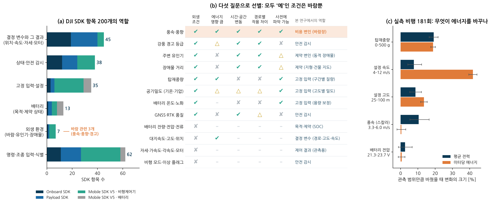

# 연구 배경: 왜 SOC를 목적 변수로, 왜 바람(크기·방향)을 변인으로, 왜 드론이 경로를 결정하는가

> 근거 데이터: `results/background.json`, `results/dji_conditions.json`, `results/E12_latency.json`, `results/summary.json` · 그림 F22–F25
> 재현: `PYTHONPATH=src python scripts/background_analysis.py`, `PYTHONPATH=src python scripts/exp_latency.py 16`
> 조건: 성남 판교·분당 실제 지형·건물, 2026-10-27 GFS 예보 바람, DJI M100 전력 모델(실측 198회 보정), 거점↔배송지 2.4 km 왕복, 탑재 0.5 kg

이 문서는 연구 설계의 세 가지 선택을 설명합니다. 각 선택마다 (1) 대안이 무엇이었는지, (2) 어떤 기준으로 골랐는지, (3) 우리 데이터로 확인한 근거를 적었습니다.

| 선택 | 한 줄 답 |
|---|---|
| 목적 변수 = SOC | 임무 가능 여부를 정하는 값이고, 바람·중량·속도·고도·대기를 한 단위로 합산하며, 기체가 비행 중 직접 재는 값입니다. |
| 변인 = 바람(크기·방향) | DJI 드론이 내놓는 조건 200개를 모두 검토하면, 밖에서 주어지고·영향이 크고·시공간에 따라 변하고·경로에 따라 작용이 달라지고·미리 알 수 있는 조건은 바람뿐입니다. |
| 결정 = 드론의 경로 | 주문이 정해지면 바꿀 수 있는 것은 경로(수평 경로·고도·속도·대기)뿐이고, 결정이 늦으면 회피할 수 없습니다. |

---

## 1. 왜 SOC를 목적 변수로 두는가

### 1.1 후보와 선택 기준
경로계획의 목적 변수 후보는 비행 거리, 비행 시간, 소비 에너지, SOC(배터리 잔량)입니다. 다음 네 기준으로 비교했습니다.

| 기준 | 거리 | 시간 | 에너지 [J] | **SOC [%]** |
|---|---|---|---|---|
| ① 임무 가능 여부(예비 잔량)와 같은 단위인가 | ✘ | ✘ | △ (용량으로 나눠야 함) | ✔ |
| ② 바람·중량·속도·고도·대기(호버)를 한 척도로 합산하는가 | ✘ | △ (전력 차이 무시) | ✔ | ✔ |
| ③ 기체가 비행 중 직접 계측하는가 | ✔ | ✔ | △ (적산 필요) | ✔ (BMS) |
| ④ 기체·배터리가 달라도 비교할 수 있는가 | ✘ | ✘ | ✘ | ✔ (정규화) |

- **① 임무 가능 여부:** 배송 드론의 임무는 "예비 SOC를 남기고 돌아올 수 있는가"로 판정됩니다. 본 연구는 예비 20 %를 기준으로 삼았습니다.
- **② 합산:** 배터리 소모는 구간 전력 × 시간의 합입니다. 전력은 대기속도·상승률·질량에 따라 달라지고, 호버 대기와 이착륙도 포함됩니다. 거리나 시간은 이 차이를 담지 못합니다.
- **③ 계측:** SOC는 배터리 관리 장치(BMS)가 실시간으로 내놓는 값입니다. 계획한 SOC와 실제 SOC를 비교해 재계획이나 비상 착륙을 판단할 수 있습니다. 실시간 플랫폼도 이 값으로 비상 착륙을 결정합니다.
- **④ 정규화:** SOC는 에너지를 배터리 용량으로 나눈 값이라, 기체나 배터리가 달라도 같은 척도로 비교할 수 있습니다.

### 1.2 근거 1 – 실측 비행에서 거리는 에너지를 설명하지 못한다
CMU의 DJI M100 실측 비행(학습에 쓰지 않은 날짜 56회)에서 비행 에너지를 예측했습니다 [rodrigues2021dataset].

| 예측 방법 | R² | MAPE |
|---|---|---|
| 거리에 비례 | **−1.47** | 26.3 % |
| 시간에 비례 | 0.68 | 10.9 % |
| 전력 모델 (바람·중량·속도 반영) | **0.77** | 9.6 % |

거리 비례 모델은 평균으로 예측하는 것보다 나쁩니다(R² < 0). 최단 경로 계획은 사실상 이 모델을 비용으로 쓰는 셈입니다.

### 1.3 근거 2 – 목적 변수를 바꾸면 결과가 달라진다 (그림 F22)
같은 임무(배송 왕복)를 출발 시각 09–20시 12회에 대해 세 가지 목적으로 계획했습니다.

| 목적 | 비행 거리 | 비행 시간 | SOC 소모 | 예비 20 % 충족 |
|---|---|---|---|---|
| 거리 최소 (최단 경로, 정속 10 m/s) | 4,964 m | 766 s | 94.6 %p | **0/12** |
| 시간 지향 (최단 경로, 낼 수 있는 최고 속도) | 4,964 m | 647 s | 78.2 %p | 7/12 |
| **SOC 최소 (제안)** | 5,289 m (+6.6 %) | **599 s (−22 %)** | **71.8 %p (−24 %)** | **12/12** |

- **거리가 6.6 % 길어도 SOC는 24 %, 시간은 22 % 줄었습니다.** 순풍을 받는 고도와 방향을 골라 더 빨리, 더 적은 전력으로 날기 때문입니다.
- **거리 최소 계획은 12회 모두 임무 불가였습니다.** 가장 짧은 경로가 가장 오래 걸리고 배터리도 가장 많이 썼습니다.
- **시간 지향 계획은 바람이 센 13–17시에 임무 불가였습니다.** 같은 경로에서 속도만 올린 것으로는 부족했습니다.

### 1.4 SOC와 에너지의 관계 (정직하게 밝힐 점)
- **한 기체·한 배터리에서는 '에너지 최소'와 'SOC 최소'의 최적 경로가 같습니다.** 본 구현에서 SOC 소모는 에너지에 비례합니다(ΔSOC = E / E_b × 손실 계수 × 100).
- **SOC를 쓰는 이유는 최적 경로가 달라서가 아닙니다.** 제약(예비 SOC), 계측(BMS), 운용 판단(귀환·비상 착륙)이 모두 SOC 단위이기 때문입니다. 계획·감시·판단을 한 변수로 이을 수 있습니다.
- **한계:** 전압 강하, 온도, 배터리 노화에 따른 비선형성은 모델에 넣지 않았습니다. 이를 넣으면 SOC와 에너지의 차이가 실제로 생기며, 향후 과제입니다.

### 1.5 문헌 근거
- 드론 배송 경로 문제는 배터리·탑재중량에 따른 에너지 모델 없이는 계획이 성립하지 않는다는 점이 일찍 지적되었습니다 [dorling2017vrp].
- 배송 드론의 에너지 모델은 모델 범위와 가정에 따라 추정값이 크게 달라, 실측 기반 검증이 필요하다고 보고되었습니다 [zhang2021energy].
- 실측 비행으로 배송 에너지를 추정한 연구가 있습니다 [stolaroff2018energy, rodrigues2021dataset].

---

## 2. 왜 바람(크기·방향)을 변인으로 두는가

이 장은 "에너지에 영향을 줄 만한 조건이 많은데 왜 바람인가"에 답합니다. 후보를 임의로 고르지 않고, **DJI 드론이 실제로 내놓는 조건 전부**를 놓고 걸러 냈습니다.

> 근거 데이터: `results/dji_conditions.json` · 그림 F25 · 항목 목록 `data/raw/dji_sdk/`
> 재현: `PYTHONPATH=src python scripts/dji_conditions_review.py`

### 2.1 DJI 드론에서 얻을 수 있는 조건 전수 (그림 F25 a)
DJI 공식 SDK 세 가지의 비행 관련 항목을 원문에서 모두 추출했습니다. 합계 **200개**입니다.

| SDK | 실행 위치 | 항목 수 | 원문 |
|---|---|---|---|
| Onboard SDK | 기체 탑재 컴퓨터 | 47 토픽 | `dji_telemetry.hpp` |
| Payload SDK | 기체 탑재 장치 | 56 토픽 | `dji_fc_subscription.h` |
| Mobile SDK V5 | 조종기 앱 | 비행제어기 82 키 + 배터리 15 키 | `FlightControllerKey`, `BatteryKey` 문서 |

200개를 계획에서의 역할로 나누면 다음과 같습니다(같은 물리량이 SDK마다 중복되어 있습니다).

| 역할 | 항목 수 | 물리량 (대표 항목) |
|---|---|---|
| 결정 변수와 그 결과 | 45 | 수평 위치 9 (`GPS_FUSED`, `RTK_POSITION`, `KeyAircraftLocation3D`) · 고도 8 (`ALTITUDE_FUSED`, `ALTITUDE_BAROMETER`, `HEIGHT_RELATIVE`, `KeyUltrasonicHeight`) · 대지속도 7 (`VELOCITY`, `KeyAircraftVelocity`) · 자세 4 (`QUATERNION`, `KeyAircraftAttitude`) · 가속도 6 · 각속도 4 · 기수 방위 5 (`COMPASS`, `RTK_YAW`) · 모터 2 (`ESC_DATA`: 전류·회전수·전압·온도) |
| 상태·안전 감시 | 38 | 비행 상태·모드 13 (`STATUS_FLIGHT`, `KeyFlightMode`) · GNSS·RTK 품질 14 (`GPS_SIGNAL_LEVEL`, `KeyGPSSatelliteCount`) · 이상 플래그 11 (`FLIGHT_ANOMALY`, `STATUS_MOTOR_START_ERROR`) |
| 임무 전 고정 입력·설정 | 35 | 홈포인트 9 · 고도·거리 제한과 귀환 설정 18 · 배터리 노화 4 (`KeyFullChargeCapacity`, `KeyNumberOfDischarges`) · 배터리 온도 1 · 누적 비행 이력 3 |
| 배터리 (목적·제약 상태) | 13 | 잔량 6 (`BATTERY_INFO`, `KeyChargeRemainingInPercent`) · 전압·전류 3 (`KeyVoltage` mV, `KeyCurrent` mA, `KeyCellVoltages`) · 저전압 경고·귀환 판단 4 |
| **외생 환경** | **7** | **풍속 1 (`KeyWindSpeed`, dm/s) · 풍향 1 (`KeyWindDirection`, 지구 좌표) · 강풍 경고 1 (`KeyWindWarning`)** · 주변 유인기 2 (`KeyAirSenseSystemInformation`) · 장애물 거리 2 (`AVOID_DATA`) |
| 명령·조종 입력·식별 | 62 | 명령 키 22 (이륙·착륙·귀환·보정) · 짐벌 17 · 조종기 입력 5 · 식별·연결 11 · 시각 7 |

- **200개 중 드론이 정하지 않고 밖에서 주어지는 환경 조건은 7개뿐입니다.** 바람(3), 주변 유인기(2), 장애물 거리(2)입니다.
- **나머지는 환경 조건이 아닙니다.** 배터리 값은 결과이고, 위치·속도·자세·모터 값은 우리가 정하는 경로의 결과이며, 나머지는 설정·감시·명령입니다.
- **DJI가 내놓지 않는 조건도 있습니다.** 탑재중량을 재는 항목은 없습니다(주문 정보로 넣어야 합니다). 외기온·기압을 직접 주는 항목도 없고, 기압고도(`ALTITUDE_BAROMETER`)로 간접 추정할 수 있을 뿐입니다.

### 2.2 다섯 질문으로 선별 (그림 F25 b)
경로계획의 '비용 변인'이 되려면 다섯 질문에 모두 '예'여야 합니다.
- **Q1 외생인가:** 드론의 결정과 무관하게 주어지는가. (아니면 조건이 아니라 결과입니다.)
- **Q2 에너지 영향이 큰가.**
- **Q3 시간·공간에 따라 변하는가.** (어디서나 같으면 경로를 가르지 못합니다.)
- **Q4 경로에 따라 작용이 달라지는가.**
- **Q5 경로 전체에 대해 미리 알 수 있는가.** (현재 위치 값만으로는 앞길을 계획할 수 없습니다.)

| 조건 | DJI 항목 | Q1 | Q2 | Q3 | Q4 | Q5 | 본 연구에서의 역할 | 근거 |
|---|---|---|---|---|---|---|---|---|
| **풍속·풍향** | MSDK KeyWindSpeed [dm/s], KeyWindDirection (지구 좌표) | ✔ | ✔ | ✔ | ✔ | ✔ | 비용 변인 (바람장) | 모델: 10 m/s에서 방향에 따라 -38 ~ +150 % |
| 강풍 경고 등급 | MSDK KeyWindWarning, OSDK·PSDK FLIGHT_ANOMALY.strongWindLevel1/2 | ✔ | △ | ✔ | ✔ | ✘ | 안전 감시 | 등급(2–3단계)만 제공, 현재 위치만 |
| 주변 유인기 | MSDK KeyAirSenseSystemInformation (ADS-B 수신) | ✔ | ✘ | ✔ | ✔ | △ | 제약 변인 (동적 장애물) | 에너지에는 우회·대기로만 작용 |
| 장애물 거리 | OSDK·PSDK AVOID_DATA | ✔ | ✘ | ✔ | ✔ | △ | 제약 (지형·건물 지도) | 감지 거리 수십 m, 계획에는 지도를 사용 |
| 탑재중량 | DJI 키 없음 (주문 정보로 입력) | ✔ | ✔ | ✘ | ✘ | ✔ | 고정 입력 (구간별 질량) | 실측: 0→500 g 평균 전력 +21 % · 모델: -9 ~ +5 % |
| 공기밀도 (기온·기압) | 직접 키 없음 (ALTITUDE_BAROMETER로 간접) | ✔ | △ | △ | △ | ✔ | 고정 입력 (고도별 밀도) | 모델: -3 ~ +4 % |
| 배터리 온도·노화 | MSDK KeyBatteryTemperature, KeyFullChargeCapacity, KeyNumberOfDischarges | ✔ | – | ✘ | ✘ | ✔ | 고정 입력 (용량 보정) | 모델 미반영 (향후 과제) |
| GNSS·RTK 품질 | GPS_SIGNAL_LEVEL, GPS_DETAILS, RTK_*_INFO, KeyGPSSatelliteCount | ✔ | ✘ | ✔ | △ | ✘ | 안전 감시 | 에너지와 무관 |
| 배터리 잔량·전압·전류 | BATTERY_INFO, BATTERY_SINGLE_INFO, KeyChargeRemainingInPercent, KeyVoltage, KeyCurrent | ✘ | – | – | – | – | 목적·제약 (SOC) | 조건이 아니라 결과 |
| 대지속도·고도·위치 | VELOCITY, ALTITUDE_FUSED, GPS_FUSED, KeyAircraftVelocity, KeyAircraftLocation3D | ✘ | ✔ | – | – | – | 결정 변수 (경로·고도·속도) | 실측: 속도 4→12 m/s 미터당 에너지 -33 % · 모델: 속도 고정 +23 % |
| 자세·가속도·각속도·모터 | QUATERNION, ACCELERATION_*, ANGULAR_RATE_*, ESC_DATA, KeyAircraftAttitude | ✘ | – | – | – | – | 제어 결과 (관측용) | 경로·바람이 정해지면 따라오는 값 |
| 비행 모드·이상 플래그 | STATUS_FLIGHT, STATUS_DISPLAYMODE, FLIGHT_ANOMALY, KeyFlightMode | ✘ | – | – | – | – | 안전 감시 | 이산 상태 |

(✔ 예, △ 부분적, ✘ 아니오, – 해당 없음)

- **다섯 질문에 모두 '예'인 조건은 바람(풍속·풍향)뿐입니다.**
- **주변 유인기와 장애물은 Q2만 '아니오'입니다.** 에너지를 직접 바꾸지는 않지만 지나갈 수 있는 공간을 바꿉니다. 그래서 본 연구는 이 둘을 비용이 아니라 **제약**(동적 장애물, 지형·건물)으로 다룹니다.
- **탑재중량은 영향이 크지만 Q3·Q4가 '아니오'입니다.** 주문이 정하고 구간 안에서 일정하므로, 어느 경로가 좋은지를 가르지 않습니다. 구간별 질량으로 입력합니다.
- **정리하면 DJI가 주는 외생 조건은 바람(비용)과 주변 비행체·장애물(제약) 두 가지이고, 본 연구의 계획기는 정확히 이 둘을 다룹니다.**

### 2.3 실측 확인 – 조건별 설명력 (그림 F25 c)
CMU의 DJI M100 실측 비행 중 조건이 고르게 바뀐 181회(경로 R1, 설정 속도 > 0, 탑재 0·250·500 g)로, 각 조건을 관측 범위(5–95 백분위)만큼 바꿨을 때 평균 전력과 미터당 에너지가 얼마나 달라지는지 다중 회귀로 구했습니다(괄호는 부트스트랩 95 % 구간, ΔR²는 그 조건을 뺐을 때 줄어드는 설명력).

| 조건 | 관측 범위 | 평균 전력 변화 | ΔR² | 미터당 에너지 변화(크기) | ΔR² |
|---|---|---|---|---|---|
| 탑재중량 | 0 → 500 g | +19.1 % [+16.5, +21.7] | 0.431 | 18.8 % [17.4, 20.1] | 0.167 |
| 설정 속도 | 4 → 12 m/s | +7.6 % [+4.1, +12.1] | 0.047 | 41.8 % [39.4, 44.2] | 0.592 |
| 설정 고도 | 25 → 100 m | +8.6 % [+5.3, +12.0] | 0.072 | 13.5 % [11.6, 15.4] | 0.071 |
| 풍속 (기체 풍속계, 스칼라) | 3.3 → 6.0 m/s | +10.4 % [+5.3, +16.4] | 0.067 | 0.5 % [0.0, 3.0] | 0.000 |
| 배터리 전압 | 21.3 → 23.7 V | -2.6 % [-6.6, +1.3] | 0.004 | 0.6 % [0.0, 2.5] | 0.000 |

(전체 R²: 평균 전력 0.57, 미터당 에너지 0.95)

- **속도와 고도는 결정 변수입니다.** 미터당 에너지를 가장 많이 바꾸는 것은 속도이고(4→12 m/s에서 -33 %), 이는 계획기가 정하는 값입니다.
- **탑재중량은 실측에서 평균 전력을 가장 많이 설명합니다**(0→500 g에서 +21 %). 다만 2.2에서 본 대로 고정 입력입니다.
- **배터리 전압은 설명력이 없습니다**(ΔR² 0.004).
- **스칼라 풍속은 평균 전력을 +10 % 바꾸지만 미터당 에너지에는 차이가 없습니다**(+0.5 %). 이것은 바람이 중요하지 않다는 뜻이 아니라, 이 자료로는 바람의 효과를 볼 수 없다는 뜻입니다. 이유는 세 가지입니다.
  - **방향이 없습니다.** 비행 단위 자료에는 풍속 크기만 있고 진행 방향 대비 풍향이 없습니다. 바람의 효과는 방향에 따라 부호가 바뀝니다(2.6).
  - **닫힌 경로입니다.** 출발지로 돌아오는 경로에서는 역풍과 순풍이 섞여 평균 효과가 작아집니다. 모델로도 4 m/s 바람의 왕복 평균 증가는 6 %입니다.
  - **기체에 단 풍속계는 바람과 기체 속도를 합친 값을 잽니다.** 비행별 최대 풍속과 설정 속도의 상관이 0.82이고, 설정 속도 4→12 m/s에서 최대 풍속 평균이 8.7→14.9 m/s로 늘었습니다. 시험 당일 풍속도 약했습니다(일평균 3.7–5.8 m/s).
- **주의:** 실측의 탑재중량 효과(+21 %)는 모델의 수평 순항 효과(0→0.75 kg에서 14 % 폭)보다 큽니다. 실측 평균 전력에는 이착륙·상승이 들어 있기 때문으로 보이나, 모델의 질량 민감도는 따로 확인이 필요합니다 [확인요망: 순항 구간만 분리한 질량 민감도].

### 2.4 DJI에서 바람을 얻는 방법과 한계
| 경로 | 얻는 값 | 한계 |
|---|---|---|
| Mobile SDK V5 `KeyWindSpeed`, `KeyWindDirection` | 풍속(dm/s)과 풍향(지구 좌표), 기체가 추정한 값 | 현재 위치의 값만 줍니다. 기체별 지원 여부와 추정 정확도는 문서에 없습니다 [확인요망] |
| Mobile SDK V5 `KeyWindWarning`, Onboard·Payload SDK `FLIGHT_ANOMALY.strongWindLevel1/2` | 강풍 등급 | 수치가 아닌 등급입니다. Onboard·Payload SDK에는 풍속·풍향 수치 토픽이 없습니다 |
| 추가 풍속계 (CMU M100 실측 방식) | 기체 기준 풍속·풍향 | M100에는 바람 항목이 없어 초음파 풍속계를 따로 달았습니다 [rodrigues2021dataset]. 기체 속도를 빼야 실제 바람이 됩니다 |
| 수치 예보 (본 연구: NOAA GFS) | 공역 전체의 시간별 바람장 | 격자가 성기고 예보 오차가 있습니다 |

- **기체가 주는 바람은 '지금 여기'의 값이고, 계획에는 '앞으로 갈 곳'의 바람이 필요합니다.** 그래서 본 연구는 예보 바람장으로 계획합니다.
- **기체의 바람 값은 예보를 확인·보정하는 데 쓸 수 있습니다.** 현재 구현에는 넣지 않았으며 향후 과제입니다.
- **강풍 플래그는 비용이 아니라 안전 판단(운항 중단)에 맞는 값입니다.**

### 2.5 근거 1 – 영향 크기: 바람이 가장 크다 (그림 F23 a)
보정한 전력 모델로 수평 비행의 미터당 최소 에너지를 계산했습니다(기준: 무풍, 총 질량 3.6 kg, 29.9 J/m).

| 요인 (범위) | 미터당 에너지 변화 |
|---|---|
| **바람 방향** (10 m/s, 순풍 ↔ 역풍) | **−38 % ~ +150 %** (18.4 ↔ 75.0 J/m, 4.1배) |
| 바람 크기 (역풍 0 → 10 m/s) | +150 % |
| 바람 크기 (측풍 0 → 10 m/s) | +28 % |
| 속도 선택 (무풍, 최적 ↔ 10 m/s 고정) | +23 % |
| 탑재중량 (0 → 0.75 kg) | −9 % ~ +5 % |
| 공기밀도 (35 °C·450 m ↔ −10 °C·50 m) | −3 % ~ +4 % |

임무 수준에서도 같습니다(제안 방법, 배송 왕복).
- **바람:** 출발 시각에 따라 평균 풍속이 8.9–11.6 m/s로 바뀌면 SOC 소모가 65.7–78.3 %p로 **12.6 %p** 달라집니다.
- **탑재중량:** 보정 범위 전체(0–0.75 kg)를 바꿔도 73.9–78.3 %p로 **4.4 %p** 달라집니다.

### 2.6 근거 2 – 왜 '크기'만이 아니라 '방향'까지인가 (그림 F23 b)
- **방향에 따라 효과의 부호가 바뀝니다.** 같은 10 m/s 바람이 순풍이면 −38 %, 역풍이면 +150 %입니다. 풍속 스칼라만으로는 이득인지 손해인지조차 알 수 없습니다.
- **왕복해도 상쇄되지 않습니다.** 갈 때 역풍, 올 때 순풍인 왕복의 평균 에너지는 무풍 대비 다음과 같이 늘어납니다.

| 풍속 | 4 m/s | 6 m/s | 8 m/s | 10 m/s | 12 m/s |
|---|---|---|---|---|---|
| 왕복 평균 에너지 (무풍 = 1) | 1.06 | 1.15 | 1.29 | 1.56 | 2.07 |

- **최적 속도도 방향에 따라 달라집니다.** 10 m/s 바람에서 에너지 최소 대지속도는 순풍 20 m/s, 측풍 13.5 m/s, 역풍 7 m/s입니다. 그래서 바람은 벡터장 W(x, y, z, t)로 다뤄야 합니다.

### 2.7 근거 3 – 실제 바람은 고도와 시간에 따라 변한다 (그림 F23 c)
실험 당일 GFS 예보 바람(비행 가능 공역, 지면 기준 30–150 m)입니다.
- **범위:** 고도 구간·시각별 평균 풍속이 6.7–12.5 m/s입니다(셀 단위로는 5.2–14.1 m/s).
- **고도:** 15시에 30–50 m 구간은 9.9 m/s, 130–150 m 구간은 12.5 m/s로 1.26배입니다. 고도를 고르는 것만으로 받는 바람이 달라집니다.
- **시각:** 90–110 m 구간 풍속이 하루 동안 8.4–11.9 m/s로 바뀝니다.
- **풍향:** 304°–329° 범위로, 이날은 비교적 일정했습니다.

### 2.8 문헌 근거
- 바람이 변하는 조건에서 에너지 제약 배송을 다룬 연구 [bettisorbelli2021wind], 풍향·풍속이 임무 수행에 미치는 영향을 분석한 연구 [thibbotuwawa2020weather]가 있습니다.
- 바람장에서의 에너지 인지 경로계획이 최근 활발합니다 [lian2025walpa, lian2025wind, gu2026wind].

---

## 3. 왜 '경로'를, 왜 '드론 쪽에서' 결정하는가

### 3.1 주문이 정해지면 조절할 수 있는 것은 경로뿐이다
| 항목 | 조절 가능? | 비고 |
|---|---|---|
| 목적지, 화물 무게 | ✘ | 주문이 결정 |
| 기체, 배터리 | ✘ | 보유 자산 |
| 바람 | ✘ | 환경 (피할 수는 있음) |
| 출발 시각 | △ | 배송 기한이 제한 |
| **수평 경로, 고도, 구간 속도, 대기** | **✔** | 본 연구의 '경로' (4차원 궤적) |

바람 자체는 바꿀 수 없지만, **진행 방향과 고도를 바꾸면 바람이 기체에 작용하는 방식이 달라집니다**(2.6, 2.7). 경로가 바람에 대응하는 유일한 수단입니다.

같은 임무(강풍일 15시 배송 왕복)에서 결정 범위를 넓혀 가며 SOC 소모를 쟀습니다(그림 F24 a).

| 결정 범위 | SOC 소모 |
|---|---|
| 최단 경로 + 정속 10 m/s | 102.9 %p (임무 불가) |
| + 구간 속도 결정 | 86.1 %p |
| + 바람 고려 경로·고도 (격자) | 80.8 %p |
| + 에너지 비교 지름길 (제안) | **76.7 %p** |

### 3.2 왜 드론 쪽에서, 비행 중에 결정하는가
**근거 1 – 결정이 늦으면 피할 수 없다 (E12, 그림 F24 b)**
순항 중 실측 ADS-B 항적 침입기(20 m/s, 반경 80 m)가 25초 뒤 드론 예정 위치로 향하는 조우를 16회 만들고, 충돌 예상을 알아챈 뒤 새 경로가 적용되기까지의 **결정 지연**을 바꿔 가며 침범 횟수를 쟀습니다.

| 결정 지연 | 원격 판단만 (기체는 스스로 못 멈춤) | 기체 탑재 판단 (즉시 비상 정지 가능) |
|---|---|---|
| 1 s | 0/16 | 0/16 |
| 3 s | 0/16 | 0/16 |
| 10 s | 1/16 (6 %) | 2/16 (13 %) |
| 20 s | **6/16 (38 %)** | 1/16 (6 %) |
| 30 s | **14/16 (88 %)** | 2/16 (13 %) |

- **지연이 3초 이하이면 두 방식 모두 침범이 없었습니다.** 최소 이격도 79 m 이상이었습니다.
- **원격 판단만으로는 지연이 조우 시간(25초)에 가까워질수록 회피가 불가능해집니다.** 20초에서 38 %, 30초에서 88 %가 침범했습니다(95 % 신뢰구간 64–97 %).
- **기체가 스스로 멈출 수 있으면 지연이 길어도 침범이 6–13 %에 머뭅니다.** 다만 0은 아닙니다. 멈춰 선 자리로 침입기가 들어오는 경우가 있기 때문입니다.
- **결론:** 탐지에서 경로 적용까지 수 초 안에 끝나야 하므로, 판단은 통신 왕복에 의존하지 않는 기체(또는 현장) 쪽에 있어야 합니다. 표본이 16회라 신뢰구간이 넓다는 점은 한계입니다.

**근거 2 – 출발 전 계획만으로는 부족하다**
- 비행 중 장애물 궤적이 바뀐 시나리오(E9)에서 출발 전 1회 계획은 충돌했고, 변경을 60 s 주기로 확인하는 방식도 충돌했습니다.
- 실측 항적 침입기 400회 조우(E11)에서 충돌의 대부분(4.5 %)은 감시 주기와 재계획 지연 사이에 침입기가 선회한 경우였습니다.

**근거 3 – 기체만이 실제 SOC와 주변 상황을 안다**
- 전력 모델의 오차는 MAPE 9.6 %입니다. 계획한 SOC와 실제 SOC의 차이는 기체의 BMS로만 확인할 수 있습니다.
- 실시간 플랫폼은 예비 SOC에 도달하면 그 자리에서 비상 착륙합니다.

**근거 4 – 기체 쪽에서 결정할 만큼 계산이 빠르다**
- 남은 경로 검사 약 7 ms, 재계획 0.8 s(최대 1.6 s)입니다(10배속 실시간 벤치).
- 한계: 이 수치는 서버급 CPU에서 잰 것입니다. 드론 탑재 컴퓨터에서의 성능은 검증하지 않았습니다.

### 3.3 정직하게 밝힐 점 – 바람 '변화'만으로는 비행 중 재계획의 이득이 작았다 (그림 F24 c)
- **오래된 바람 정보의 손해:** 1–6시간 전 바람으로 만든 경로를 그대로 날았을 때, 최신 바람으로 만든 경로 대비 에너지 손해는 평균 −0.4 ~ +1.9 %(최대 +7.9 %)였습니다.
- **예보 갱신의 영향:** 00Z 예보와 06Z 예보의 바람 벡터 차이는 RMS 3.2 m/s(평균 풍속의 31 %)였지만, 00Z로 계획한 경로의 에너지 손해는 평균 −1.3 %로 사실상 없었습니다.
- **해석:** 이날은 풍향이 일정(304°–329°)해서 좋은 경로의 모양이 크게 바뀌지 않았습니다. 탐색기가 근사 해법이라 ±6 % 정도의 변동도 있습니다.
- **따라서:** 비행 중 결정이 필요한 주된 이유는 바람의 변화가 아니라 **장애물·공역의 변화와 예측 불확실성**입니다. 풍향이 급변하는 날(전선 통과 등)의 효과는 다일 평가로 확인해야 합니다.

---

## 4. 발표에서 쓸 한 문단 요약

> 배송 드론의 임무 성패는 배터리 잔량, 곧 SOC로 정해집니다. 실측 비행에서 거리는 에너지를 설명하지 못했고(R² −1.47), 최단 경로 계획은 강풍일 12회 모두 임무 불가였습니다. DJI 드론이 내놓는 조건 200개 가운데 드론 밖에서 주어지는 환경 조건은 바람과 주변 비행체·장애물뿐이고, 그중 에너지에 직접 작용하는 것은 바람입니다. 10 m/s 바람은 방향에 따라 미터당 에너지를 −38 %에서 +150 %까지 바꾸는데, 탑재중량 전체 범위의 영향은 14 %, 공기밀도는 6 %에 그칩니다. 바람은 고도와 시간에 따라 변하고 방향에 따라 부호가 바뀌므로, 크기와 방향을 가진 바람장으로 다뤄야 합니다. 주문이 정해지면 운용자가 바꿀 수 있는 것은 경로·고도·속도뿐이고, 이것이 바람에 대응하는 유일한 수단입니다. 또한 결정이 늦으면 다른 비행체를 피할 수 없으므로, 그 결정은 비행 중 기체 쪽에서 이루어져야 합니다.

## 5. 한계
- 한 지역·하루(강풍일)·한 기체의 결과입니다. 바람이 약한 날에는 바람의 상대적 중요도가 낮아집니다(왕복 평균 에너지 증가가 4 m/s에서 6 %).
- 민감도는 실측으로 보정한 전력 모델로 계산한 값이며, 실측 자료에는 경로 대비 풍향 정보가 없어 방향 효과를 직접 검증하지 못했습니다. 실측에서 스칼라 풍속은 미터당 에너지를 설명하지 못했습니다(2.3).
- DJI 조건 검토는 SDK가 정의한 항목 기준입니다. 기체마다 지원 항목이 다르고, 풍속·풍향 키의 지원 기체와 정확도는 확인하지 못했습니다.
- 결정 지연 실험은 시뮬레이션이며, 실제 통신 지연 분포를 측정한 것이 아닙니다.
