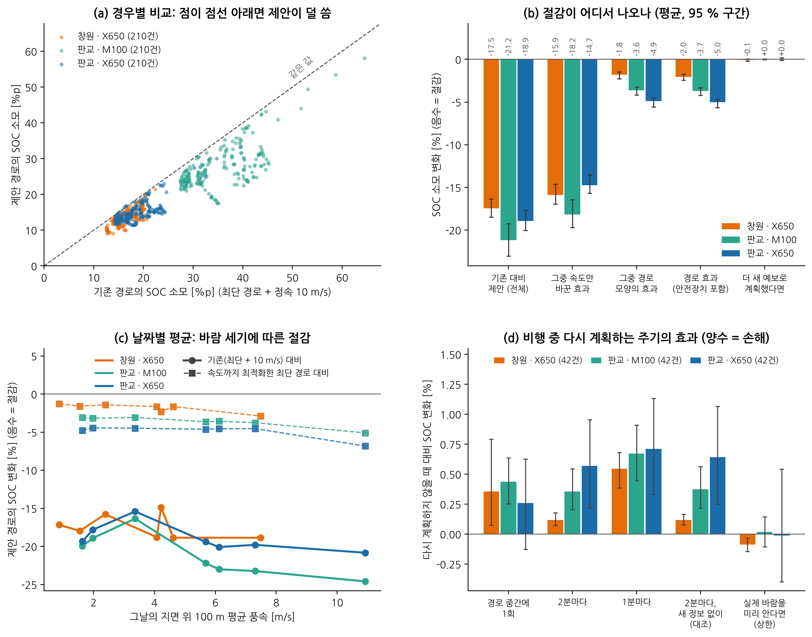
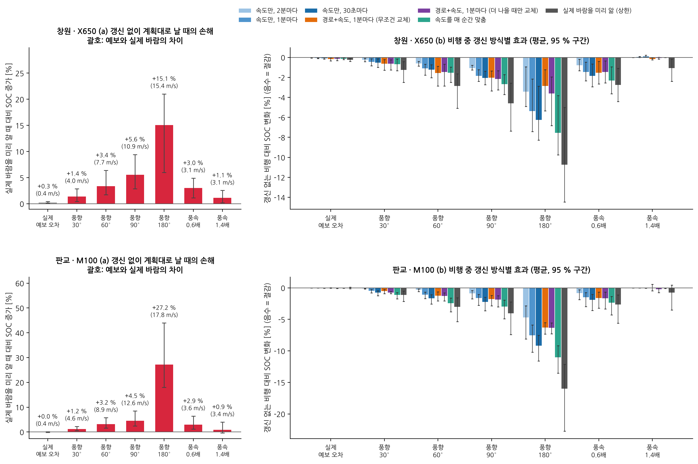

# 검토: 기존 경로 대비 우수성과 남은 점검 항목 (E13 · E14)

이 문서는 다음 목표에 비추어 지금까지의 결과를 점검한 것입니다.

> SoC를 목적으로 바람·지형·장애물을 고려하고, 국토 정보와 기상 정보를 주기적으로(몇 분마다 또는 경로 중간에) 받아 경로를 갱신하는 알고리즘이 **기존 경로보다 효율이 좋다**는 것을 보인다.

이전 결과는 판교 한 날짜·한 왕복 경로의 사례였습니다. 사례 하나로는 "더 우수하다"를 주장할 수 없으므로, 7일 × 2개 지역 × 2개 기체 × 630건으로 넓혀 다시 쟀습니다(E13). 이어서 기상 정보 갱신 주기를 설계 변수로 두고 효과를 쟀습니다(E14).

## 1. 결론 먼저

| 질문 | 답 | 근거 |
|---|---|---|
| 제안 경로가 기존 경로보다 SOC를 덜 쓰는가 | **예.** 평균 17.5–21.2 % 덜 씁니다 (630건 중 626건에서 우수). | E13, 표 2 |
| 그 절감은 어디서 나오는가 | 대부분 **속도 선택**입니다(14.7–18.2 %). 경로 모양의 몫은 1.8–4.9 %입니다. | E13, 표 3 |
| 기상 정보를 주기적으로 받아 갱신하면 더 좋아지는가 | **예보가 맞을 때는 아닙니다(0.0–0.3 %). 예보가 틀릴 때는 예**이고, 이득은 경로가 아니라 속도 갱신에서 나옵니다. | E13 표 4, E14 표 6 |
| 갱신 주기는 얼마가 좋은가 | 3–5분 비행에서는 **30초 이하**입니다. 틀린 예보로 생긴 손해를 2분 주기는 12–35 %, 30초 주기는 42–73 % 되찾습니다. | E14 표 6 |
| 경로를 비행 중에 다시 짜야 하는가 | 바람 때문이라면 아닙니다. **장애물·금지구역이 바뀔 때** 다시 짭니다. | E9, E14 |

가장 중요한 점검 항목은 세 가지입니다.

1. **"기존 경로"의 정의를 먼저 확정해야 합니다.** 기준이 '최단 경로 + 정속 10 m/s'면 절감이 약 18 %이고, '최단 경로 + 속도 최적화'면 2–5 %입니다.
2. **절감의 대부분이 기체 전력 곡선의 가정에 달려 있습니다.** X650의 항력 면적(CdA)을 0.08 m²로 가정했는데, 이 값이 0.16 m²이면 속도 선택의 이득이 22 %에서 7 %로 줄어듭니다(표 5). 실비행 속도 시험으로 보정해야 합니다.
3. **주기 갱신의 효율 이득을 보이려면 예보가 실제 바람과 얼마나 다른지부터 재야 합니다.** 지금은 평가용 바람도 예보(6시간 뒤 발표분)라서 차이가 0.4 m/s뿐입니다. 차이가 4 m/s 이상이어야 되찾을 손해가 1 %를 넘습니다(표 6). 실증 지역의 실측 바람이 필요합니다 `[자료필요: 비행 고도의 실측 바람과 예보의 차이]`.

## 2. 비교 방법 (E13)

| 항목 | 내용 |
|---|---|
| 지역 | 판교(6.2 × 5.5 km), 창원 창이대로 71 주변(4.4 × 4.0 km) |
| 기체 | Holybro X650(전력 모델은 제원 기반 추정), DJI M100(CMU 실측으로 보정) |
| 날짜 | 2026-10-01, 02, 12, 19, 27, 29, 31 (지면 위 100 m 평균 풍속 0.5–11.6 m/s) |
| 경우 | 날짜 7 × 출발 시각 3(15·17·19시) × 출발·도착 쌍 10 = 지역·기체 조합마다 210건, 모두 630건 |
| 비행 거리 | 1.5–2.8 km (평균 2.0 km), 탑재 1.0 kg |
| 계획에 쓴 바람 | 그날 00Z 발표 GFS 예보 |
| 평가에 쓴 바람 | 6시간 뒤 06Z 발표 예보 (계획 때는 모르는 값으로 취급) |
| 통계 | 평균과 95 % 구간(같은 날의 경우들은 바람이 같으므로 날짜 단위로 다시 뽑는 부트스트랩), 날짜 평균 7개에 대한 Wilcoxon 부호순위 검정 |

비교한 방식은 다음과 같습니다.

| 기호 | 경로 | 속도 | 뜻 |
|---|---|---|---|
| EX | 최단 경로 | 정속 10 m/s | **기존 경로.** ArduCopter의 기본 수평 속도(`WP_SPD`)가 10 m/s입니다. |
| EXv | 최단 경로 | 구간별 최적화 | 기존 경로에 속도 최적화만 더한 것 (경로 모양의 몫을 가르는 대조) |
| P0 | 에너지 탐색(WE-LT\*) | 구간별 최적화 | **제안 경로** |
| P0s | P0와 EXv 중 예보 기준 에너지가 적은 쪽 | 구간별 최적화 | 제안 + 안전장치 |
| PO | 에너지 탐색, 평가용 바람을 미리 앎 | 구간별 최적화 | 더 새 예보로 계획했을 때의 상한 |

최단 경로에 기체의 하강률로는 못 나는 급경사 구간이 있으면, 수평으로 간 뒤 수직으로 내려가도록 고쳐서 비교했습니다(`make_flyable`). 고치기 전에는 한 쌍(21건)이 비행 불가였습니다.

## 3. 결과: 기존 경로 대비 우수성



**표 2. 기존 경로(EX) → 제안 경로(P0)의 SOC 소모 변화**

| 조합 | 기존 SOC 소모 | 제안 SOC 소모 | 변화 (95 % 구간) | 제안이 우수한 경우 | 가장 나쁜 경우 | 비행 시간 |
|---|---|---|---|---|---|---|
| 창원 · X650 | 16.6 %p | 13.7 %p | **−17.5 %** (−18.5, −16.3) | 210/210 | −1.2 % | −22.7 % |
| 판교 · X650 | 18.6 %p | 15.0 %p | **−18.9 %** (−20.0, −17.6) | 206/210 | +2.0 % | −21.8 % |
| 판교 · M100 | 35.1 %p | 27.5 %p | **−21.2 %** (−23.0, −19.2) | 210/210 | −2.1 % | −28.8 % |

- 세 조합 모두 7일의 날짜 평균이 전부 절감 방향이었습니다. 날짜 평균에 대한 Wilcoxon 검정은 p = 0.016입니다. 날짜가 7개일 때 나올 수 있는 가장 작은 값이므로, 더 강한 통계 주장을 하려면 날짜를 늘려야 합니다.
- 절감은 바람이 약한 날에도 나왔습니다(창원, 풍속 0.9 m/s인 날 −17.2 %). 바람이 셀수록 커지는 경향은 M100에서만 뚜렷했습니다(−16.4 % → −24.6 %).

**표 3. 절감의 분해**

| 조합 | 속도만 바꾼 효과 (EX → EXv) | 경로 모양의 효과 (EXv → P0) | 경로가 더 나빴던 경우 | 안전장치를 넣으면 (EXv → P0s) |
|---|---|---|---|---|
| 창원 · X650 | −15.9 % | −1.8 % (−2.3, −1.5) | 16 %, 최악 +8.0 % | −2.0 %, 나쁜 경우 1 %, 최악 +0.1 % |
| 판교 · X650 | −14.7 % | −4.9 % (−5.5, −4.5) | 19 %, 최악 +2.3 % | −5.0 %, 나쁜 경우 1 %, 최악 +0.2 % |
| 판교 · M100 | −18.2 % | −3.6 % (−4.2, −3.2) | 15 %, 최악 +3.7 % | −3.7 %, 나쁜 경우 0 %, 최악 0.0 % |

- **절감의 대부분은 속도 선택에서 나옵니다.** 10 m/s는 두 기체 모두 미터당 에너지가 가장 적은 속도(모델 기준 15 m/s 부근)보다 느립니다.
- **경로 모양의 몫은 1.8–4.9 %입니다.** 중앙값은 0.3–2.1 %로 더 작습니다. 일부 경우(바람이 세고 지형·건물을 넘는 경로)에서 크게 줄고(최대 −23 %), 다수에서는 거의 같습니다.
- 이전에 보고한 판교 M100 사례(경로 기여 약 11 %)는 이 분포의 유리한 쪽에 있는 경우였습니다. 같은 날(10월 27일)의 평균은 −5.1 %입니다.
- **에너지 탐색이 최단 경로보다 나쁜 경로를 낸 경우가 15–19 % 있었습니다.** 탐색이 근사 해법이기 때문입니다. 최단 경로도 후보에 넣어 예보 기준으로 더 나은 쪽을 고르면(`plan_best_of_two`) 이 경우가 1 % 이하로 줄고, 가장 나쁜 경우도 +0.2 % 이내가 됩니다. 630건 중 132건에서 최단 경로가 선택됐습니다.

**표 5. 속도 선택 이득이 전력 모델 가정에 얼마나 민감한가** (X650, 탑재 1.0 kg, 무풍 수평 비행, 10 m/s 대비 최적 속도의 미터당 에너지)

| 가정 | 최적 속도 | 10 m/s 대비 |
|---|---|---|
| CdA 0.04 m² | 15.0 m/s (상한) | −35.0 % |
| **CdA 0.08 m² (현재 가정)** | 15.0 m/s (상한) | **−22.2 %** |
| CdA 0.12 m² | 13.5 m/s | −12.5 % |
| CdA 0.16 m² | 12.5 m/s | −6.6 % |
| CdA 0.24 m² | 11.0 m/s | −1.0 % |
| 최대 대기속도 12 m/s (CdA 0.08) | 12.0 m/s (상한) | −15.2 % |
| 무탑재 호버 시간 24–36분 | 15.0 m/s | −22.1 – −22.2 % |
| 블레이드 형상 전력 15–60 W | 15.0 m/s | −21.8 – −22.8 % |

- 이득은 **항력 면적과 최대 대기속도**에 좌우되고, 호버 시간과 형상 전력에는 거의 무관합니다. X650의 CdA는 실측값이 없습니다 `[확인요망: X650 전진 비행 전력 실측]`.
- M100 모델은 CMU 실측으로 보정했지만 실측 속도 범위가 4–12 m/s입니다. 12 m/s까지는 평균 전력이 거의 일정해(4 m/s 421 W, 12 m/s 400 W) 빠를수록 미터당 에너지가 줄어든다는 점이 실측으로 확인됩니다. 12 m/s를 넘는 구간(모델상 10 → 12 m/s −13 %, 12 → 15.5 m/s 추가 −5 %)은 외삽입니다.

## 4. 결과: 기상 정보를 주기적으로 받아 다시 계획하면

**표 4. 다시 계획하지 않을 때 대비 SOC 변화** (E13, 조합마다 42건. 양수 = 손해. 기체가 잰 바람으로 예보를 보정한 뒤 남은 경로를 다시 계획)

| 조합 | 경로 중간 1회 | 2분마다 | 1분마다 | 실제 바람을 미리 안다면 (상한) |
|---|---|---|---|---|
| 창원 · X650 | +0.35 % | +0.12 % | +0.54 % | −0.09 % |
| 판교 · X650 | +0.26 % | +0.57 % | +0.71 % | −0.01 % |
| 판교 · M100 | +0.44 % | +0.36 % | +0.67 % | +0.02 % |

- **얻을 수 있는 최대치가 0에 가깝습니다.** 실제 바람을 미리 알고 계획해도 −0.1 % 이내입니다. 00Z 예보와 06Z 예보의 바람 차이가 0.1–0.7 m/s뿐이기 때문입니다.
- **다시 계획할수록 조금씩 나빠집니다.** 새 바람 정보 없이 다시 계획만 해도 같은 크기로 나빠졌으므로(2분마다, 대조 +0.12 / +0.64 / +0.37 %), 원인은 바람 정보가 아니라 다시 계획하는 행위입니다. 격자점에서 다시 출발하면서 경로가 꺾입니다.
- 5분 주기는 비행이 3–5분에 끝나 갱신이 한 번도 일어나지 않았습니다.

### 4.1 속도 명령을 계획대로 고정해 날 때 (E14)

표 4의 평가는 기체가 실제 바람에 맞춰 속도를 매 순간 다시 고른다고 가정했습니다. 실제 미션 파일은 구간 대지속도를 계획 때 정해 내려보냅니다(`DO_CHANGE_SPEED`). 이 가정을 풀고, 갱신 방식과 주기를 설계 변수로 두어 다시 쟀습니다.

| 기호 | 방식 |
|---|---|
| 고정 | 출발 전 예보로 경로와 구간 속도를 정하고 끝까지 그대로 비행 (기준) |
| 속도만 Δ | 경로는 그대로 두고, Δ마다 기체가 잰 바람으로 예보를 보정해 남은 구간의 속도만 다시 정함 |
| 경로+속도 Δ | Δ마다 남은 경로와 속도를 모두 다시 계획 (새 경로를 무조건 채택) |
| 더 나을 때만 Δ | 위와 같되, 새 경로의 예상 에너지가 지금 경로보다 1 % 넘게 적을 때만 교체 |
| 매 순간 | 속도를 매 순간 실제 바람에 맞춤 (Δ → 0의 극한) |
| 상한 | 실제 바람을 미리 알고 계획 |

예보 오차는 두 가지로 줬습니다. '실제'는 00Z 예보로 계획하고 06Z 예보에서 비행한 것(7일, 84건)이고, 나머지는 예보의 풍향을 돌리거나 풍속 배율을 바꾼 것을 실제 바람으로 둔 것입니다(3일, 경우마다 18건). 비행 시간은 평균 3.2–4.5분이고, 갱신 횟수는 2분 주기 0.8–0.9회, 1분 주기 2.1–2.2회, 30초 주기 4.5–5.0회입니다.



**표 6. 고정 비행 대비 SOC 변화 [%]** (음수 = 절감. '손해'는 고정 비행이 상한보다 더 쓴 비율과 95 % 구간)

창원 · X650

| 예보 오차 | 바람 차이 | 고정의 손해 | 속도만 2분 | 속도만 1분 | 속도만 30초 | 경로+속도 1분 | 더 나을 때만 1분 | 매 순간 | 상한 |
|---|---|---|---|---|---|---|---|---|---|
| 실제 (00Z ↔ 06Z) | 0.4 m/s | +0.3 (+0.1, +0.4) | −0.0 | −0.1 | −0.1 | −0.2 | −0.2 | −0.1 | −0.2 |
| 풍향 30° | 4.0 m/s | +1.4 (+0.4, +2.9) | −0.2 | −0.4 | −0.5 | −0.6 | −0.6 | −0.7 | −1.2 |
| 풍향 60° | 7.7 m/s | +3.4 (+1.7, +6.4) | −0.6 | −1.1 | −1.2 | −1.6 | −1.5 | −1.5 | −2.8 |
| 풍향 90° | 10.9 m/s | +5.6 (+2.9, +9.4) | −1.1 | −1.8 | −2.1 | −2.0 | −2.2 | −2.7 | −4.6 |
| 풍향 180° | 15.4 m/s | +15.1 (+6.0, +21.0) | −3.4 | −5.4 | −6.3 | −2.9 | −3.6 | −7.6 | −10.7 |
| 풍속 0.6배 | 3.1 m/s | +3.0 (+1.1, +4.9) | −0.8 | −1.5 | −1.8 | −1.5 | −1.5 | −2.3 | −2.8 |
| 풍속 1.4배 | 3.1 m/s | +1.1 (+0.2, +2.5) | −0.0 | +0.0 | +0.1 | −0.2 | −0.0 | +0.0 | −1.1 |

판교 · M100

| 예보 오차 | 바람 차이 | 고정의 손해 | 속도만 2분 | 속도만 1분 | 속도만 30초 | 경로+속도 1분 | 더 나을 때만 1분 | 매 순간 | 상한 |
|---|---|---|---|---|---|---|---|---|---|
| 실제 (00Z ↔ 06Z) | 0.4 m/s | +0.0 (−0.1, +0.1) | −0.0 | −0.0 | −0.0 | −0.0 | −0.0 | −0.0 | +0.0 |
| 풍향 30° | 4.6 m/s | +1.2 (+0.6, +2.3) | −0.1 | −0.5 | −0.7 | −0.5 | −0.7 | −1.1 | −1.1 |
| 풍향 60° | 8.9 m/s | +3.2 (+1.6, +5.8) | −0.3 | −1.1 | −1.7 | −1.3 | −1.3 | −2.5 | −3.0 |
| 풍향 90° | 12.6 m/s | +4.5 (+2.4, +8.5) | −0.9 | −1.6 | −2.2 | −1.8 | −1.9 | −3.0 | −4.1 |
| 풍향 180° | 17.8 m/s | +27.2 (+18.0, +44.0) | −4.7 | −7.5 | −9.2 | −6.3 | −6.3 | −11.0 | −16.0 |
| 풍속 0.6배 | 3.6 m/s | +2.9 (+1.2, +6.4) | −0.8 | −1.5 | −1.9 | −1.6 | −1.6 | −2.3 | −2.6 |
| 풍속 1.4배 (16건) | 3.4 m/s | +0.9 (−0.4, +4.0) | −0.0 | −0.0 | −0.0 | −0.0 | −0.2 | −0.1 | −0.8 |

읽는 법은 다음과 같습니다.

- **갱신의 가치는 예보가 얼마나 틀리느냐에 달려 있습니다.** 실제 예보 오차(0.4 m/s)에서는 되찾을 손해가 0.0–0.3 %뿐입니다. 바람 차이가 4 m/s를 넘으면 손해가 1 % 이상, 8–13 m/s면 3–6 %가 됩니다.
- **주기가 짧을수록 더 되찾습니다.** 예보가 틀린 경우(풍향 30–180°, 풍속 0.6배)에 되찾은 비율은 2분 주기 12–35 %, 1분 주기 36–58 %, 30초 주기 42–73 %, 매 순간 52–97 %입니다. "몇 분" 주기는 3–5분 비행에서 한 번 갱신하는 데 그쳐 효과가 작습니다.
- **효과의 대부분은 속도 갱신에서 나옵니다.** 같은 1분 주기에서 경로까지 바꿔도 속도만 바꾼 것보다 0.0–0.5 %p 더 줄 뿐이고, 풍향이 반대인 경우에는 오히려 덜 줄었습니다(창원 −2.9 % 대 −5.4 %).
- **'더 나을 때만 교체'는 무조건 교체와 거의 같습니다(차이 0.2 %p 이내).** 갱신 316회 중 38회만 경로를 바꿨습니다(판교 M100, 1분 주기). 풍향이 반대인 경우에만 창원에서 0.7 %p 나았고(−3.6 % 대 −2.9 %), 그래도 속도만 바꾼 것(−5.4 %)에 못 미쳤습니다.
- 실제 풍속이 예보의 1.4배인 경우 갱신으로는 되찾지 못했습니다. 판교 M100에서는 18건 중 2건이 어떤 갱신 방식으로도 비행할 수 없었습니다(평균 풍속 16.7 m/s, 기체 최대 대기속도 17 m/s). 이 경우는 효율이 아니라 **출발 여부 판단**의 문제입니다.
- 예보를 일부러 틀리게 한 경우는 3일·18건씩이라 구간이 넓습니다. 크기의 순서를 보는 용도입니다.

표 4와 표 6이 다르게 보이는 이유는 평가 가정입니다. 표 4는 속도를 매 순간 맞춘다고 가정했으므로 갱신으로 더 얻을 것이 없었고, 표 6은 속도 명령을 고정했으므로 갱신할 것이 남아 있습니다. 두 결과를 합치면 **"바람 정보 갱신의 효율 이득은 경로가 아니라 속도에서 나온다"**가 됩니다.


## 5. 최적 설계 문제로 정리하면

| 구분 | 내용 | 지금 상태 |
|---|---|---|
| 목적 | 도착 SOC 최대화 (= 임무 SOC 소모 최소화) | 구현 |
| 결정 변수 | 수평 경로, 고도, 구간 대지속도, 호버 대기 | 구현 (WE-LT\*, 시공간 탐색) |
| 설계 변수 | 정보 갱신 주기 Δ, 경로 교체 기준(이득 한계), 갱신할 대상(속도만 / 경로까지) | E14에서 처음 다룸 (Δ = 30·60·120초, 한계 1 %) |
| 제약 | 지형·건물 이격, 정적·동적 장애물, 금지구역, 대기속도·상승률 한계, SOC 예비 | 구현 |
| 입력 (국토) | 지형, 건물, 금지구역 | 지형 Copernicus DSM 30 m, 건물 Overture. 국내 공식 자료는 미연동 |
| 입력 (기상) | 고도별 바람의 예보와 실황 | GFS 0.25° 1시간. 국내 고해상도 자료는 미연동 |
| 비교 기준 | 기존 경로 | **확정 필요** (1절 1번) |

설계 변수의 선택은 4절의 결과로 다음과 같이 권합니다.

- **경로:** 출발 전에 한 번 계획하고, 최단 경로를 후보에 넣는 안전장치를 켭니다.
- **속도:** 기체가 잰 바람으로 예보를 보정해 남은 구간의 대지속도를 **30초 이하 주기**로 다시 내려보냅니다. 탑재 컴퓨터가 없으면 지상국에서 같은 주기로 보냅니다. 2분 주기는 3–5분 비행에서 효과가 작습니다.
- **경로 교체:** 바람 때문에는 바꾸지 않는 것을 기본으로 합니다. 바꾼다면 예상 에너지가 한계(1 %) 넘게 줄 때만 바꿉니다. 장애물·금지구역이 바뀌면 주기와 무관하게 즉시 다시 계획합니다(E9).
- **출발 판단:** 실제 풍속이 예보보다 크게 세면 갱신으로 해결되지 않습니다. 이륙 직후 잰 바람으로 임무 가능 여부를 다시 확인하는 절차가 필요합니다.

## 6. 추가로 검토해야 할 항목

우선순위는 "기존 경로보다 우수하다"는 주장에 미치는 영향이 큰 순서입니다.

| 순위 | 항목 | 왜 필요한가 | 필요한 것 |
|---|---|---|---|
| 1 | **기존 경로의 정의 확정** | 기준에 따라 주장 크기가 18 %와 2–5 %로 갈립니다. | 과제 계획서의 비교 대상 확인. 두 기준을 모두 보고하는 것을 권합니다. |
| 2 | **X650 전력 곡선 보정** | 절감의 대부분이 속도 선택이고, 그 크기가 CdA 가정에 좌우됩니다(표 5). | 정속 수평 비행 5–15 m/s, 탑재 0·1·2 kg의 전력 로그 (`BATTERY_STATUS`, `ESC_TELEMETRY`) |
| 3 | **실비행 비교 시험** | 지금 결과는 모두 시뮬레이션입니다. | 7절의 짝지은 비행 |
| 4 | **실측 바람과 예보의 차이 측정, 고해상도 기상 자료 연동** | 갱신의 이득은 예보 오차에 비례합니다(표 6). 지금은 오차를 가정으로만 줬습니다. | 실증 지역의 비행 고도 바람 실측, 아래 6.1 |
| 5 | **더 긴 임무에서 재평가** | 1.5–2.8 km·3–5분 비행에서는 "몇 분 주기"가 한두 번뿐입니다. | 10 km 이상 경로 또는 다중 배송 순회, 더 넓은 지도 |
| 6 | **국토 정보의 공식 자료 연동과 갱신** | 건물·지형이 해외 공개 자료이고, 금지구역은 수동 입력입니다. | 아래 6.2 |
| 7 | **실시간 플랫폼의 바람·속도 갱신** | 실시간 화면(`/live`)은 장애물만 갱신하고 바람은 출발 전 값을 씁니다. E14의 속도 갱신은 실험 코드에만 있습니다. | 기체 바람 추정(`WIND`, `EK3_DRAG_BCOEF_X/Y` 설정 필요)과 예보 보정 연결, 30초 주기 속도 명령, 미션 파일의 속도 구간 갱신 |
| 8 | **모델에 없는 손실** | 선회·가감속 에너지, 배터리 전압 강하·온도, 돌풍, 수직 20 m 격자. 꺾임이 많은 경로가 실제로는 더 불리할 수 있습니다. | 2번 시험 로그로 크기 확인 후 필요하면 꺾임 비용 추가 |
| 9 | **계절·지역 확장** | 10월 7일, 2개 지역뿐입니다. | 계절별 날짜, 산지·해안 지역 |
| 10 | **공역·규정** | 고도 상한(지면 위 150 m), 관제권, 비가시권 승인 조건을 경로 제약으로 확인하지 않았습니다. | 실증 지역의 공역 자료 `[확인요망]` |

### 6.1 기상 정보

| 자료 | 해상도 | 갱신 | 용도 | 상태 |
|---|---|---|---|---|
| GFS (현재 사용) | 0.25° (약 25 km), 1시간 | 하루 4회 | 넓은 영역의 고도별 바람 | 사용 중 |
| 기상청 국지예보모델 (LDAPS) | 1.5 km, 70층 | 하루 4회, 36–48시간 예측 | 지형에 따른 바람 차이 | 미연동 `[확인요망: 등압면·고도별 바람 제공 형식]` |
| 기상청 초단기예보 | 읍·면·동 격자 | 매시 30분 발표, 6시간 이내 | 지상 풍속·풍향의 잦은 갱신 | 미연동 `[확인요망: 격자 간격과 실황 발표 주기]` |
| 지상 관측(AWS), 기체가 잰 바람 | 지점 | 분 단위 | 예보 보정 | 기체 바람 보정은 실험에 구현, 플랫폼에는 미연동 |

- 이 환경에서는 기상청 API에 접속할 수 없어 실제 자료로 시험하지 못했습니다.
- 주기 갱신의 효율 이득을 보이려면, **예보와 실제 바람이 얼마나 다른지**를 알아야 합니다. GFS에 없는 지형·건물 주변의 국지 바람이 그 차이의 후보입니다. E14는 기체가 잰 한 지점의 차이를 영역 전체에 더하는 단순 보정을 썼습니다. 국지 바람에는 더 나은 보정이 필요할 수 있습니다.

### 6.2 국토 정보

| 자료 | 현재 | 국내 공식 자료 후보 | 갱신의 의미 |
|---|---|---|---|
| 지형 | Copernicus DSM 30 m | 국토지리정보원 수치표고모델 | 거의 고정 (출발 전 1회) |
| 건물 | Overture | 브이월드 3차원 건물 (오픈 API 제공) | 신축·크레인 등은 수시 |
| 금지구역·공역 | 화면에서 수동 입력 | 드론 원스톱의 공역 정보 `[확인요망: 공개 API 유무]` | 임시 비행 제한은 수시 |
| 다른 항공기 | ADS-B 실측 오차 모형 (E11) | 실증 시 감시 수단 | 초 단위 |

- 국토 정보의 갱신은 효율이 아니라 **비행 가능 여부와 안전**을 바꿉니다. 이 부분은 장애물 변경 시 재계획(E9), 불확실성 튜브(E10·E11), 실시간 플랫폼으로 이미 다뤘습니다.

## 7. 실비행으로 보이려면

CMU의 M100 반복 비행에서 같은 조건의 에너지 변동계수는 약 2.6 %였습니다. 이 값을 쓰면, 기존 경로와 제안 경로를 **같은 날 번갈아 나는 짝지은 비교**에서 검정력 80 %(양측 5 %)에 필요한 짝의 수는 다음과 같습니다.

| 보이려는 차이 | 변동계수 2.6 % | 변동계수 5 % (보수적) |
|---|---|---|
| 5 % | 7쌍 | 18쌍 |
| 10 % | 4쌍 | 7쌍 |

- 기존 대비 18 % 차이는 4쌍 안팎으로 보일 수 있습니다. 경로 모양만의 차이(2–5 %)는 18쌍 이상이 필요하고, 바람이 센 날을 골라야 합니다.
- X650의 반복 비행 변동은 모릅니다 `[자료필요: X650 반복 비행 에너지 변동]`. 첫 시험일에 같은 경로를 5회 이상 반복해 먼저 재야 합니다.

## 8. 재현

```bash
PYTHONPATH=src python scripts/fetch_gfs_days.py                       # 7일 GFS 예보 (두 지역)
PYTHONPATH=src python scripts/exp_superiority.py run changwon x650     # E13 (조합마다 약 25분)
PYTHONPATH=src python scripts/exp_superiority.py run pangyo x650
PYTHONPATH=src python scripts/exp_superiority.py run pangyo m100
PYTHONPATH=src python scripts/exp_superiority.py safeguard changwon x650   # 안전장치 (조합마다)
PYTHONPATH=src python scripts/exp_superiority.py runerr changwon x650      # 예보를 일부러 틀리게
PYTHONPATH=src python scripts/exp_superiority.py analyze                   # results/E13_stats.json, F28
PYTHONPATH=src python scripts/exp_update_period.py run changwon x650       # E14
PYTHONPATH=src python scripts/exp_update_period.py run pangyo m100         # 약 40분
PYTHONPATH=src python scripts/exp_update_period.py analyze                 # results/E14_stats.json, F29
PYTHONPATH=src python -m pytest -q tests/test_superiority.py
```

## 9. 이 검토의 한계

- 모든 수치는 시뮬레이션입니다. 평가용 "실제 바람"도 6시간 뒤의 예보이지 관측이 아닙니다. 실제 바람은 예보보다 더 다를 수 있고, 그만큼 갱신의 가치는 여기서 잰 것보다 클 수 있습니다.
- X650 전력 모델은 추정입니다. 표 2의 X650 수치는 표 5의 범위만큼 달라질 수 있습니다.
- 기존 경로를 '최단 + 정속 10 m/s'로 둔 것은 ArduCopter 기본값에 근거한 가정입니다. 실제 운용 속도가 다르면 수치가 달라집니다.
- 날짜 7개는 검정의 최소 수준입니다.

## 출처

- 기상청 국지예보모델 제원(1.5 km, 70층, 하루 4회): <https://www.kma.go.kr/super/model-manage.jsp>
- 기상청 초단기예보(매시 30분 발표, 6시간 이내): <https://www.data.go.kr/data/15043492/fileData.do>, <https://www.data.go.kr/data/15084084/openapi.do>
- 브이월드 3차원 건물·오픈 API: <https://smartcity.go.kr/2025/01/15/16일부터-브이월드v-world-3단계-서비스-시작/>
