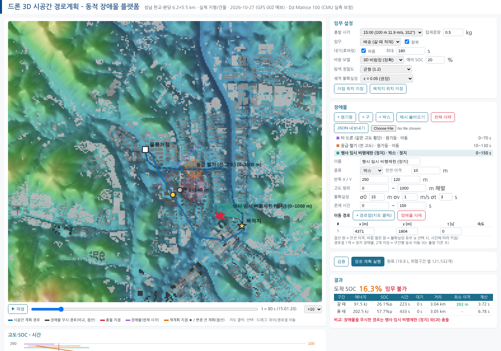
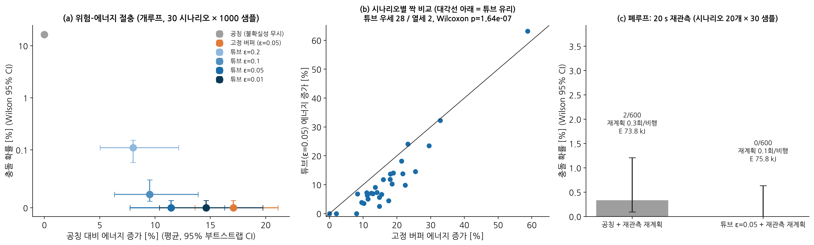
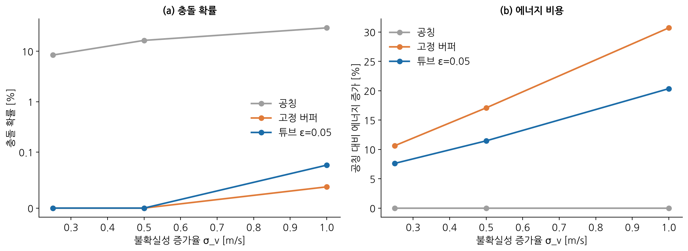
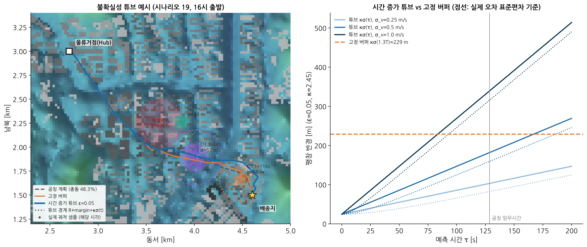
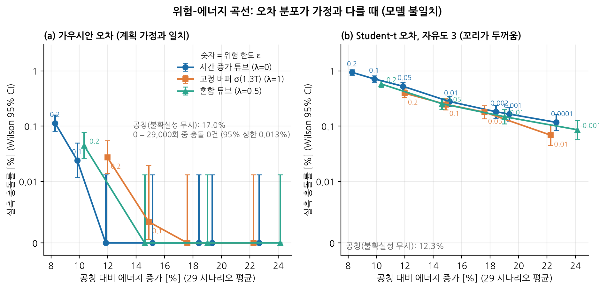

# 장애물 궤적 불확실성을 고려한 위험 한도(ε) 강건 경로계획

> 코드: `src/dpo/obstacles.py` (`build_interval_table(eps=…)`, `risk_kappa`, `_quad_le0`),
> `src/dpo/robust_eval.py` (시나리오·몬테카를로), `scripts/run_experiments.py` (E10, E10b),
> `scripts/analyze_robust.py` (통계·그림) · 결과: `results/robust_stats.json`, 그림 F16–F18
> 논문 자료: `docs/paper/manuscript_en.md`, `docs/paper/논문화_가이드.md`

## 1. 문제

지금까지의 시공간 계획(WE-SIPP-Theta*)은 장애물의 **예측 궤적이 정확하다**고 가정했습니다. 실제로는 관측 오차와 속도 추정 오차가 있고, 예측 시간이 길수록 위치 오차가 커집니다.

| 방법 | 처리 방식 | 문제 |
|---|---|---|
| 공칭 (N) | 예측 궤적 + 고정 안전 이격 | 오차가 이격보다 크면 충돌 (실험: 16.4 %) |
| 고정 버퍼 (B) | 예측 지평 끝의 최대 오차를 처음부터 적용 | 안전하지만, 가까운 미래에도 큰 반경을 적용해 우회가 큼 |
| **위험 한도 튜브 (R_ε)** | 오차가 **예측 시간에 따라 커지는** 튜브, 위험 한도 ε로 크기 결정 | – |

## 2. 불확실성 모델

장애물 j의 실제 위치(수평)는 다음과 같이 둡니다.

```
p_j(t) = p̂_j(t − δt_j) + e_j + δv_j · (t − t_obs)⁺
e_j ~ N(0, σ0² I),   δv_j ~ N(0, σ_v² I),   δt_j ~ N(0, σ_t²)
```

- σ0: 관측 시점의 위치 오차 [m]
- σ_v: 속도 추정 오차 [m/s]. 예측 시간이 길수록 위치 오차가 커지는 원인입니다.
- σ_t: 도달 시각 오차 [s]

축별 표준편차는 √(σ0² + σ_v²τ²) ≤ σ0 + σ_v τ 입니다. 계획기는 우변 상계 **σ(t) = σ0 + σ_v (t − t_obs)⁺** 를 쓰므로 보수적입니다.

## 3. 기회 제약 → 튜브 반경

2D 등방 가우시안 오차에서 ‖e‖ > κσ 일 확률은 exp(−κ²/2) 입니다. 따라서 다음이 성립합니다.

```
P(충돌 at t) ≤ ε   ⇐   ‖x(t) − p̂(t)‖ ≥ ρ(t) = R + margin + c_cell + κ_ε σ(t),   κ_ε = √(2 ln(1/ε))
```

| ε | 0.2 | 0.1 | 0.05 | 0.01 |
|---|---|---|---|---|
| κ_ε | 1.79 | 2.15 | 2.45 | 3.03 |

도달 시각 오차는 안전구간을 앞뒤로 z_{1−ε/2}·σ_t 만큼 넓혀(time dilation) 반영합니다.

## 4. 해석적 위험구간 (SIPP 안전구간표)

장애물이 등속 v로 움직이면, 격자 셀 중심 c에 대해 `|c − (p0 + v τ)| ≤ ρ0 + κσ_v τ` 를 제곱하면 τ에 대한 2차 부등식이 됩니다.

```
a τ² + b τ + c ≤ 0,   a = |v|² − (κσ_v)²,   b = −2 d·v − 2 ρ0 κσ_v,   c = |d|² − ρ0²
```

- **a > 0** (장애물 속도 > 튜브 팽창 속도): 두 근 사이의 **한 구간**이 위험합니다.
- **a < 0** (튜브가 장애물보다 빨리 커짐): 근의 **바깥 두 구간**이 위험합니다. 앞쪽 가장자리와 뒤쪽 가장자리가 차례로 셀을 덮기 때문입니다.
- **a ≈ 0**: 1차식으로 처리합니다.

표본 추출 없이 셀마다 정확한 위험구간을 만들고(`_quad_le0`), 기존 SIPP 탐색에 그대로 넣습니다. 박스형 장애물은 축별 1차 부등식(`_lin_box`)으로 계산합니다.

## 5. 사용법

```python
SP = STPlanner(site, drone)
SP.set_obstacles(obstacles, t_offset=t_dep, eps=0.05)       # 튜브 (권장)
SP.set_obstacles(obstacles, t_offset=t_dep, inflate_const=…) # 고정 버퍼 비교안
```

**플랫폼** (`python -m dpo.webapp`)
- '궤적 불확실성' 목록에서 ε를 선택합니다 (무시 / 0.2 / 0.1 / 0.05 / 0.01).
- 장애물마다 σ0·σv·σt를 입력하면, 지도에 시간에 따라 커지는 옅은 튜브가 표시됩니다.
- 비행 중 변경 발표 시 관측 시각(t_obs)이 발표 시각으로 갱신됩니다. 튜브가 다시 작아지는 것이 재관측의 효과입니다.

예: 예시 장애물에 σ0 = 15 m, σv = 1 m/s, σt = 3 s를 지정한 경우

| 설정 | 갈 때 에너지 | 최소 이격(예측 궤적 기준) |
|---|---|---|
| 무시 | 77.5 kJ | 32 m |
| ε = 0.05 | 91.5 kJ | 393 m |



## 6. 검증 (E10, E10b)

- **설정**: 실제 경로를 무작위로 가로지르는 직선 이동 장애물 3개(반경 40–150 m, 속도 8–30 m/s)로 시나리오 30개를 만들었습니다. 15–18시 GFS 바람, σ0 = 10 m, σ_v = 0.5 m/s, σ_t = 2 s입니다.
- **개루프**: 계획 경로 1개마다 실제 궤적 1,000개를 샘플링해 충돌을 판정합니다. 충돌은 장애물 물리 반경 + 드론 반경 0.5 m 기준이며 안전 이격은 제외합니다.
- **폐루프**: 20 s마다 실제 장애물을 재관측하고, 충돌이 예상될 때만 재계획합니다.

수치는 `results/robust_stats.json`에서 자동으로 읽습니다. 요약은 다음과 같습니다.

| 방법 | 충돌률 (95 % CI) | 공칭 대비 에너지 |
|---|---|---|
| 공칭 N | 16.4 % (16.0–16.9) | – |
| 고정 버퍼 B | 0 / 30,000 (≤ 0.013 %) | +17.1 % |
| 튜브 ε=0.1 | 0.023 % | +9.5 % |
| 튜브 ε=0.05 | 0 / 30,000 (≤ 0.013 %) | +11.5 % |
| 튜브 ε=0.01 | 0 / 30,000 | +14.6 % |

- **튜브(ε=0.05) vs 고정 버퍼**: 짝지은 비교에서 에너지 −4.9 % [−6.0, −3.7], 28승 2패, Wilcoxon p = 1.6×10⁻⁷.
- **σ_v 민감도**: 불확실성이 빨리 커질수록 이득이 커집니다(σ_v 0.25 / 0.5 / 1.0 → −2.5 / −4.9 / −7.2 %).
- **꼬리가 두꺼운 오차**(Student-t, 자유도 3, 같은 표준편차; E10c·E10d): 위 우위는 **가우시안 오차일 때만** 성립합니다.
  - 같은 위험 수준에서 튜브(ε=0.001)와 고정 버퍼(ε=0.05)의 에너지 차이는 유의하지 않습니다(+1.2 %, p = 0.27).
  - 가장 낮은 위험 영역에서는 고정 버퍼가 더 좋습니다.
  - 혼합 튜브 σ_λ(τ) = (1−λ)σ(τ) + λσ(T_h), λ=0.5는 두 방법 사이에 위치합니다(`blend_buffer`).
  - 원인: 꼬리가 두꺼우면 최적 팽창 반경이 σ에 덜 민감해집니다(거듭제곱 꼬리 α에서 r ∝ σ^(α/(α+1))). 그래서 고정 버퍼 쪽 모양이 유리해집니다. **실제 항적 데이터로 오차 꼬리를 추정해 팽창 모양을 정해야 합니다.**
- **폐루프**: 충돌 2/600 vs 0/600은 유의하지 않습니다. 재계획은 0.32 → 0.087회/비행(−73 %), 에너지는 +2.6 %입니다.






## 7. 해석과 한계

- **실측 충돌률은 ε보다 훨씬 작습니다.** 시점별 상계, σ 합 상계, 셀 반경 여유 때문입니다. ε는 '조절 손잡이'이며 임무 전체의 위험 확률이 아닙니다. 궤적 전체에 대한 위험 보정은 향후 과제입니다.
- **강건 계획은 시간을 이용합니다.** 이륙 지연이나 공중 대기로 튜브가 지나간 뒤에 통과해 우회 거리를 줄입니다(F18). 따라서 실제 실행에서도 계획된 대기를 지켜야 합니다.
- **불확실성 모델은 가우시안이고 장애물은 직선 등속입니다.** 실제 오차의 꼬리가 두꺼우면 튜브의 에너지 이득이 사라집니다(위 E10c). 실제 항적 데이터로 σ와 꼬리를 추정하는 것이 다음 과제입니다.

## 8. 실측 항적으로 오차 꼬리를 추정하고 팽창 모양을 맞추기

> 코드: `src/dpo/adsb_errors.py`, `scripts/analyze_adsb.py`, `scripts/run_e11.py`, `scripts/analyze_e11.py`
> 결과: `results/adsb_error_model.json`, `results/e11_stats.json`, 그림 F20, F21 · 데이터 출처: `data/raw/adsb/README.md`

### 8.1 데이터와 예측 오차
- **자료:** `traffic` 패키지(MIT)에 포함된 OpenSky Network ADS-B 실측 항적 샘플을 썼습니다.
  - 항공사 편명 제외, 기압고도 6,000 ft 이하, 10~75 m/s, **1 Hz로 기록된 항적만** 사용했습니다.
  - 그 결과 기체 18대(응급 헬기 REGA·SAMU 3편, 파리 일대 일반 항공·비즈니스기, 감시 비행)와 관측 3,186개(2 s 간격)가 남았습니다.
- **예측기:** 관측 순간 ADS-B가 보고한 속도로 등속 직선 외삽합니다. 계획기가 침입기 궤적을 예측하는 방식과 같습니다.
- **오차 정의:** 실제 위치에서 예측 위치를 뺀 값이며, 예측 시간 0~180 s에 대해 계산합니다.
- **전처리에서 발견한 문제:**
  - 5~30 s 간격 자료는 위치·시각 불일치가 커서 오차를 과대평가했습니다. 그래서 민감도 확인에만 썼습니다.
  - 일부 교정 비행은 ADS-B 보고 방위가 실제 이동 방향과 90° 넘게 어긋났습니다. 이 경우 위치 변화로 속도를 추정했습니다.
  - 갱신되지 않은 위치가 반복 보고되는 경우가 있어 제거했습니다.

### 8.2 꼬리와 성장 모양 (그림 F20)
| 지표 | 실측 | 가우시안 |
|---|---|---|
| 표준화 반경 중앙값 | 0.39 σ | 1.18 σ |
| 95 % 분위수 | 3.33 σ | 2.45 σ |
| 99 % 분위수 | 4.39 σ | 3.03 σ |
| 99.9 % 분위수 | **9.12 σ** | 3.72 σ |
| 축별 초과 첨도 | 12.3 | 0 |

- **꼬리 해석:** 대부분은 예측이 잘 맞고(직진), 선회할 때만 크게 빗나갑니다. 그래서 중심은 뾰족하고 꼬리는 두껍습니다.
  - 반경 상위 5 %의 Hill 지수는 α ≈ 5.1로, 거듭제곱 꼬리입니다.
  - 다만 극단값은 물리적으로 제한됩니다(최대 2Vτ).
- **성장 모양:** 속도로 정규화한 오차 분위수는 예측 시간에 대해 **τ^1.4~1.5**로 커집니다.
  - 선회가 쌓이면서 오차가 가속되기 때문입니다.
  - 따라서 가우시안 튜브가 가정한 '선형 증가'는 모양부터 맞지 않습니다.

### 8.3 팽창 모양 적합과 보정 검증
- **모델 형태:** 모든 모델은 속도로 정규화한 오차(단위 s)로 적합하고, 사용할 때 침입기 속도 V를 곱합니다. 속도 구간별로 따로 적합한 것보다 시험 보정이 좋았습니다.
- **G(ε):** 가우시안 튜브 V·κ_ε(s0 + s1τ)입니다. 축별 RMS에 선형으로 적합했습니다.
- **B(ε):** 가우시안 고정 버퍼입니다.
- **Q(ε):** **데이터 분위수 튜브** V·q_{1−ε}(τ)입니다. 꺾임점 0·5·10·20·30·45·60 s에서 구간별 선형이고, 단조 증가하도록 보정했습니다. `DynObstacle.tube`로 계획기에 그대로 넣을 수 있고, 위험구간은 해석해로 계산됩니다.
- **QB(ε):** 데이터 고정 버퍼입니다.
- **검증 방법:** 10분 블록(기체·시간) 단위로 2분할하는 것을 20회 반복했습니다. 학습에 쓰지 않은 블록에서 시점별 초과확률 P(‖e(τ)‖ > r(τ))를 τ = 5~60 s 평균으로 계산했습니다.

| ε | 가우시안 튜브 | 가우시안 버퍼 | **데이터 튜브** | 데이터 버퍼 |
|---|---|---|---|---|
| 0.05 | 7.5 % (최대 13.4 %) | 3.5 % | **5.1 % (최대 6.9 %)** | 1.0 % |
| 0.01 | 4.2 % (최대 8.1 %) | 1.7 % | **1.1 % (최대 2.0 %)** | 0.2 % |
| 평균 반경/V (ε=0.05) | 29 s | 54 s | 36 s | 75 s |

- **데이터 튜브:** 모든 예측 시간에서 목표 ε 부근을 유지합니다.
- **가우시안 튜브:** 짧은 예측(< 20 s)에서는 과하게 덮습니다. 긴 예측에서는 부족하게 덮으며, ε=0.01이면 실제 위험이 4배입니다.
- **고정 버퍼:** 반경이 1.5~2배라 보수적입니다.
