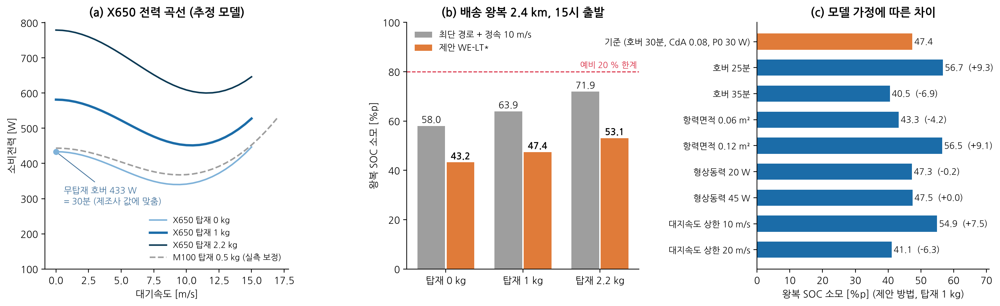
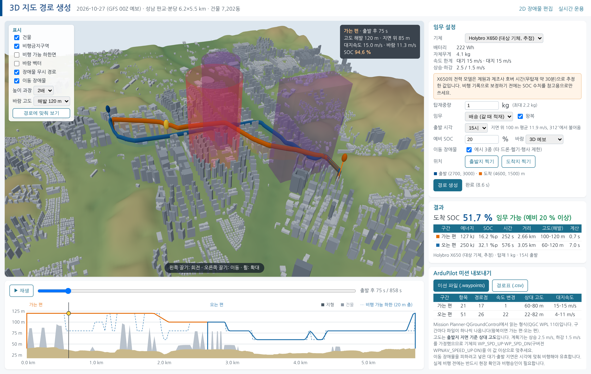

# 실증 대상 기체 Holybro X650 반영과 3D 지도 경로 생성

> 근거 데이터: `results/x650.json` · 그림 F26 · 미션 예 `results/missions/` · 화면 `results/figures/platform_3d.png`
> 재현: `PYTHONPATH=src python scripts/run_x650.py` · 플랫폼 `PYTHONPATH=src python -m dpo.webapp` → `http://127.0.0.1:8765/3d`
> 입력 문서: 「실증 드론 부품 구성표 — Holybro X650 (ArduPilot)」(xlsx), 「초경량비행장치 제원 및 성능표」(hwpx)

이 문서는 세 가지를 다룹니다. (1) 첨부된 대상 기체 제원을 계획기에 어떻게 넣었는가, (2) 3D 지도에서 경로를 만드는 화면, (3) 만든 경로를 대상 기체(ArduPilot)가 읽는 미션 파일로 내보내는 방법입니다.

| 항목 | 한 줄 요약 |
|---|---|
| 대상 기체 | Holybro X650, Pixhawk 6X + ArduCopter, 222 Wh, 자체무게 4.1 kg, 최대이륙중량 6.3 kg (탑재 최대 2.2 kg) |
| 전력 모델 | 비행 자료가 없어 **제원과 제조사 호버 시간(무탑재 약 30분)으로 추정**했습니다. 보정 전에는 참고용입니다. |
| 3D 지도 | 지형·건물·금지구역·바람·경로·이동 장애물을 3D로 보고, 지도에서 출발·도착을 찍어 경로를 만듭니다. |
| 미션 내보내기 | 계획 경로를 Mission Planner가 읽는 `.waypoints`(QGC WPL 110)와 경로표 CSV로 내보냅니다. |

---

## 1. 대상 기체 – 첨부 문서에서 읽은 제원

| 구분 | 내용 |
|---|---|
| 기체 | Holybro X650 (쿼드콥터, 휠베이스 650 mm) |
| 비행제어 | Holybro Pixhawk 6X + ArduCopter (MAVLink2, AUTO·RTL·Geofence) |
| 추진 | T-Motor MN4014 KV330 × 4 · Holybro Tekko32 F4 45A · 프로펠러 1555 카본 (15×5.5 in) |
| 전원 | Tattu LiPo 6S 10,000 mAh (22.2 V, 222 Wh) · Holybro PM02D (전압·전류) |
| 측위 | Holybro H-RTK F9P (u-blox ZED-F9P, RTK 8 Hz) |
| 통신·영상 | Skydroid H12 Pro / R12 PRO (2.4 GHz) · Skydroid C11 3축 짐벌 |
| 중량 | 자체무게 4.1 kg · 최대이륙중량 6.3 kg |
| 호버 시간 | 무탑재 약 30분 (제조사) |
| 대수 | 실증 기체 3대 동일 구성 |

- **두 문서의 무게가 다릅니다.** 부품 구성표는 프레임 자체무게를 "약 2.0 kg(배터리 제외)"로, 제원표는 자체무게를 4.1 kg으로 적었습니다. 계획기는 제원표의 4.1 kg을 **배터리와 탑재 장비를 포함한 무탑재 이륙 중량**으로 보았습니다 [확인요망: 실제 계량값].
- **탑재 한계는 2.2 kg으로 두었습니다**(최대이륙중량 − 자체무게). 제원표의 유상하중 칸은 비어 있습니다.

## 2. 전력 모델 – 무엇이 제원이고 무엇이 가정인가

전력 모델의 식은 M100과 같습니다(유도·형상·유해·상승 동력). 계수만 X650에 맞게 정했습니다.

| 계수 | 값 | 출처 |
|---|---|---|
| 무탑재 질량 | 4.1 kg | 제원표 |
| 회전면 면적 | 0.456 m² | 제원 (15 in 프로펠러 4개) |
| 배터리 에너지 | 222 Wh | 제원 |
| 상승률 / 하강률 | 2.5 / 1.5 m/s | ArduCopter 기본값 (WP_SPD_UP, WP_SPD_DN) |
| 종합 효율 η | 0.726 | **무탑재 호버 30분에 SOC 100 %p가 줄도록 맞춘 값** |
| 형상동력 P0 | 30 W | 가정: M100 보정값(68.6 W)을 회전면 면적비와 팁 속도비의 세제곱으로 환산 |
| 팁 속도 | 72 m/s | 가정: 추력계수 0.11로 구한 호버 회전수 약 3,600 rpm |
| 동체 항력면적 CdA | 0.08 m² | 가정 (M100 보정값 0.070 m²와 비슷한 크기) |
| 항전·탑재장비 | 10 W | 가정 |
| 대기속도 한계 / 대지속도 상한 | 15 / 15 m/s | 가정 (실증 운용 여유) |

이 모델이 내놓는 호버 전력과 최적 순항 조건입니다(무풍, 해수면 밀도).

| 탑재 | 총 질량 | 호버 전력 | 호버 시간 | 미터당 에너지 최소 속도 | 미터당 에너지 |
|---|---|---|---|---|---|
| 0 kg | 4.1 kg | 433 W | 30.0 분 | 13.5 m/s | 29.4 J/m |
| 1 kg | 5.1 kg | 581 W | 22.4 분 | 15.0 m/s | 35.2 J/m |
| 2.2 kg | 6.3 kg | 779 W | 16.7 분 | 15.0 m/s | 43.1 J/m |

**가정이 틀리면 결과가 얼마나 달라지는가** (같은 임무: 15시 출발, 탑재 1 kg, 제안 방법)

| 바꾼 가정 | η | 왕복 SOC 소모 | 기준 대비 |
|---|---|---|---|
| 기준 (호버 30분, CdA 0.08, P0 30 W) | 0.726 | 47.4 %p |  |
| 호버 25분 | 0.603 | 56.7 %p | +9.3 |
| 호버 35분 | 0.850 | 40.5 %p | -6.9 |
| 항력면적 0.06 m² | 0.726 | 43.3 %p | -4.2 |
| 항력면적 0.12 m² | 0.726 | 56.5 %p | +9.1 |
| 형상동력 20 W | 0.702 | 47.3 %p | -0.2 |
| 형상동력 45 W | 0.761 | 47.5 %p | +0.0 |
| 대지속도 상한 10 m/s | 0.726 | 54.9 %p | +7.5 |
| 대지속도 상한 20 m/s | 0.726 | 41.1 %p | -6.3 |

- **가정에 따라 왕복 SOC 소모가 40.5–56.7 %p 범위로 달라집니다.** 호버 시간과 항력면적 가정이 가장 크게 작용합니다(각각 최대 약 +9 %p).
- **따라서 아래 4장의 SOC 값은 보정 전 추정입니다.** 절댓값은 비행 기록으로 보정해야 합니다. 가정을 바꿨을 때 방법 사이의 순서가 유지되는지는 따로 확인하지 않았습니다.

**보정에 필요한 비행 기록** (Pixhawk 6X가 남기는 값으로 충분합니다)
- 전압·전류(PM02D → 로그 `BAT`), 대지속도·위치(RTK GNSS), 자세, 기압·온도
- 권장 시험: 탑재 0·1·2 kg에서 호버 2분씩, 정속 5·8·11·14 m/s 왕복 직선 비행(바람 방향과 나란히, 직각으로 각 1회)
- 이 기록이 있으면 M100 때와 같은 방법(`dpo.energy.calibrate`)으로 η·P0·CdA·항전 전력을 맞출 수 있습니다. 로그를 읽는 변환기는 아직 만들지 않았습니다.

## 3. X650에서 얻을 수 있는 조건 (MAVLink)

배경 문서 2장은 DJI SDK를 기준으로 조건을 걸렀습니다. 대상 기체는 ArduPilot이므로 같은 조건을 MAVLink 메시지로 다시 확인했습니다(메시지와 필드 이름은 `mavlink/mavlink`의 `common.xml`·`ardupilotmega.xml` 원문에서 확인).

| 조건 | X650에서 얻는 방법 | 비고 |
|---|---|---|
| **풍속·풍향** | `WIND` (direction, speed, speed_z) | 비행제어기가 추정한 값입니다. 멀티콥터는 `EK3_DRAG_BCOEF_X/Y`를 설정해야 추정이 켜집니다(기본값 0 = 꺼짐). 풍속계는 구성표에 없습니다. |
| 배터리 잔량·전압·전류 | `BATTERY_STATUS` (voltages, current_battery, current_consumed, energy_consumed, battery_remaining) | PM02D 전원 모듈이 전압·전류를 잽니다. |
| 위치·속도·자세 | `GLOBAL_POSITION_INT`, `GPS_RAW_INT`, `GPS_RTK`, `ATTITUDE`, `VFR_HUD` | H-RTK F9P (RTK 8 Hz) |
| 모터 | `ESC_TELEMETRY_1_TO_4` (rpm, current, voltage, temperature) | Tekko32(BLHeli32)의 텔레메트리 배선·설정이 되어 있어야 합니다 [확인요망] |
| 기압·온도 (공기밀도) | `SCALED_PRESSURE` (press_abs, temperature) | DJI에는 없던 값입니다. 온도는 센서 온도라 외기온과 다를 수 있습니다. |
| 주변 유인기 | `ADSB_VEHICLE` | ADS-B 수신기가 있어야 합니다. **구성표에 없습니다.** |
| 장애물 거리 | `DISTANCE_SENSOR`, `OBSTACLE_DISTANCE` | 근접 센서가 있어야 합니다. **구성표에 없습니다.** |
| 탑재중량 | 없음 | 주문 정보로 입력합니다. |

- **바람을 변인으로 두는 결론은 그대로입니다.** 기체가 주는 바람은 현재 위치의 추정값이고, 계획에는 예보 바람장이 필요합니다.
- **이 기체는 주변 비행체를 스스로 탐지하지 못합니다.** 동적 장애물 회피를 실증하려면 지상(GCS·UTM)에서 받은 정보를 플랫폼의 `/api/live/report`로 넣거나, ADS-B 수신기를 추가해야 합니다.
- **공기밀도는 DJI보다 유리합니다.** 기압과 온도를 직접 주므로 밀도를 계산할 수 있습니다.

## 4. 결과 – X650 (추정 모델)

조건: 성남 판교·분당 실제 지형·건물, 2026-10-27 GFS 바람(00Z로 계획, 06Z로 평가), 거점↔배송지 2.4 km 왕복, 15시 출발, 예비 SOC 20 %.

**방법별** (탑재 1 kg, 배송)

| 방법 | 왕복 SOC 소모 | 가는 편 / 오는 편 | 비행 시간 | 예비 20 % |
|---|---|---|---|---|
| 최단(Lazy Theta*)+정속 10 m/s | 63.9 %p | 23.3 / 40.7 | 1087 s | 가능 |
| 최단(Lazy Theta*)+속도최적화 | 57.5 %p | 16.8 / 40.7 | 1009 s | 가능 |
| 에너지 A*(26방향) | 50.1 %p | 17.3 / 32.9 | 899 s | 가능 |
| 제안 WE-LT* | 47.4 %p | 16.1 / 31.4 | 847 s | 가능 |

**탑재중량별**

| 탑재 | 최단 경로 + 정속 10 m/s | 제안 WE-LT* | 제안 방법 임무 가능 |
|---|---|---|---|
| 0 kg | 58.0 %p | 43.2 %p | 가능 |
| 1 kg | 63.9 %p | 47.4 %p | 가능 |
| 2.2 kg | 71.9 %p | 53.1 %p | 가능 |

**출발 시각 09–20시 12회** (탑재 1 kg, 예보 바람 기준): 예비 20 %를 지킨 횟수는 최단 경로 + 정속 12회, 제안 방법 12회입니다. 제안 방법의 SOC 소모는 39.7–48.4 %p였습니다.

- **X650은 배터리가 M100의 2.2배(222 Wh 대 99.9 Wh)라 같은 임무에서 여유가 큽니다.** M100에서는 정속 최단 경로가 임무 불가였지만, X650에서는 네 방법 모두 예비 20 %를 지켰습니다.
- **그래도 방법에 따른 차이는 뚜렷합니다.** 탑재 1 kg에서 제안 방법은 정속 최단 경로보다 SOC를 16.5 %p 적게 쓰고(63.9 → 47.4 %p), 비행 시간도 22 % 짧습니다(1,087 → 847 s). 남는 SOC는 더 먼 배송지나 더 무거운 화물에 쓸 수 있습니다.
- **절댓값은 2장의 가정에 따라 달라집니다**(제안 방법 기준 40.5–56.7 %p).

## 5. 3D 지도 경로 생성 화면 (`/3d`)

계획기는 처음부터 3D 격자(수평 25 m, 수직 20 m, 지면 위 30–150 m)에서 경로를 찾았습니다. 이번에 더한 것은 **그 3D 공간을 그대로 보고 임무를 정하는 화면**입니다.

- **지도:** 지형(Copernicus DSM)과 건물 7천여 동(Overture 바닥 다각형을 높이만큼 세움), 비행금지구역, 고도별 바람 벡터, 계획 격자의 비행 가능 하한면을 켜고 끌 수 있습니다. 높이는 1–3배로 과장해 볼 수 있습니다.
- **임무 설정:** 기체(X650 / M100), 탑재중량, 배송·회수, 왕복, 출발 시각, 예비 SOC를 고르고, 지도를 눌러 출발지와 도착지를 정합니다.
- **경로:** 가는 편·오는 편 경로와 장애물을 무시한 경로를 3D로 그리고, 아래에 경로를 따라 자른 고도 단면(지형·건물·비행 가능 하한·비행 고도)을 보여 줍니다.
- **재생:** 시간 막대를 움직이면 드론과 이동 장애물의 위치, 고도, 대지속도, 바람, SOC가 함께 바뀝니다.
- **내보내기:** ArduPilot 미션 파일과 경로표를 내려받습니다(6장).
- **동작 환경:** three.js를 저장소에 함께 넣어 인터넷 없이 동작합니다. 브라우저의 WebGL이 필요합니다.

## 6. ArduPilot 미션 내보내기

계획 경로를 ArduCopter의 AUTO 모드가 읽는 미션으로 바꿉니다(`src/dpo/ardupilot.py`). 쓰는 명령은 모두 ArduCopter 소스(`mode_auto.cpp`)에서 지원을 확인했습니다.

| 명령 | 번호 | 쓰임 |
|---|---|---|
| NAV_TAKEOFF | 22 | 출발지에서 첫 경로점 고도까지 이륙 |
| NAV_WAYPOINT | 16 | 경로 꼭짓점 (경로점 사이는 직선 비행) |
| DO_CHANGE_SPEED | 178 | 구간 대지속도 (p1 = 1 대지속도, p2 = m/s) |
| NAV_LOITER_TIME | 19 | 이동 장애물을 피하기 위한 호버 대기 |
| NAV_DELAY | 93 | 이륙 전 지상 대기 |
| NAV_LAND | 21 | 도착지 착륙 |

- **고도 기준:** 출발지 지면 기준 상대 고도(frame 3)입니다. 계획기의 해발고도에서 출발지 지면 고도를 뺍니다. 절대 고도는 DSM·기압계·지오이드 차이로 수 m 어긋날 수 있어 쓰지 않았습니다.
- **구간:** 한 파일이 한 번의 이륙~착륙입니다. 왕복은 가는 편·오는 편 두 파일이고, 오는 편의 홈은 배송지입니다.
- **경로점 수:** 일직선 위의 중간 점은 합칩니다. 한 직선 안에서 최적 속도가 1 m/s 이상 바뀌면 그 지점에 경로점과 속도 명령을 넣습니다.
- **경로표(CSV):** 항목별 예상 도착 시각, SOC, 지면·건물 위 높이를 함께 내보냅니다. 운용자가 비행 중 계획과 실제를 비교하는 데 씁니다.

**예: 15시 출발, 탑재 1 kg 배송 왕복** (`results/missions/x650_15h_out.waypoints`, `…_back.waypoints`)

| 구간 | 계획 노드 | 미션 항목 | 경로점 | 속도 변경 | 상대 고도 | 대지속도 | 시간 (미션 / 시뮬레이션) | 도착 SOC (미션 / 시뮬레이션) | pymavlink 로더가 읽은 항목 |
|---|---|---|---|---|---|---|---|---|---|
| 가는 편 | 15 | 18 | 14 | 1 | 60–80 m | 15–15 m/s | 251 s / 251 s | 83.9 % / 83.9 % | 18 |
| 오는 편 | 36 | 44 | 26 | 15 | 22–82 m | 4.5–7.5 m/s | 580 s / 580 s | 51.6 % / 51.6 % | 44 |

- **미션의 시간·SOC는 전체 시뮬레이션과 일치합니다**(단위 시험에서 시간 1 % 이내, SOC 0.3 %p 이내).
- **`pymavlink`의 미션 로더가 파일을 그대로 읽습니다.** 실제 Mission Planner나 SITL(모의 비행)에서는 시험하지 못했습니다.

**비행 전에 확인할 것**
- **상승·하강률:** 계획기는 상승 2.5 m/s, 하강 1.5 m/s를 가정했습니다. 기체의 `WP_SPD_UP`·`WP_SPD_DN`(구버전 `WPNAV_SPEED_UP`·`DN`)이 이보다 작으면 예상 시각과 SOC가 어긋납니다.
- **시각 의존:** 대기와 출발 지연은 이동 장애물을 피하려고 넣은 것이라, 정한 시각에 출발해야 유효합니다. ArduPilot은 도착 시각을 보장하지 않습니다.
- **수직 해상도:** 계획 격자의 층 간격이 20 m라, 층을 바꾸는 경사 구간에서는 비행 가능 하한보다 최대 10 m 낮아질 수 있습니다. 하한 자체가 건물 위 20 m, 수평 1셀(25 m) 여유를 포함합니다.
- **안전 설정:** 지오펜스, 배터리 페일세이프, RTL 고도는 이 파일에 들어 있지 않습니다. 기체 파라미터로 따로 설정해야 합니다.
- **비행승인:** 판교 일대는 서울공항 관제권입니다. 지도와 금지구역은 예시이며, 실제 실증 장소의 지형·건물·공역으로 바꿔야 합니다.

## 7. 한계
- X650 전력 모델은 추정입니다. 비행 기록으로 보정하지 않았습니다.
- 이 문서의 결과는 성남 판교·분당 지도 기준입니다. 창원 창이대로 71 주변 시뮬레이션은 `docs/changwon_tour.md`에 있습니다.
- 미션 파일은 형식 검증(pymavlink)까지만 했습니다. SITL이나 실기체에서 비행해 보지 않았습니다.
- 3D 지도의 건물 높이는 7,109동 중 1,257동만 실측값이고, 나머지는 층수나 용도로 추정했습니다.
- 3D 화면에서 장애물 편집과 순회 임무를 할 수 있습니다(`docs/changwon_tour.md`). 비행 중 재계획은 2D 화면(`/`)과 실시간 화면(`/live`)에 있습니다.
