# 한눈에 보기

처음 설치부터 첫 경로가 나오기까지 **터미널 명령 4개, 화면 조작 6번**이면 됩니다. 아래 시간은 새 가상환경에 처음부터 설치해 잰 실제 값입니다(Linux, 인터넷 연결).

| 단계 | 할 일 | 걸린 시간 | 절 |
|---|---|---|---|
| 설치 (처음 한 번) | 가상환경 만들기 → 프로그램 설치 → 자료 묶음 풀기 | 약 20초 | 1 |
| 점검 (처음 한 번) | `dpo-plan --check` | 8초 | 1.3 |
| 켜기 | `dpo-server --open` | 4초 | 2 |
| 화면 열림 | 3D 지도가 그려짐 | 4초 | 2 |
| 임무 설정 | 기체·탑재중량·임무 형태·위치·출발 시각 고르기 | 사용자 입력 | 3 |
| 경로 생성 | '경로 생성' 누르기 | 13초 | 3.6 |
| 결과·비교·내보내기 | 결과 읽기, 기존 경로와 비교, 미션 파일 받기 | 수 초 | 4–6 |

화면 그림은 모두 실제 실행 화면입니다. 빨간 테두리와 번호는 누를 곳을 표시하려고 덧그린 것입니다.

# 1. 설치 (처음 한 번)

## 1.1 받는 파일

| 파일 | 내용 |
|---|---|
| `drone_path_opt-1.2.0-py3-none-any.whl` | 프로그램 (약 0.4 MB) |
| `dpo_data_1.2.0.zip` | 자료 묶음: 지형·건물 격자, 예보 바람, 건물 모양, 오차 모형 (약 20 MB) |

필요한 것: **Python 3.10 이상**, 설치할 때 인터넷 연결(numpy 등 기본 라이브러리를 받습니다), WebGL이 되는 브라우저(Chrome, Edge 등).

## 1.2 설치 명령

두 파일을 한 폴더에 두고 그 폴더에서 실행합니다.

```bash
python3 -m venv dpo-env
```

```bash
source dpo-env/bin/activate
```

```bash
pip install "drone_path_opt-1.2.0-py3-none-any.whl[mavlink]"
```

```bash
unzip dpo_data_1.2.0.zip
```

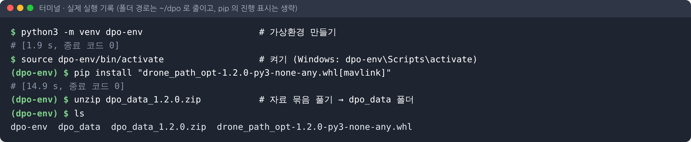{width=100%}

- **Windows:** `py -m venv dpo-env`, `dpo-env\Scripts\activate`로 바꾸고, zip은 탐색기에서 '압축 풀기'로 풉니다 `[확인요망: Windows에서는 시험하지 않았습니다]`.
- 자료 묶음을 풀면 `dpo_data` 폴더가 생깁니다. **이 폴더 옆에서 실행하면 프로그램이 자료를 저절로 찾습니다.** 다른 곳에서 실행하려면 환경변수 `DPO_HOME`을 `dpo_data` 폴더로 지정합니다.

## 1.3 점검

```bash
dpo-plan --check
```

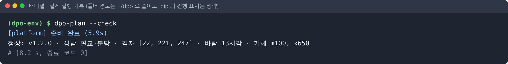{width=100%}

"정상"이 나오면 준비가 끝났습니다. 설치 후 처음 한 번은 계산 코드를 컴파일하느라 몇 초 더 걸립니다.

# 2. 프로그램 켜기

```bash
dpo-server --open
```

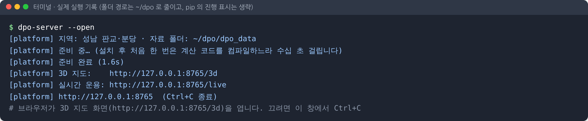{width=100%}

브라우저가 3D 지도 화면(`http://127.0.0.1:8765/3d`)을 엽니다. 저절로 열리지 않으면 이 주소를 브라우저 주소창에 넣습니다. **이 터미널 창은 닫지 마십시오.** 창을 닫으면 프로그램이 꺼집니다.

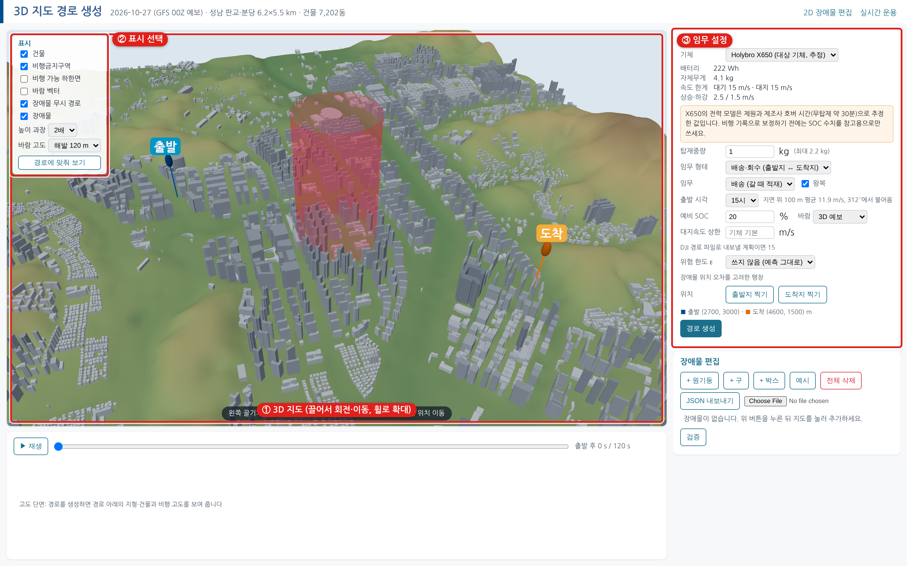{width=100%}

| 번호 | 영역 | 하는 일 |
|---|---|---|
| ① | 3D 지도 | 지형·건물·비행금지구역(붉은 원기둥)을 보여 줍니다. 왼쪽 끌기 = 회전, 오른쪽 끌기 = 이동, 휠 = 확대 |
| ② | 표시 선택 | 건물·바람·경로 등 보일 것을 고릅니다. '경로에 맞춰 보기'로 화면을 경로에 맞춥니다. |
| ③ | 임무 설정 | 기체, 탑재중량, 임무, 출발 시각을 정하고 경로를 생성합니다 (3장). |

# 3. 경로 만들기

## 3.1 기체와 탑재중량

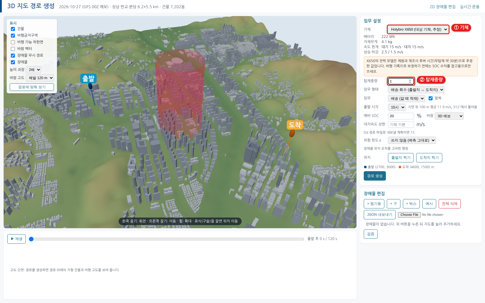{width=100%}

① 기체를 고르면 그 아래에 배터리 용량·자체 무게·속도 한계가 나옵니다. ② 탑재중량은 기체가 실을 수 있는 최대값(오른쪽 괄호) 안에서 넣습니다.

## 3.2 임무 형태

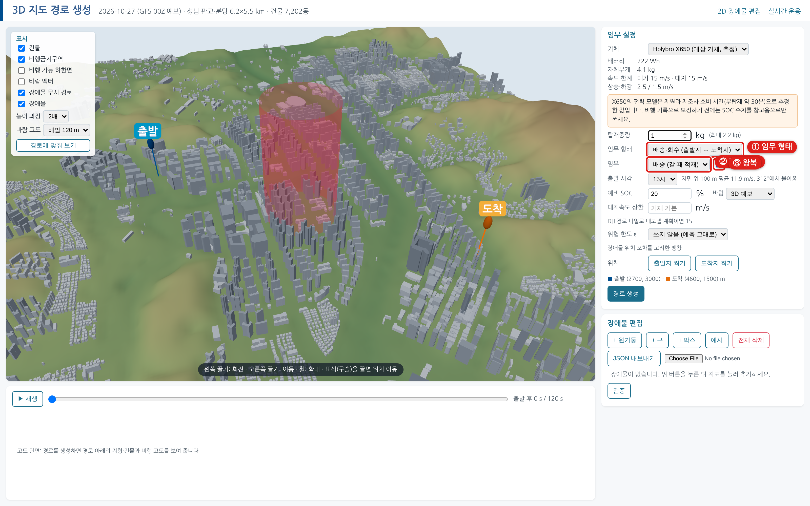{width=100%}

| 번호 | 항목 | 고를 수 있는 것 |
|---|---|---|
| ① | 임무 형태 | **배송·회수**: 출발지 ↔ 도착지 / **순회**: 경유점을 돌고 출발지로 돌아옴 |
| ② | 임무 | **배송**: 갈 때 싣고 감 / **회수**: 올 때 싣고 옴 |
| ③ | 왕복 | 끄면 편도만 계획합니다. |

## 3.3 출발지와 도착지

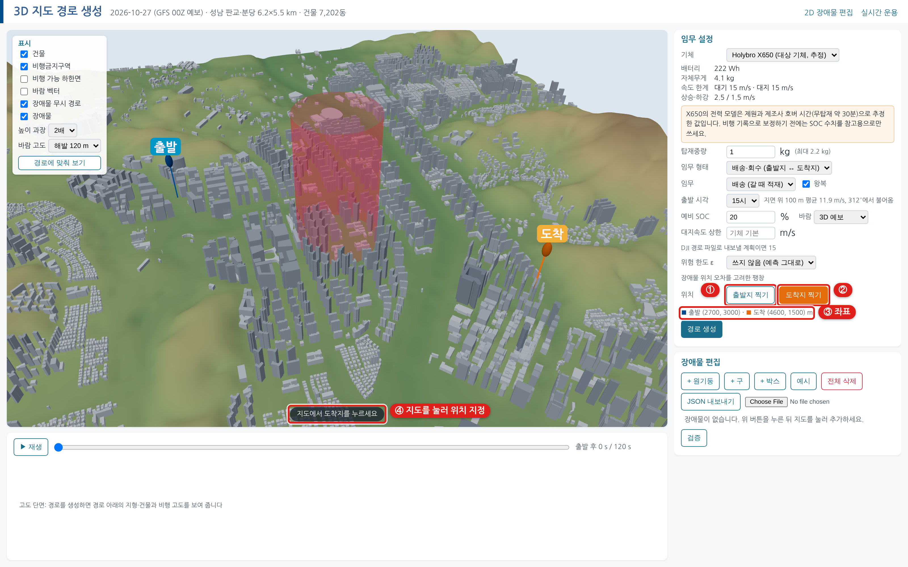{width=100%}

① '출발지 찍기' 또는 ② '도착지 찍기'를 누르고 ④ 지도를 누르면 그 자리로 옮겨집니다. 지도 위의 표식(구슬)을 끌어도 됩니다. ③ 지금 좌표가 표시됩니다. 처음에는 지역의 기본 위치가 들어 있어 그대로 써도 됩니다.

## 3.4 출발 시각과 예비 SOC

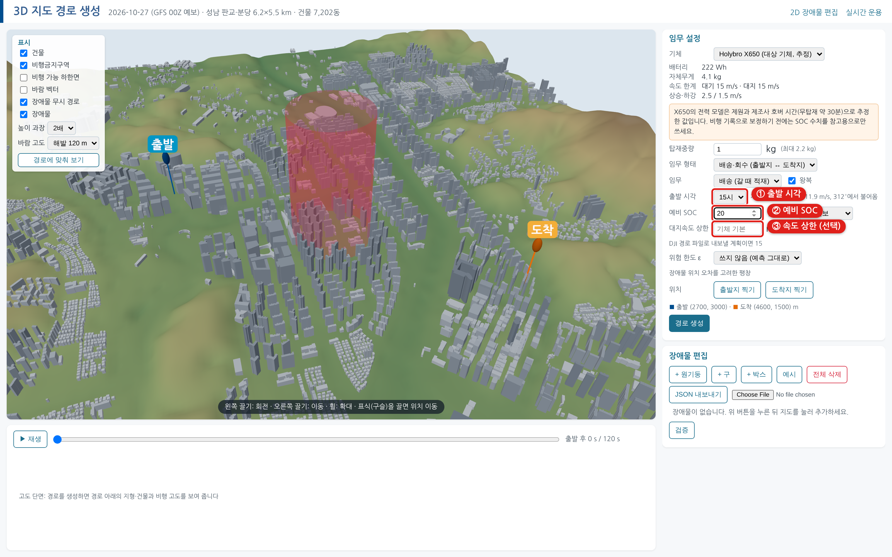{width=100%}

| 번호 | 항목 | 뜻 |
|---|---|---|
| ① | 출발 시각 | 그 시각의 예보 바람으로 계획합니다. 오른쪽에 그 시각의 평균 풍속이 나옵니다. |
| ② | 예비 SOC | 착륙했을 때 남겨야 할 배터리 [%]. 이보다 적게 남으면 '임무 불가'입니다. |
| ③ | 대지속도 상한 | 비워 두면 기체 기본값. DJI 경로 파일로 내보낼 계획이면 15를 넣습니다. |

## 3.5 경로 생성

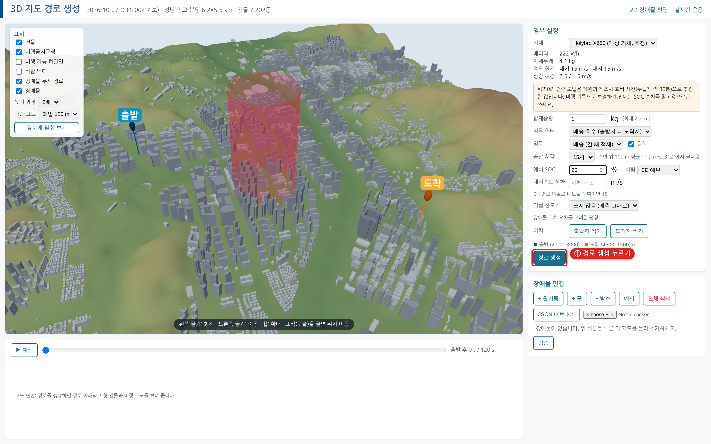{width=100%}

'경로 생성'을 누릅니다. 옆에 '계산 중…'이 나오고, 이 예(판교, 왕복 약 5 km)에서는 **13초** 걸렸습니다.

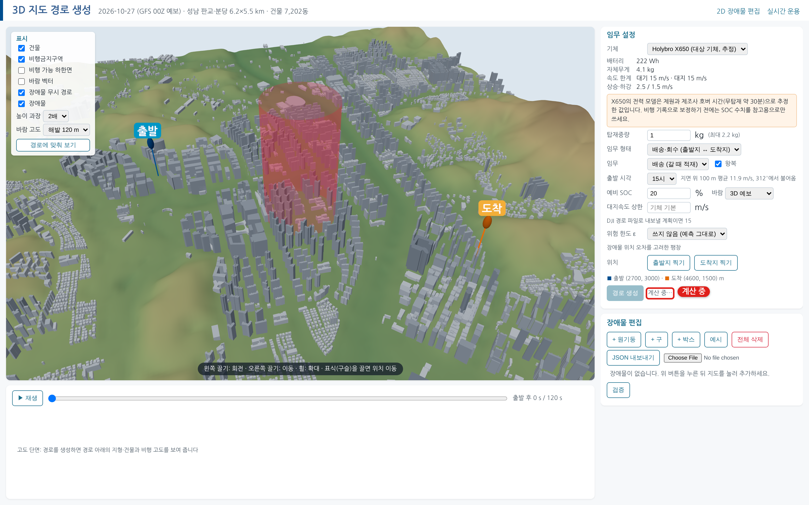{width=100%}

# 4. 결과 보기

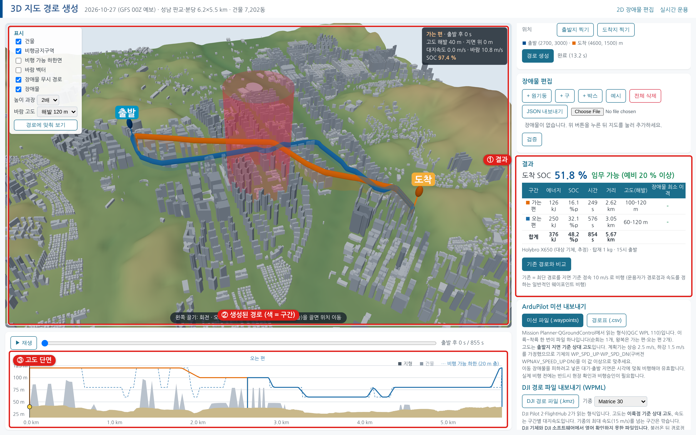{width=100%}

| 번호 | 영역 | 읽는 법 |
|---|---|---|
| ① | 결과 | **도착 SOC**와 임무 가능 여부. 구간마다 에너지, SOC 소모, 시간, 거리, 고도 |
| ② | 생성된 경로 | 가는 편 = 주황, 오는 편 = 파랑. 반투명 막은 경로 아래로 내린 그림자입니다. |
| ③ | 고도 단면 | 경로를 따라 지형·건물과 비행 고도. 점선은 비행할 수 있는 가장 낮은 높이입니다. |

이 예에서는 탑재 1 kg으로 왕복해 **도착 SOC 51.8 %, 임무 가능**이 나왔습니다.

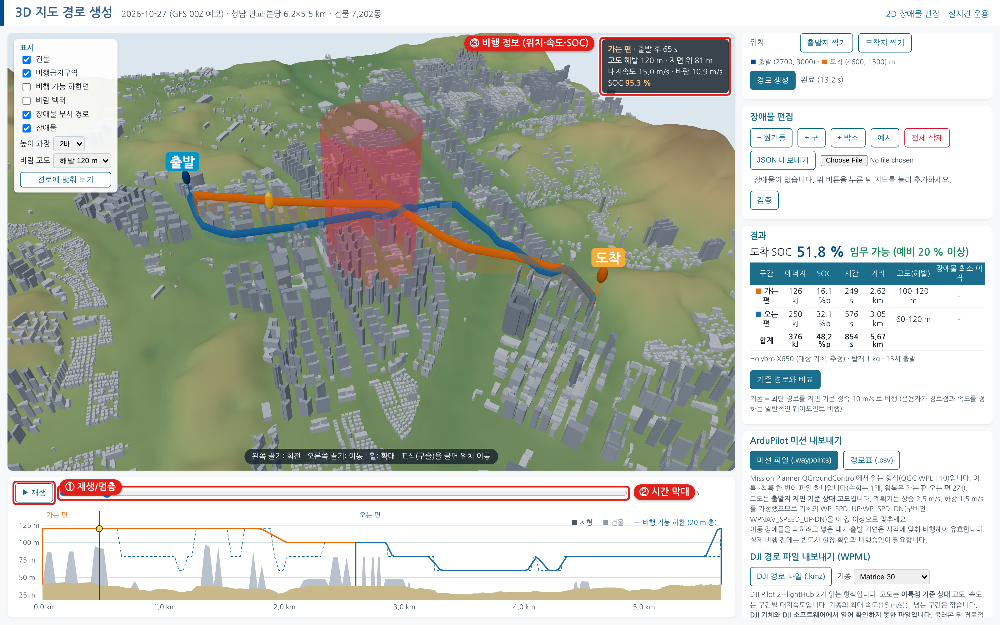{width=100%}

① '재생'을 누르면 기체가 경로를 따라 움직입니다. ② 시간 막대를 끌어 원하는 시각으로 갑니다. ③ 그 시각의 위치·고도·속도·바람·SOC가 나옵니다.

# 5. 기존 경로와 비교

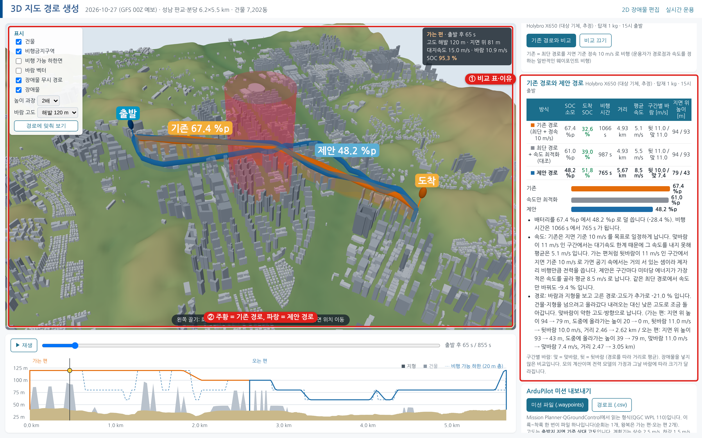{width=100%}

결과 아래의 '기존 경로와 비교'를 누릅니다. ② 지도에 기존 경로(최단 경로를 정속 10 m/s로 비행)가 주황색으로 겹쳐지고, ① 오른쪽에 세 방식의 수치와 **왜 다른지**를 설명하는 문장이 나옵니다. '비교 끄기'로 원래대로 돌아갑니다.

# 6. 내보내기

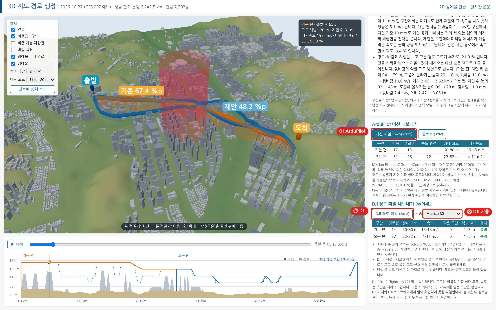{width=100%}

| 번호 | 단추 | 받는 파일 | 쓰는 곳 |
|---|---|---|---|
| ① | 미션 파일 (.waypoints) | ArduPilot 미션. 구간마다 파일 하나 (왕복이면 2개) | Mission Planner, QGroundControl |
| ② | DJI 경로 파일 (.kmz) | DJI 경로 파일 | DJI Pilot 2, FlightHub 2 |
| ③ | DJI 기종 | DJI 파일을 만들 기종 | |

- 고도는 **출발지(이륙점) 기준 상대 고도**입니다. 실제 이륙 위치가 계획의 출발지와 같아야 합니다.
- DJI 경로 파일은 DJI 기체와 DJI 소프트웨어에서 열어 확인하지 못했습니다. 불러온 뒤 고도·속도·복귀 고도를 반드시 확인하십시오 (`docs/dji_wpml.md`).
- 실제 비행 전에는 현장 확인과 비행승인이 필요합니다.

# 7. 끄기

서버를 켠 터미널 창에서 **Ctrl+C**를 누릅니다. `[platform] 종료`가 나오면 꺼진 것입니다. 다음부터는 1장 없이 다음 두 줄만 실행하면 됩니다.

```bash
source dpo-env/bin/activate
```

```bash
dpo-server --open
```

# 8. 화면 없이 명령 한 줄로 (선택)

같은 계획을 화면 없이 할 수 있습니다. 결과 요약이 출력되고 미션 파일이 `--out` 폴더에 생깁니다.

```bash
dpo-plan --drone x650 --payload 1.0 --dep-hour 15 --out missions
```

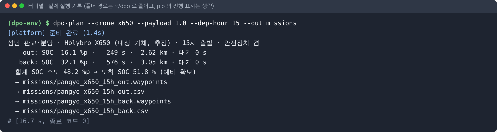{width=100%}

지역을 바꾸려면 `--site changwon`, 편도는 `--one-way`, DJI 경로 파일까지 만들려면 `--wpml m30`을 붙입니다.

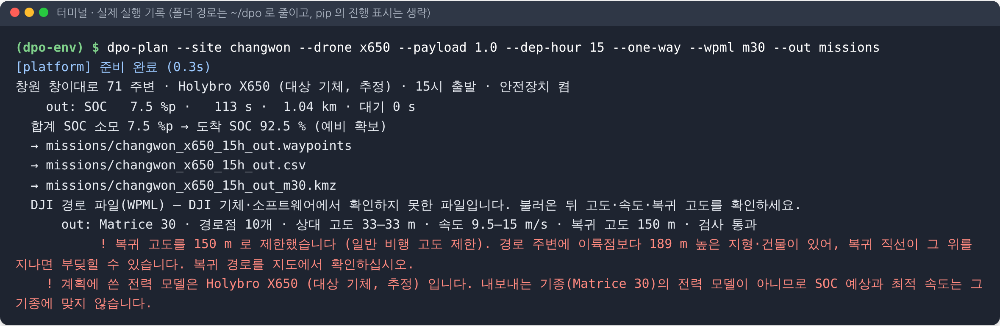{width=100%}

| 자주 쓰는 인자 | 뜻 |
|---|---|
| `--site pangyo / changwon` | 지역 (서버도 `dpo-server --site changwon`) |
| `--drone m100 / x650`, `--payload KG` | 기체, 탑재중량 |
| `--dep-hour H` | 출발 시각 (9–20시) |
| `--one-way`, `--kind pickup` | 편도, 회수 임무 |
| `--reserve %` | 예비 SOC |
| `--confidence 0.95 --forecast-age H` | 예보 오차를 감안한 출발 판정 (예보 시점 H시간 전) |
| `--wpml MODEL` | DJI 경로 파일도 만듦 |

# 9. 문제가 생기면

| 증상 | 원인과 조치 |
|---|---|
| `필수 자료가 없습니다` | 자료 묶음을 풀지 않았거나 다른 폴더에서 실행했습니다. `dpo_data` 폴더 옆에서 실행하거나 `DPO_HOME`을 지정합니다 (그림 9-1). |
| `포트 8765 를 열 수 없습니다` | 서버가 이미 켜져 있습니다. 브라우저에서 `http://127.0.0.1:8765/3d`를 바로 열거나, `dpo-server --port 8766`처럼 다른 포트로 켭니다 (그림 9-2). |
| `입력 오류: 탑재중량은 …` | 기체가 실을 수 있는 범위를 넘었습니다. 안내된 범위 안에서 넣습니다 (그림 9-3). |
| 결과가 **임무 불가** | 예비 SOC를 지키는 경로가 없습니다. 탑재중량·예비 SOC·출발 시각·거리를 바꿉니다. 화면에 원인이 구간별로 나옵니다 (그림 9-4). |
| 화면에 지도가 안 나옴 | 브라우저의 WebGL(그래픽 가속)이 꺼져 있습니다. Chrome·Edge 최신판으로 열거나 그래픽 가속을 켭니다. |
| 첫 실행이 느림 | 설치 후 처음 한 번은 계산 코드를 컴파일합니다(이 시험에서 6초). 다음부터는 빨라집니다. |
| 브라우저가 저절로 안 열림 | 터미널에 나온 주소(`http://127.0.0.1:8765/3d`)를 직접 엽니다. |

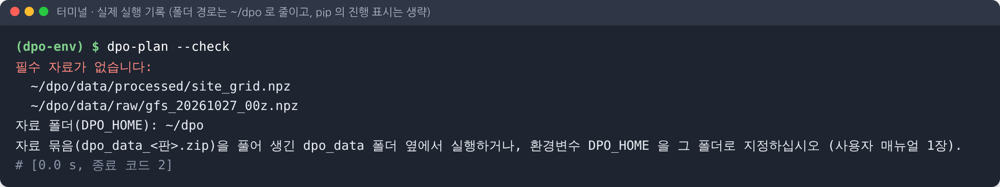{width=100%}

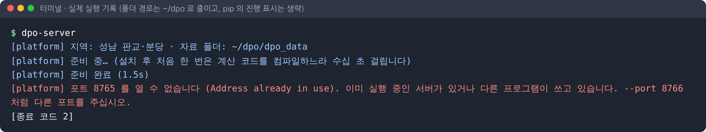{width=100%}

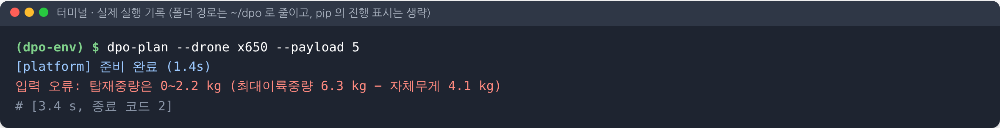{width=100%}

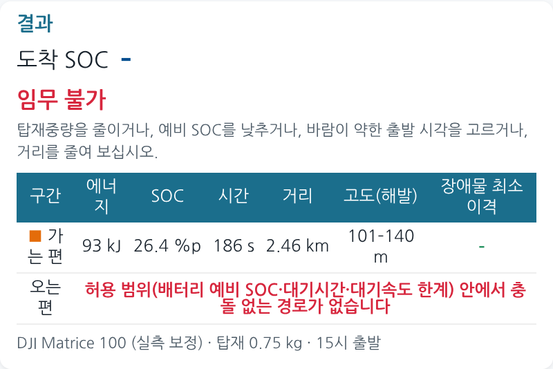{width=60%}

# 10. 구동 시험 기록

이 매뉴얼은 다음 조건에서 처음부터 다시 설치해 확인했습니다.

| 항목 | 내용 |
|---|---|
| 환경 | Linux, Python 3.13, Chromium (자동 조작), 저장소와 떨어진 빈 폴더 |
| 설치 | 새 가상환경 1.9 s, 프로그램 설치 14.9 s (처음 받을 때 24.3 s), 자료 풀기 0.1 s |
| 첫 경로까지 | 서버 준비 3.8 s, 화면 열림 4.0 s, 경로 생성 13.1 s |
| 화면 오류 | 브라우저 콘솔 오류 없음 |
| 내려받기 | 미션 파일 2개, DJI 경로 파일 2개를 실제로 받아 열어 봄 |

시험하면서 고친 것은 다음과 같습니다.

| 발견한 점 | 고친 것 |
|---|---|
| 자료 폴더를 매번 환경변수로 지정해야 했음 | `dpo_data` 폴더 옆에서 실행하면 저절로 찾음 |
| 자료가 없을 때 현재 폴더에 빈 폴더가 생김 | 만들지 않음. 무엇을 하라는 안내를 오류 문구에 넣음 |
| 서버가 자료 없음·포트 사용 중일 때 긴 오류 추적을 출력 | 한두 줄 안내로 바꿈 |
| 서버가 화면의 요청마다 한 줄씩 출력해 터미널이 넘침 | 오류만 출력 (`DPO_VERBOSE=1`이면 전부) |
| 새로 설치하면 건물이 상자 모양으로 그려짐 | 건물 모양 라이브러리(shapely)를 기본 설치에 넣음 |
| 브라우저를 직접 열고 주소를 쳐야 했음 | `--open`으로 3D 화면을 바로 엶 |
| 임무 불가인데 도착 SOC가 크게 표시됨 (앞 구간까지의 값) | '–'로 표시하고 바꿔 볼 것을 안내, 비교 단추를 숨김 |
| DJI 경로 파일의 복귀 고도가 209 m로 나옴 (주변 산 때문) | 150 m로 제한하고 경고 |

시험하지 못한 것: **Windows·macOS**, 인터넷이 없는 PC에서의 설치(기본 라이브러리를 미리 받아 두는 방법이 필요합니다), 여러 사용자가 동시에 쓰는 경우.
